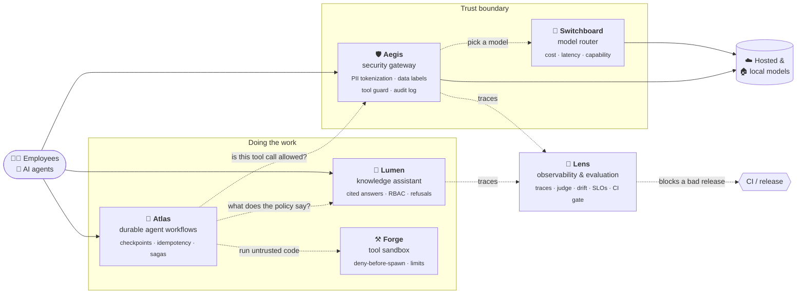
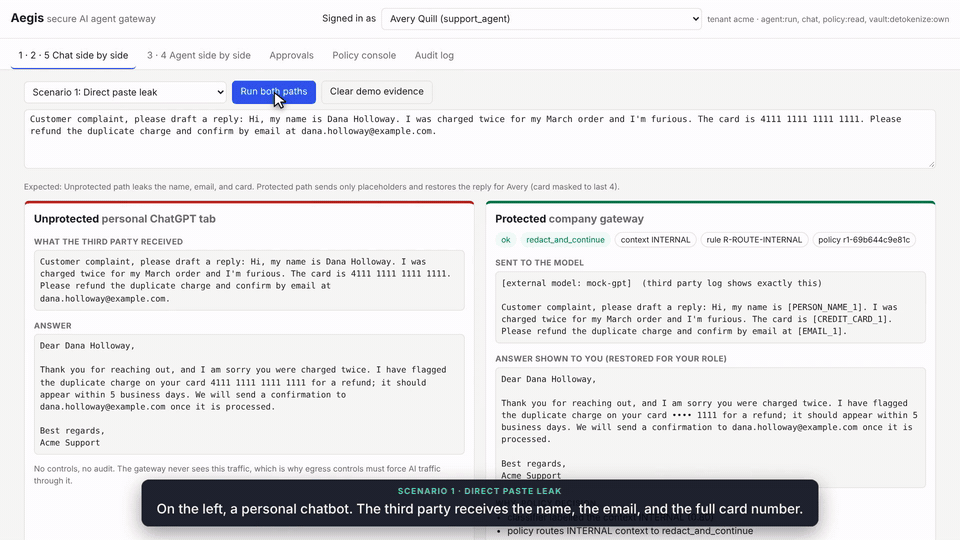
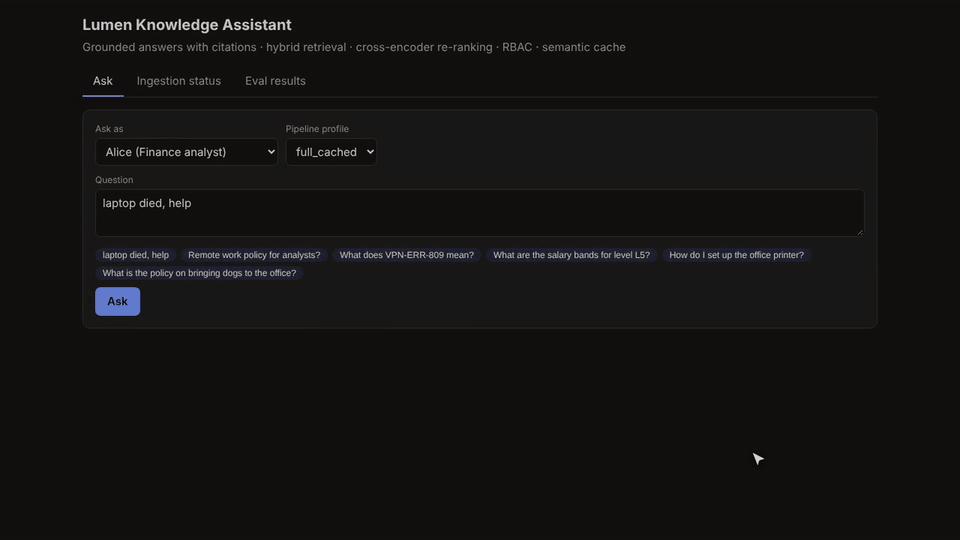
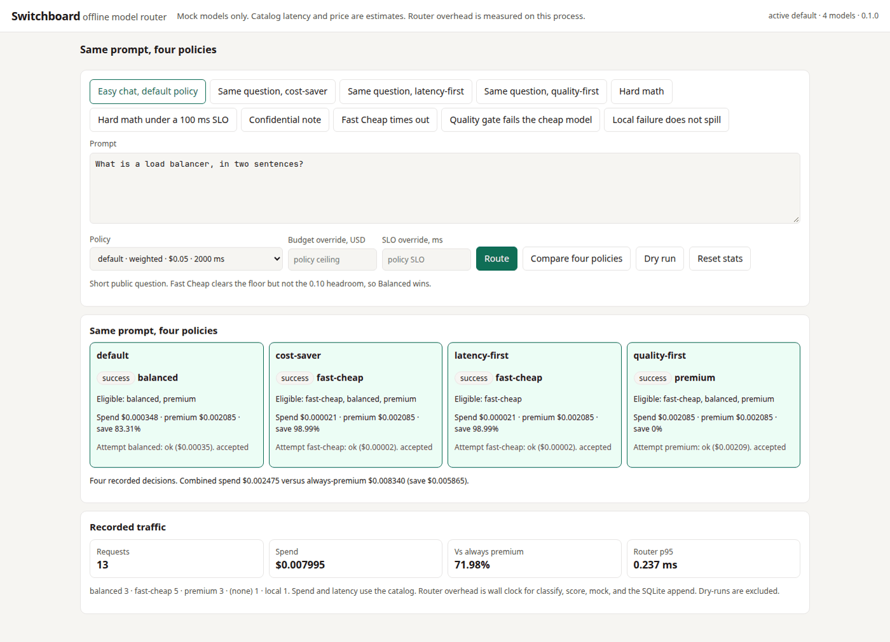
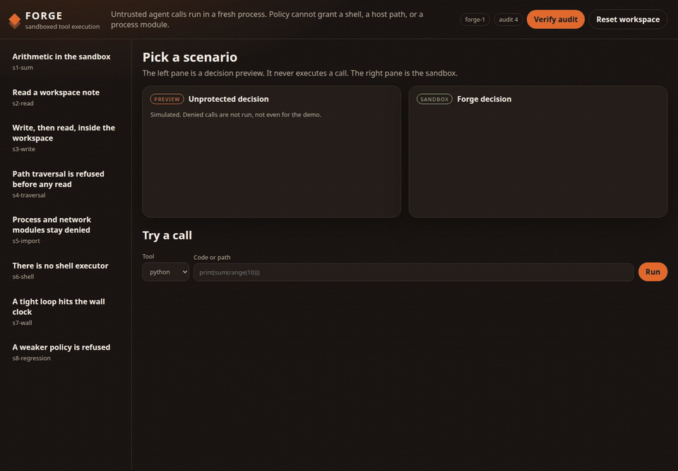
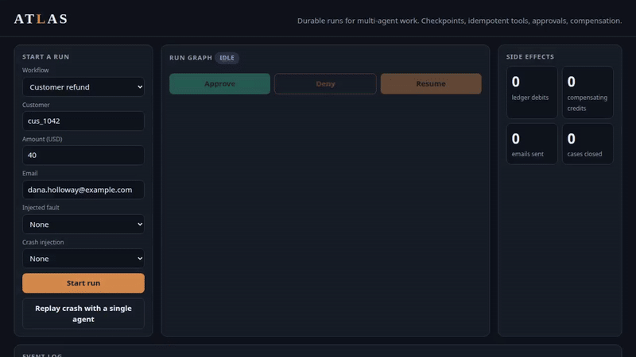
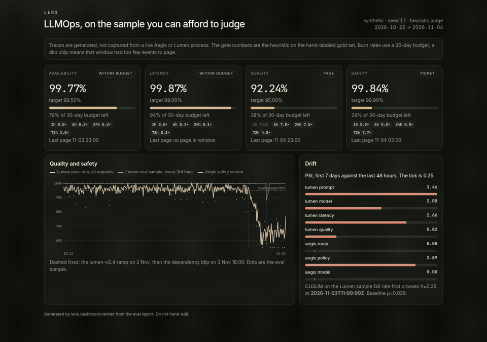

# 🏗️ The Enterprise AI Platform, built piece by piece

**Six production-style systems that answer one question: 
how does a company let its people and its AI agents use LLMs *safely, cheaply, reliably, and measurably*?**

Each project solves one hard part on its own, runs offline with one command, and proves its claims with a saved evaluation.

[**The platform**](#-the-platform-in-one-picture) · [**The six projects**](#-the-six-projects) · [**How they connect**](#-how-the-projects-connect) · [**Engineering standards**](#-engineering-standards) · [**Where to start**](#-where-to-start)

---

## 💡 The problem in plain English

Every company wants its employees and its AI agents to use the best language models. The moment they do,
six things go wrong:

| What goes wrong | Example | Which project fixes it |
|:--|:--|:--|
| **Private data leaks to a third party** | A support agent pastes a customer's card number into a chatbot | 🛡️ [**Aegis**](secure-ai-gateway/) |
| **The bill explodes, or answers are too slow** | Every “what is a load balancer?” goes to the most expensive model | 🔀 [**Switchboard**](switchboard/) |
| **The assistant makes up company policy** | “You get 30 days of leave”, when the handbook says 20 | 🔦 [**Lumen**](rag-knowledge-assistant/) |
| **An agent's code does something it shouldn't** | A generated script reads `../../secrets` or loops until the machine stalls | ⚒️ [**Forge**](forge/) |
| **A multi-step agent crashes halfway** | The refund is charged, the worker dies, and the retry charges the customer twice | 🧭 [**Atlas**](atlas/) |
| **Quality quietly gets worse and nobody notices** | A prompt change drops answer accuracy from 97% to 55% on part of the traffic | 🔬 [**Lens**](lens/) |

Each project takes one of these problems and solves it the way a production team would: with a clear
architecture, a measured result, honest limitations, and a test that fails if the protection ever regresses.

## 🗺️ The platform in one picture

Solid arrows run today inside each project. Dashed arrows are the documented contracts between projects; which ones are live, and which are tested against a stand-in, is in <a href="#-how-the-projects-connect">How the projects connect</a>.

## 🧩 The six projects

<table>
<tr>
<td width="50%" valign="top">

### 🛡️ [Aegis](secure-ai-gateway/) · security gateway

Replaces names, emails and card numbers with placeholders before a prompt leaves the company, keeps
confidential text on a local model, checks every agent tool call, and writes a tamper-evident audit log.

**97.0% recall · 95.5% precision** on an 84-case red-team suite · **9.2 ms** p95 added latency · 200 tests

</td>
<td width="50%" valign="top">

### 🔦 [Lumen](rag-knowledge-assistant/) · knowledge assistant (RAG)

Answers employee questions from company documents with citations, refuses when the answer isn't there,
and never shows anyone a document they aren't allowed to read.

Answer accuracy **63% → 89%** · restricted-doc leaks **100% → 0%** · cached answers in **5 ms** · 52 tests

</td>
</tr>
<tr>
<td valign="top">

### 🔀 [Switchboard](switchboard/) · model router

Picks the cheapest model that is good enough for each request, under a versioned policy with latency
and budget ceilings, and falls back safely when a model times out.

**65% cheaper** than always using the premium model (answered requests) · **0.079 ms** p95 routing overhead · 29 tests

</td>
<td valign="top">

### ⚒️ [Forge](forge/) · sandbox for agent tool calls

Refuses dangerous file paths and imports *before* any process starts, runs the rest in a short-lived
restricted interpreter with resource limits, and logs every decision.

**55 / 55** eval cases · refuses in **0.21 ms** p95 · **41** protections locked by a regression gate · 54 tests

</td>
</tr>
<tr>
<td valign="top">

### 🧭 [Atlas](atlas/) · durable multi-agent workflows

Lets agents run multi-step business workflows that survive a crash at the worst moment, with approvals,
budgets, and automatic undo, without ever charging a customer twice.

**16 / 16** workflows succeed vs **3 / 16** for a naive agent · **0** duplicate charges after a crash · 30 tests

</td>
<td valign="top">

### 🔬 [Lens](lens/) · LLM observability & continuous evaluation

Traces every retrieval, model and tool step, judges a smart sample of traffic, catches drift, tracks
error budgets, and blocks a release in CI when quality drops.

Judge agreement **κ 0.76** with hand labels · a seeded regression is **blocked** on 5 of 6 gate rules · 23 tests

</td>
</tr>
</table>

Every number above is produced by the project's own code and committed in its <code>reports/</code> or <code>eval_results/</code> folder. Test counts are from running each suite.

## 🔗 How the projects connect

The projects are built to fit together, but each one deploys and runs **on its own**. Where one project
depends on another, it talks to it through a small, documented contract (a *port*), and ships an offline
stand-in so its own demo and tests never need the other service running. That keeps every project
independently testable, and makes the seams between them explicit.

| Link | What flows across it | Status today |
|:--|:--|:--|
| **Atlas → Aegis** | Every tool call an agent proposes → `allow`, `require_approval`, or `block`, with an `R-TOOL-…` rule id | ✅ Tested against an offline Aegis-shaped guard (same verdicts and rule vocabulary). ⚠️ The HTTP mode targets `/v1/tool-guard/evaluate`, which Aegis doesn't expose yet, so it fails closed (blocks everything). |
| **Atlas → Lumen** | “What does the refund policy allow?” → a cited answer, or a refusal that stops the step | ✅ Tested against an offline Lumen-shaped stub. ⚠️ The `POST /ask` contract matches Lumen, but going live needs a service identity for Atlas in Lumen and Atlas's policies in Lumen's documents. |
| **Aegis, Lumen → Lens** | Retrieval, model and tool events → OpenTelemetry-style spans → judge, drift, SLOs, CI gate | ✅ Adapters plus a seeded 14-day synthetic trace log. ⚠️ Neither service exports Lens's event schema yet. |
| **Aegis → Switchboard** | After the security decision, choose which model answers | ⚠️ Not wired. Aegis calls any OpenAI-compatible endpoint; Switchboard routes between in-process mock models. They share the same idea of sensitivity: confidential text is pinned to a local model in both. |
| **Atlas → Forge** | Agent tools that run code or touch files | ⚠️ Not wired. Forge is the intended executor for code-running tools; Atlas's demo tools are ledger, email, pager and webhook calls. |
| **Switchboard, Forge ↔ Aegis** | Identity and prompt-injection defence | By design: both stay out of the auth path and rely on Aegis at the boundary (documented in their architecture decisions). |

**What “fully wired” would take** is small and well-defined: an authenticated tool-guard endpoint in Aegis,
a service identity plus three policy documents in Lumen, an event exporter in Aegis and Lumen, Switchboard
as Aegis's model endpoint, and Forge behind Atlas's code-running tools. Those are the next steps, listed
openly rather than hidden.

## 📐 Engineering standards

Every project is held to the same bar, so a reviewer can trust the numbers without reading the code first.

| | Aegis | Lumen | Switchboard | Forge | Atlas | Lens |
|:--|:-:|:-:|:-:|:-:|:-:|:-:|
| Automated tests | 200 | 52 | 29 | 54 | 30 | 23 |
| Lint + format (Ruff) | ✅ | ✅ | ✅ | ✅ | ✅ | ✅ |
| GitHub Actions on every push | ✅ | ✅ (pgvector + Redis 8) | ✅ | ✅ | ✅ (incl. SIGKILL test) | ✅ |
| Strict type check (mypy) | ✅ | | | | | ✅ |
| Saved, reproducible evaluation | red team · classifier · latency | 46-question RAG eval | 36-case routing eval | 55-case corpus | 16 workflows vs baseline | gold set · judge κ |
| Regression gate that fails CI | ✅ policy gate | | | ✅ policy gate | | ✅ quality gate |
| Architecture doc + decision records | ✅ + 5 ADRs | ✅ | ✅ + ADRs | ✅ + ADRs | ✅ + 4 ADRs | ✅ + ADRs |
| Honest limitations section | ✅ | ✅ | ✅ | ✅ | ✅ | ✅ |
| Runs offline, no API key | ✅ | ✅ | ✅ | ✅ | ✅ | ✅ |
| Demo GIF / video | ✅ / ✅ | ✅ / ✅ | ✅ / ✅ | ✅ / ✅ | ✅ / ✅ | ✅ / ✅ |

**Shared principles**

- **Measure, don't claim.** Every headline number is regenerated by a `make` target and saved next to the code.
- **Fail closed.** If a dependency, detector or guard is unavailable, the request is refused, never sent unprotected.
- **Deterministic code decides; models suggest.** Security and correctness checks never depend on a model behaving.
- **Lock what you protect.** Red-team and regression suites run in CI, so a weaker policy cannot ship quietly.
- **Say what doesn't work.** Each README ends with its known gaps and what would fix them.

## 🧭 Where to start

A static write-up of the same six systems, for a hiring review, is in [portfolio-site/](portfolio-site/).

| If you are… | Spend | Read |
|:--|:--|:--|
| **A recruiter** | 2 minutes | This page, then the GIF at the top of any project |
| **A hiring manager** | 10 minutes | [Aegis](secure-ai-gateway/) and [Lumen](rag-knowledge-assistant/) READMEs: problem, demo, results, limitations. The [5-minute Lumen walkthrough](rag-knowledge-assistant/docs/assets/lumen-walkthrough.mp4) and the [narrated Aegis walkthrough](secure-ai-gateway/docs/media/aegis-walkthrough.mp4) |
| **An engineer** | 30 minutes | Any project's `ARCHITECTURE.md` and `docs/adr/`, then run it: `cd <project> && make install && make test && make demo` |

<b>Run everything locally</b>

Each project is self-contained. Python 3.12 is enough for Switchboard, Forge, Atlas and Lens; Aegis and
Lumen also run with Docker Compose. Ports don't collide, so they can all run side by side.

| Project | Run | UI |
|:--|:--|:--|
| Aegis | `cd secure-ai-gateway && make up` | http://localhost:8080 |
| Lumen | `cd rag-knowledge-assistant && cp .env.example .env` (set `POSTGRES_PASSWORD`), `python scripts/fetch_models.py && make up` | http://localhost:8000 |
| Switchboard | `cd switchboard && make install && make run-local` | http://127.0.0.1:8092 |
| Forge | `cd forge && make install && make up` | http://127.0.0.1:8095 |
| Atlas | `cd atlas && make install && make up` | http://127.0.0.1:8096 |
| Lens | `cd lens && make install && make eval && make up` | http://127.0.0.1:8088 |

<b>Technology</b>

Python 3.12 · FastAPI · PostgreSQL + pgvector · Redis 8 · SQLite · ONNX Runtime (MiniLM embeddings,
MS MARCO cross-encoder) · spaCy · scikit-learn · OpenTelemetry-style tracing · Docker Compose ·
GitHub Actions · Playwright (demo capture) · Mermaid

---

All names, emails, card numbers, keys and documents in this repository are synthetic.

