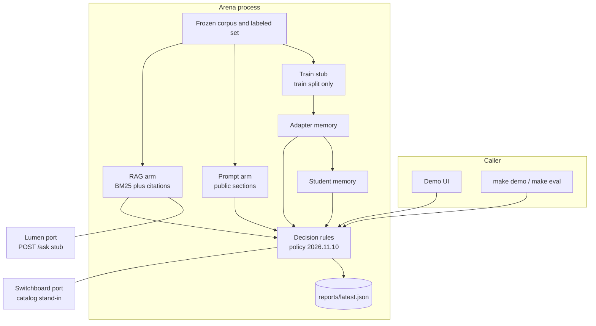
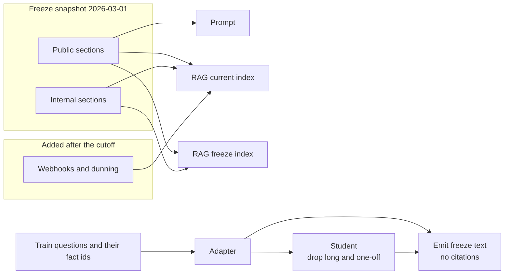
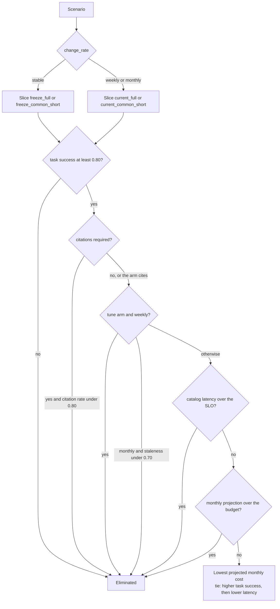
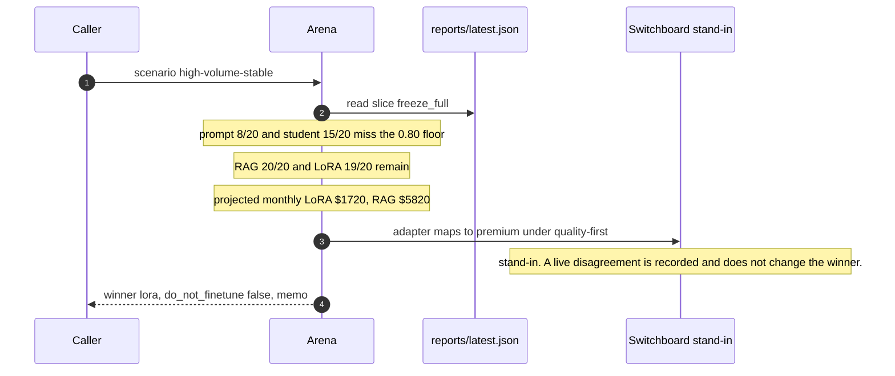
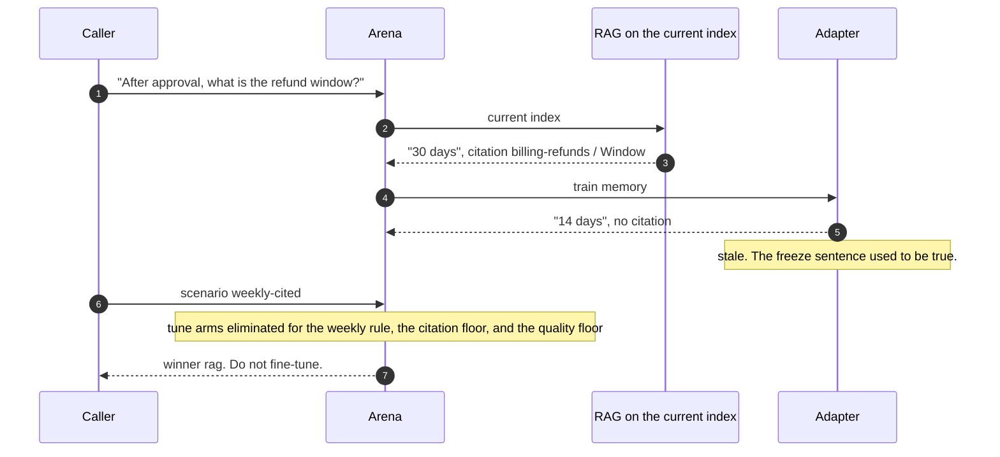

# Arena architecture

Arena answers one question five ways: given a labeled runbook task, do we prompt, retrieve, fine-tune, or distill? It does not train a network. The adapter and the student are deterministic memories, so the quality table can be regenerated in CI and the memo can say why.

Measured numbers live in `reports/latest.json`. Catalog latency and dollars live in `arena/data/price_card.yaml`. This document says which is which.

---

## 1. Assumptions

| # | Assumption | Why it is the default |
|---|------------|------------------------|
| A1 | One process, one audience, no authentication. | The thing under test is the arm choice. Aegis already sits on the identity boundary. |
| A2 | Harborline is a synthetic billing runbook, frozen 2026-03-01. | A real company's policies are not in this repo. The shape of the decision is. |
| A3 | Exact-phrase support, not a judge model. | The score has to move only when the arm's text changes, and it has to be explainable in a sentence. |
| A4 | The trainer reads the train split only. | Holdout labels are the exam. Using them to build the adapter would make the fine-tune look perfect. |
| A5 | RAG may be pointed at the freeze index or the current index. The adapter always emits freeze text. | That is the operational difference the memo is about. |
| A6 | Dollars and model latency are a price card. Overhead is wall clock. They are not added. | A 0.07 ms measurement must not move an 80 ms SLO, and CI must not fail because a laptop was busy. |
| A7 | Lumen and Switchboard are ports. The eval uses the stand-ins. | Arena has to run when the siblings are down. See ADR 0004. |
| A8 | English keyword features. No embeddings. | Twenty-one sections do not need a vector index, and BM25 is something the trace can show. |

---

## 2. System context

Nothing in the eval leaves the machine. `ARENA_LUMEN_URL` and `ARENA_SWITCHBOARD_URL` are probes. A failure there is reported and the table stays on the stub.

---

## 3. What each arm is allowed to know

| Arm | Sees | Cites | Goes stale when the runbook moves |
|-----|------|-------|-------------------------------------|
| Prompt | Public sections only | No | Only if a public sentence changed. None do, on this corpus. |
| RAG | The index you point it at | Yes, `doc_id` and section | No, if you reindex. Yes, if you leave it on the freeze index. |
| LoRA stub | Facts that appear in at least one train pair, plus the words of those questions | No | Yes. It stored the freeze sentence. |
| Student | The adapter, minus long procedures and facts with one train pair | No | Yes, same freeze text, and it also misses the long tail on a stable corpus. |

Retrieval keeps a hit when at least two content tokens overlap and the BM25 score is at least 45% of the best hit. The adapter keeps a fact when the score is at least 4. One shared word scores at most 3 (it is in the train question and in the alias list) and is not a hit. That rule is what stops "an account" from retrieving "severity one", and what stops "SSO configuration" from answering with the SSO enforcement paragraph.

---

## 4. Decision

Hard rules remove arms. Cost ranks whatever remains. The quality floor is not waived by a cheap arm.

Numbers on that diagram, from the price card and the committed eval:

| Figure | Value | Kind |
|--------|-------|------|
| Quality floor | 0.80 task success | Policy |
| Citation floor | 0.80, only when the scenario requires citations | Policy |
| Staleness floor | 0.70 on the staleness slice, monthly change only | Policy |
| Quality margin to freeze for accuracy alone | LoRA must beat RAG by 0.03 on the frozen holdout. It is behind by 0.0625. | Policy, computed |
| Prompt catalog latency | 212.16 ms | Projection |
| RAG catalog latency | 216.24 ms | Projection. Includes the extra context tokens. |
| Adapter catalog latency | 161.28 ms | Projection. Mapped to Switchboard `premium` because the catalog has no adapter id. |
| Student catalog latency | 42.36 ms | Projection. Switchboard `fast-cheap`. |
| Adapter program | $2,400, amortized over 6 months | Projection |
| Student program | $900, amortized over 6 months | Projection |
| RAG in-process overhead p95 | 0.070 ms, n=500 | Measured on the eval host. Model time not slept. |

A weekly, citation-required desk of 50,000 requests lands on RAG at $185.50 projected for the month. The same corpus, declared stable, at 2,000,000 requests and no citation requirement lands on the adapter at $1,720 against RAG at $5,820. Narrow the contract to common short answers and set the SLO to 80 ms, and the student at 42 ms is the only survivor. Two thousand requests a month puts the adapter program at $401 against RAG at $5.82, so retrieval wins again.

---

## 5. Happy path

Stable corpus, two million requests, citations off, 2 second SLO. The saved metrics already show the adapter at 19/20 on `freeze_full` and RAG at 20/20. The adapter is cheaper. The memo says the quality gap does not justify the freeze; the volume does.

## 6. Failure path

The runbook changes weekly and every answer must cite a section. Patching the adapter's task success to 1.0 in a test still leaves it eliminated: the weekly rule does not look at the score.

A 10 ms SLO on the common short slice eliminates everyone, including the student at 42 ms. The winner is `none`. The memo says to loosen a constraint. It does not recommend a fine-tune to escape an SLO the student also misses.

---

## 7. Trust boundaries

| Boundary | What crosses it | What does not |
|----------|-----------------|---------------|
| Demo UI to the process | A scenario and a question id | Train labels. The UI reads the saved report and calls the same arms. |
| Eval to the report | Quality, grades, memos, a corpus hash | Wall-clock samples. `make gate` ignores overhead. |
| Arena to Lumen | `POST /ask` with `X-User-Id`, only when the URL is set | The committed numbers. A live refusal is not written back as a fact. |
| Arena to Switchboard | A dry-run of the published demo prompt, per arm policy | The Arena winner. Disagreement is a field, not an override. |
| Price card | Projections the memo prints | Anything that looks like an invoice. The file says `label: projection`. |
| Logs | Arm name, fact id, scenario id | Customer text beyond the synthetic questions. There is no secret in the corpus. |

The demo has no auth, on purpose, matching the other projects. Aegis is the boundary in front of a real deployment.

---

## 8. What breaks at 10x

Ten times the sections is about 200 chunks. BM25 in this process still finishes well under a millisecond; the overhead number would move and would still not belong in the SLO. Ten times the labeled set is a few hundred questions. The suite stays fast. The thing that breaks is the claim.

* Exact-phrase support stops being a fair score once a real model paraphrases. A judge would be a second model on the eval path, with its own cost, and it is not here.
* Keyword memory collides. Two facts that share a pair of content words will both clear the score of 4. The keep-within window emits both, and a gold phrase can be joined by a distractor. The courtesy-credit question is the current proof that two words are required; it is not a proof that two words are enough at a larger alias list.
* The program cost is a constant. A real training program does not scale linearly with ten times the facts, and the price card will not notice.
* One audience. Lumen's RBAC is not reimplemented. A second team in the same index would leak across the stub.
* The weekly rule is a switch, not a calendar. It does not know that three of twenty-one facts moved and eighteen did not. A finer rule would need a per-fact change rate the scenario does not have.

---

## 9. Rejected alternatives

| Alternative | Why it lost |
|-------------|-------------|
| Call a hosted model for each arm | The suite would need a key, the scores would move, and the decision would be a story about that provider. |
| A real LoRA in CI | No GPU, and a seed change would make `make gate` compare noise. ADR 0001. |
| One index for every scenario | A stable corpus and a weekly corpus are different products. ADR 0002. |
| Add overhead into the catalog latency | The SLO would depend on the host. ADR 0003. |
| Import Lumen and Switchboard | Their tests would become Arena's tests. The ports are the contract. ADR 0004. |
| A learned judge for "correct" | The explanation would be a score. The explanation here is the missing phrase, the old phrase, or a refusal. |
