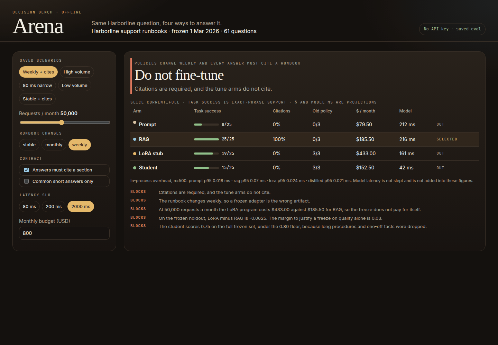
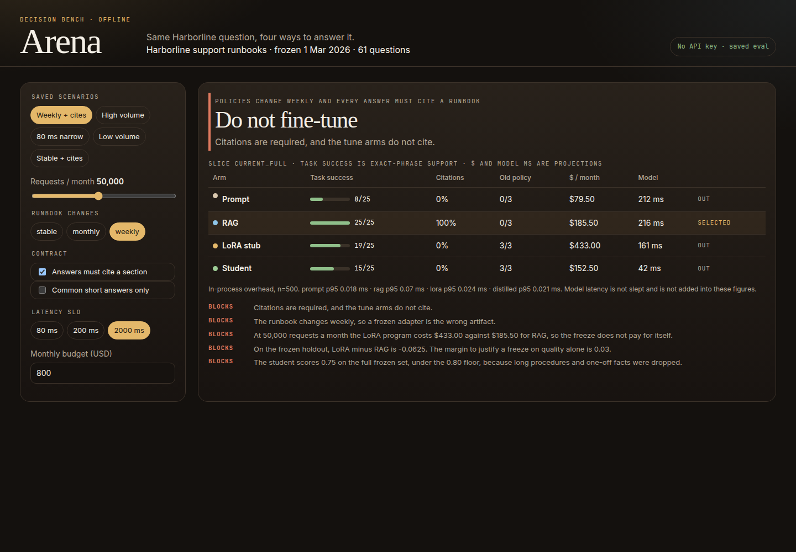
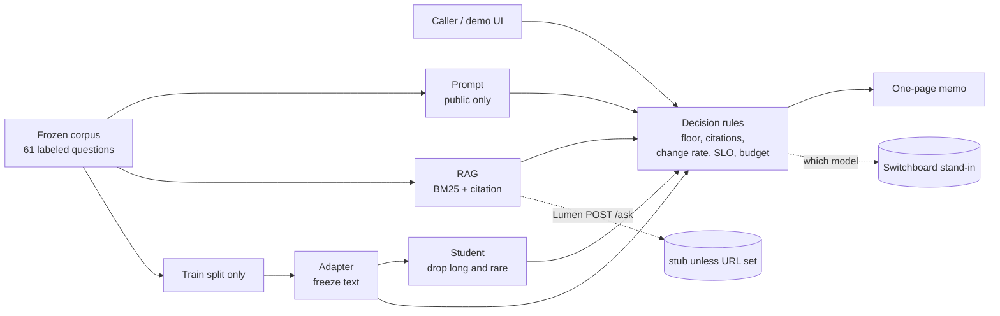
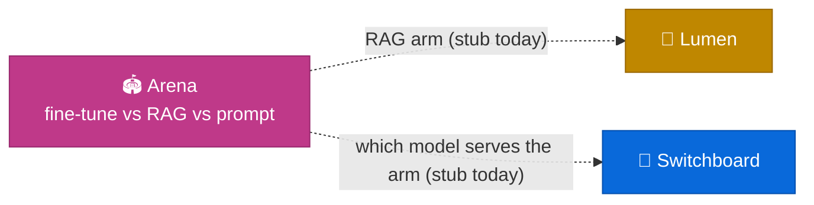

<div align="center">

# Arena

### Same question, four ways to answer it, and a memo that says which one to ship

[](https://github.com/kumarlakshya24/personal-projects/actions/workflows/arena.yml)


[**Results**](#results-measured-regenerated-by-the-code) ·
[**60-second demo**](#60-second-demo) ·
[Setup](#setup) ·
[Architecture](#architecture) ·
[Where it fits](#where-it-fits) ·
[ADRs](docs/adr)

A fine-tune on last quarter's runbook answers last quarter's policy.
A prompt that never saw the runbook refuses.
RAG cites the section you can reindex tomorrow.
Arena runs all four on one labeled set and writes the decision down.

</div>

---

## In plain English

A team that fine-tunes on the handbook gets a confident answer from the day the weights were frozen, and nobody has compared that training program to retrieval. A team that only prompts knows the public FAQ and refuses the internal one. A team that distills to a small model saves the latency budget and drops the long procedures.

Arena is the bench for that choice. One synthetic product, Harborline, and one task: answer a support question from the runbook, or refuse.

* **Prompt** reads the public sections only.
* **RAG** is BM25 over the snapshot you point it at, and it cites the section. The port matches Lumen's `POST /ask`.
* **LoRA stub** stores the freeze text of facts that appear in the train split. It does not cite. It does not read holdout labels.
* **Student** is that memory with long procedures and one-off facts removed.

The quality table is exact-phrase support on 61 labeled questions, saved in `reports/latest.json`. Dollars and model latency come from a price card and are marked as projections. The in-process overhead is measured and kept in its own column. No API key.

The adapter is not a neural trainer. [ADR 0001](docs/adr/0001-adapter-stub-not-a-gpu-job.md) says why: CI has no GPU, and a seed change would make the gate compare noise. The decision the stub preserves is the one the memo is about. Freeze date, citations, program cost, staleness, capacity.

---

## Results (measured, regenerated by the code)

| What | Result | Source |
|------|--------|--------|
| Current world, full slice | RAG **25/25**, citation rate **1.0**. Adapter **19/25**. Student **15/25**. Prompt **8/25** | [`reports/latest.json`](reports/latest.json) |
| Frozen holdout | RAG **16/16**. Adapter **15/16**. The miss is a goodwill credit asked as "courtesy money" | same |
| Amended policies | Adapter returns the old sentence on **3/3**. RAG on the current index returns the new one | staleness slice |
| Quality margin, LoRA minus RAG | **−0.0625**. The bar to freeze for accuracy alone is **+0.03** | policy `2026.11.10` |
| Weekly desk, 50k requests, citations on | **RAG**, $185.50 projected. Tune arms are out even if their score is patched to 1.0 | scenario `weekly-cited` |
| Stable corpus, 2,000,000 requests, no citations | **Adapter**, $1,720 against RAG at $5,820. It wins on cost while trailing by one holdout question | `high-volume-stable` |
| Common short answers, 80 ms SLO | **Student**, 42 ms catalog, 15/16 on that slice, 15/20 on the full set | `narrow-fast` |
| Stable corpus, 2,000 requests | **RAG**, $5.82 against an adapter program at $401.32 | `low-volume` |
| RAG overhead, p95 | **0.070 ms** (p50 0.048 ms, n=500, in-process, model time not slept) | `reports/latest.json` |
| RAG catalog latency | **216.24 ms** projected, not wall clock | price card |
| Tests | 28 unit and integration tests | `make test` |
| Locked demo checks | 16 / 16 | `make demo` |

The 0.070 ms is the bench. The 216 ms is the price card. They are not one number.

---

## 60-second demo

The clip is the decision, then the four answers, then the flips: adapter on volume, student on an 80 ms contract, RAG again when the traffic cannot pay for training, then the memo.



<video src="docs/assets/arena-demo.mp4" controls muted playsinline width="100%" poster="docs/assets/weekly.png">
</video>

<sub>Six frames, two seconds each. Weekly desk, the refund window across four arms, high-volume adapter, 80 ms student, low-volume RAG, and the paper memo.</sub>



```bash
make install
make up          # http://127.0.0.1:8097
```

1. The page opens on **Weekly + cites**. The banner says do not fine-tune. RAG is 25/25 and cites. The adapter's old-policy column is 3/3.
2. The refund question shows the mechanism. Prompt refuses. RAG says 30 days and cites `billing-refunds`. The adapter and the student say 14 days and are marked stale.
3. **High volume** declares the corpus stable and turns citations off. The adapter wins at $1,720 against RAG at $5,820. The banner says quality did not justify the freeze.
4. **80 ms narrow** leaves the student. Everyone else is over the catalog SLO. The memo still prints the full-set score of 15/20.
5. **Low volume** puts the adapter program at $401 against RAG at $5.82. Retrieval wins.

Prefer the terminal? `make demo` runs the same checks and prints PASS/FAIL.
[`docs/demo-script.md`](docs/demo-script.md) is the click-by-click version.

---

## Setup

Requirements: Python 3.12. Docker is optional. No API key.

```bash
cd arena
make install
make test
make demo
make eval          # reports/latest.json and reports/latest.md
make gate          # committed quality must match a fresh run
make up            # UI on :8097
make interview
```

With Docker:

```bash
docker compose up --build   # http://localhost:8097
```

`ARENA_LUMEN_URL` and `ARENA_SWITCHBOARD_URL` are optional probes. Empty means the offline stand-in, which is what the eval uses. See [`.env.example`](.env.example).

---

## Architecture



| Arm | Frozen holdout | Current full set | Cites | Catalog latency | $ / request |
|-----|----------------|------------------|-------|-----------------|-------------|
| Prompt | 4/16 | 8/25 | 0% | 212 ms | $0.00159 |
| RAG | 16/16 | 25/25 | 100% | 216 ms | $0.00291 |
| LoRA stub | 15/16 | 19/25 | 0% | 161 ms | $0.00066 |
| Student | 11/16 | 15/25 | 0% | 42 ms | $0.00005 |

Per-request dollars exclude the program cost. The memo adds $2,400 / 6 months for the adapter and $900 / 6 months for the student, which is why low volume and high volume disagree.

Details: [`ARCHITECTURE.md`](ARCHITECTURE.md), [`docs/adr/`](docs/adr), [`docs/FAILURE_MODES.md`](docs/FAILURE_MODES.md).

---

## When not to fine-tune

The memo always prints five checks. On the weekly desk all five block.

1. **Citations.** The tune arms do not cite. If the contract needs a section, they are out.
2. **The runbook moves.** Weekly change eliminates both tune arms even when their score is perfect. Monthly change eliminates them when the staleness slice misses 0.70. On this corpus the adapter is stale on 3 of 3 amended policies.
3. **The program does not amortize.** At 2,000 requests the adapter is $401 a month against RAG at $5.82.
4. **Quality does not pay for the freeze.** LoRA minus RAG on the frozen holdout is −0.0625. The bar is +0.03.
5. **The student forgot the tail.** 15/20 on the full frozen set. Ship it only when the contract is the common short slice and the SLO fits 42 ms.

A fine-tune wins this table when the corpus is declared stable, citations are off, volume covers the program, and the SLO still fits the endpoint. That is `high-volume-stable`. It is a cost win. The banner says so.

---

## API

| Method | Path | What |
|--------|------|------|
| GET | `/healthz` | Version, freeze date, whether the saved report matches the corpus hash |
| GET | `/v1/report` | The saved eval. `source: saved` |
| POST | `/v1/decide` | A scenario id returns the saved decision. Overrides re-rank the saved metrics. They do not rescore the labeled set |
| POST | `/v1/compare` | One question through all four arms, live |
| GET | `/v1/pipeline` | Train counts, dropped facts, the port names |
| GET | `/v1/ports` | Lumen and Switchboard probes. Disagreement does not change the table |
| GET | `/v1/questions` | The eval questions, train split excluded |

---

## Where it fits

Arena sits next to Lumen and Switchboard and does not import them.



| Link | What crosses | Today |
|------|----------------|-------|
| **Arena → Lumen** | RAG arm, `POST /ask` shape: `answer`, `refused`, `citations[].doc_id` | Offline stub over the Harborline index. `ARENA_LUMEN_URL` probes a live Lumen and leaves the eval on the stub. The stub does not reimplement Lumen's ACL. |
| **Arena → Switchboard** | Which catalog model serves the winning arm | Prompt and RAG map to `balanced` / `default`. The adapter maps to `premium` / `quality-first` because the catalog has no adapter id, and the stand-in says so. The student maps to `fast-cheap` / `latency-first`. A live disagreement is recorded. |

The Harborline corpus is not Lumen's handbook. The port is the shape of the call, the same way Atlas carries a Lumen-shaped stub.

---

## Limitations

* The adapter is a keyword memory. A real LoRA could pass the courtesy-credit rewording. It would still be frozen, and it would still not cite, unless the training set taught it to.
* Exact-phrase support marks a correct paraphrase as a miss. That is the trade for a score CI can regenerate.
* The price card is a labeled projection. A different token price moves the winner. It is one file, and the memo prints the assumptions.
* One audience. Pointed at a live Lumen, a refusal can be an ACL miss. The probe says the numbers stayed on the frozen corpus.
* Twenty-one facts. The two-word threshold is tuned for this alias list. A larger corpus will collide. [ARCHITECTURE.md](ARCHITECTURE.md) says what breaks at 10×.
* Overhead in the README is from the committed eval host. `make eval` on yours will print a different p95. `make gate` does not compare it.

---

<div align="center">
<sub>Harborline, its runbooks, and every question in the labeled set are synthetic.</sub>
</div>
