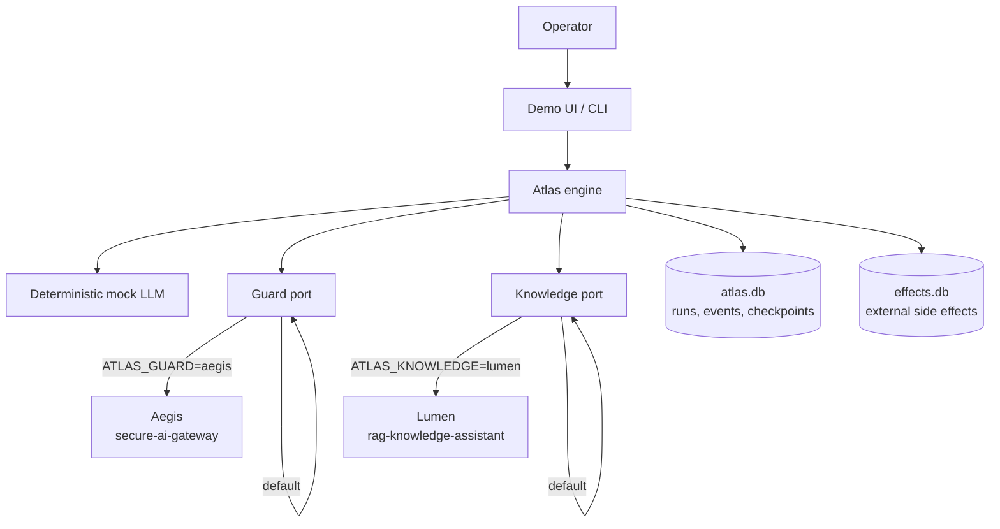
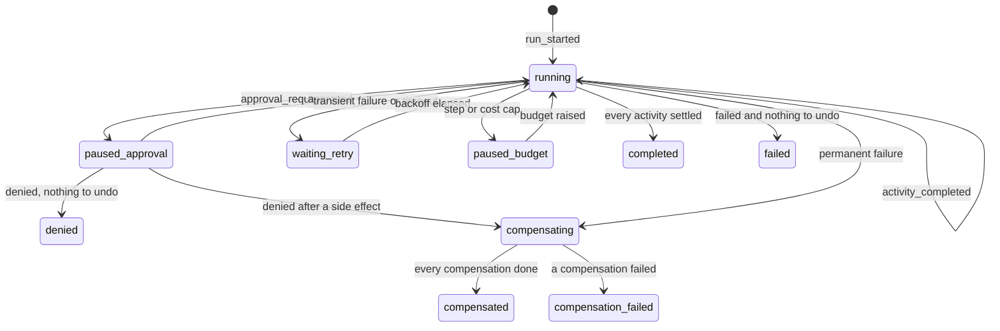
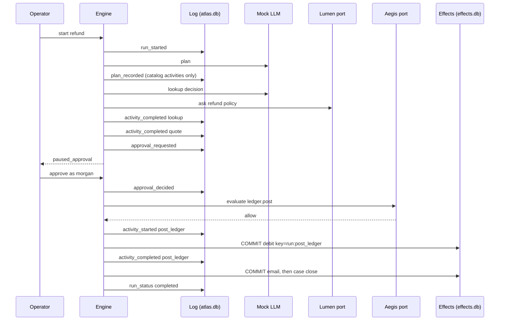
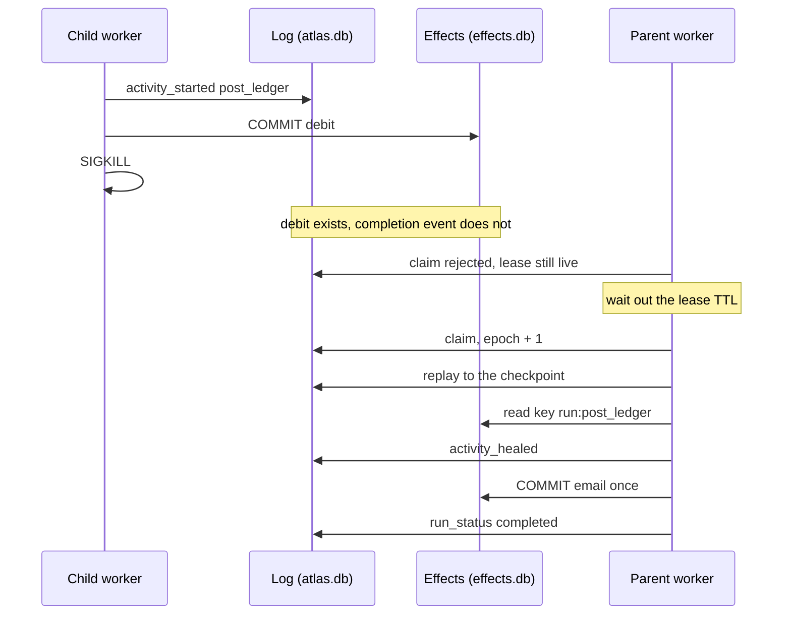

# Atlas architecture

Atlas runs multi-agent work that is allowed to crash. The engine is the product. The agents
propose tool calls. They do not get to commit a side effect themselves.

Measured numbers in this document come from eval suite `atlas-workflows-v1`
([`eval_results/latest/summary.json`](eval_results/latest/summary.json)). Recovery times are
simulated from each activity's declared `latency_ms`. A healed step costs 1 ms. Wall-clock
figures are labeled as measured on the eval host.

## 1. Goals and non-goals

| Goal | How it is enforced | Where it shows up |
|---|---|---|
| A side effect happens once | Idempotency key in `effects.db`, separate transaction from the completion event | kill-and-resume demo, crash cases in the suite |
| Resume does not re-decide finished work | Append-only event log, checkpoints, replay | `tests/test_engine.py` replay and hostile-model tests |
| A human can stop a refund | Approval activity; high-risk tools also ask the guard | `refund_denied` |
| A runaway agent stops | Step cap and cost cap, checked before a new attempt | `refund_step_budget`, `refund_cost_budget` |
| A failed later step undoes the earlier one | Saga compensations, themselves idempotent | `refund_email_compensate`, `compensate_crash` |
| The model cannot bypass policy | Aegis-shaped guard on the bound arguments | `vendor_guard`, personal-email test |
| Policy text comes from the knowledge base | Lumen-shaped `ask`; a refusal fails the quote | `lumen_refusal` |

Non-goals for this version: a sampled model, multi-region replication, a general programming
language for workflows, timers beyond retry backoff, and approval SLAs. Those are in
[`docs/FAILURE_MODES.md`](docs/FAILURE_MODES.md).

## 2. System context

Aegis and Lumen stay separate processes. Atlas does not import them. The offline stubs speak
the same verdict vocabulary as Aegis (`allow`, `require_approval`, `block`, `R-TOOL-...` rule
ids) and Lumen's `POST /ask` shape (`answer`, `citations`, `refused`, including the sentence
"Not found in the provided documents."). HTTP adapters fail closed.

## 3. Durable state machine

A run is not a row that says `running`. The row is a cache of the log. The log is the state.

A crash is not a state. It is a dead worker whose lease expires while an activity is `running`
or a compensation is `running`. Resume claims the lease, replays the log, and heals.

Activity states: `pending`, `ready`, `running`, `waiting_approval`, `waiting_retry`,
`completed`, `failed`, `skipped`, `compensated`.

### Happy path

### Crash after the debit, then resume

On this path the suite records Atlas recovery **56 ms** simulated (1 ms heal + email 35 + case 20)
and **0** completed steps re-run. The baseline, which restarts the plan, records **170 ms** and
**4** completed steps re-run, and posts the debit twice.

## 4. Decisions at a glance

| Decision | Chose | Rejected | Why | Tradeoff |
|---|---|---|---|---|
| History | Append-only event log plus checkpoints, replay on resume | One mutable status row | A row that says `running` does not say whether the debit committed | Replay has to be deterministic; the log stores the model decision |
| Side effects | Idempotency key in a second database, heal if the key exists | At-most-once (do not retry) | At-most-once drops the refund when the worker dies before the completion | The remote system must honor the key; non-idempotent tools are refused |
| Failure | Saga compensations, keyed the same way | Two-phase commit across email and ledger | Atlas does not control those systems | A compensation can fail; that is a terminal state, not a silent success |
| Agents | Mock LLM, decision recorded before the side effect | Re-prompt on resume | A live model will not repeat itself | The log holds the completion; the plan is fixed once `plan_recorded` is written |
| Arguments | Money and recipients bound by the engine from upstream results | Pass model JSON straight to the tool | The quote tool clamps to the policy cap; the model cannot change the amount | Free-form tools (`http.post`) still take model arguments, and the guard has to see them |
| Guard and knowledge | Ports with offline stubs and HTTP adapters | Import Aegis or Lumen | Those projects deploy on their own | The stub can drift; the contract is the verdict vocabulary and `POST /ask` |
| Budgets | Step cap and cost cap, pause | An unlimited tool loop | A planner bug should not drain a budget | A pause needs a person to raise the cap; compensations ignore the cap |
| Retries | Bounded attempts, exponential backoff, per-activity timeout | Immediate tight loop | A hung tool and a thundering herd | Recovery waits out the backoff; the caller ticks again |
| Workers | Lease plus a fencing epoch on every log write | A single global lock, or no lock | A second worker should pick up a dead one and an old one must not finish the job | Clock skew delays recovery by about one lease TTL |
| Storage | SQLite, two files | Postgres required for the demo | The kill demo is one directory and a signal | One writer; the SQL lives in `store.py` so a Postgres store can replace it |

## 5. Crash windows

| Window | What has committed | Resume |
|---|---|---|
| Before `activity_started` | Nothing for this step | Start the attempt |
| `after_intent` | The started event, not the remote effect | Re-execute that step only. Suite: in-flight re-run 1, catch-up 45 ms (the ledger's declared latency) |
| `after_remote` | The effect row, not the completion event | Heal. Do not call the tool. Suite: in-flight re-run 0, catch-up 1 ms |
| After `activity_completed` | Both | The scheduler will not touch the step |
| Compensation `after_remote` | The reversing credit, not the compensation event | Heal the credit. Suite: one debit, one credit |

`make kill-resume` is the `after_remote` window with `SIGKILL`, a live lease, and a second process.
In-process tests expire the lease immediately so they do not sleep. The demo waits.

## 6. Replay and checkpoints

`replay.fold` is a pure function from events to state. Resume loads the latest checkpoint whose
SHA-256 still matches the stored payload, then folds only the tail. A tampered checkpoint is
ignored and the log is folded from the previous good checkpoint. The test deletes trust in the
newest checkpoint and checks the rebuilt activities match a full fold.

The mock model is consulted only when the log has no `llm_decision` for that decision id.
A test swaps in a model that throws if asked to re-decide the email step. Resume replays the
recorded decision and still delivers the original subject.

The planner may propose extra activities. They are stored on `plan_recorded` as rejected and
never inserted. The catalog is the allowlist: tools, compensations, timeouts, and budgets.

## 7. Guard, knowledge, budgets, retries

The offline guard blocks non-idempotent tools (`R-TOOL-NOT-IDEMPOTENT`), freemail domains
(`R-TOOL-PERSONAL-DOMAIN`), and URL hosts outside `status.acme.example`, `hooks.acme.example`,
and `api.acme.example` (`R-TOOL-URL-NOT-ALLOWLISTED`). High-risk tools need an approval on the
run (`R-TOOL-HIGH-RISK`). Block wins over approval. Skipping an approval gate because its `when`
expression is false records a policy approval, so the under-$25 refund is not asked twice.

Lumen's offline corpus is three articles (`POL-REF-014`, `POL-VEN-003`, `POL-INC-009`) plus a
refusal. The quote tool parses "up to $200" and "above $25" from the answer text. If the answer
is a refusal, the quote fails permanent and nothing is posted.

Budgets are checked before a new attempt: `steps + 1` against `max_steps`, and `cost + activity
cost` against `max_cost_usd`. The in-flight attempt is not re-checked. Compensations are not
subject to the cap; undoing a charge matters more than staying under it. Cost is the declared
price, charged once on success or heal. Retries increment steps, so a retry loop hits the step
cap. Backoff is `backoff_ms * 2^(attempt-1)`, and the run parks in `waiting_retry` until the
clock passes `retry_at`. Timeouts are an elapsed-time report from the tool compared with
`timeout_ms`. A timeout after the effect committed is a success, not a retry.

## 8. What breaks first at 10×

Ten times the activities, the workers, or the side-effect rate.

* **SQLite write lock.** One file, one writer. The first move is Postgres with the same tables.
  The fencing check (`UPDATE ... WHERE lease_epoch = ?`) already assumes a transactional store.
* **Replay time.** Checkpoints keep the tail short. A poison event in the middle still forces a
  fold from the previous good checkpoint. At a large log, snapshot the checkpoint on a schedule
  and verify the hash before trusting it. That hash check is already there.
* **Effect-store locality.** `effects.db` is a stand-in sitting next to the log. A real ledger
  is another failure domain. The protocol does not change: send the key, let their unique index
  be the source of truth, write our completion after they ack. If they cannot store a key, the
  tool is marked non-idempotent and the engine refuses it, which is what `sms.send` does today.
* **A real model.** The mock is a pure function. A sampled model is safe only because the
  completion is logged before the side effect and resume does not call it again. The first bug
  will be someone "just calling the model" inside a tool that is not behind that record.
* **Fan-out.** The driver runs one ready activity at a time, in `order`. The graph can express
  parallel waves (status page and page-out share a dependency). True parallel workers need a
  per-activity lease, not only a per-run lease, or two workers will both pass the `running` check.
* **Compensation depth.** Compensations are synchronous and in order. A compensation that itself
  needs a human, or that takes minutes, needs a timer and a queue. Today it needs the worker to
  stay in `compensating` and the operator to resume if the process dies. The crash test covers
  the die-and-resume half.

## 9. Trust boundaries

| Boundary | What crosses | Control |
|---|---|---|
| Operator to API | Workflow id, inputs, approval | Demo has no auth. Production would sit behind the same IdP Aegis uses |
| Engine to model | State JSON in, decision JSON out | Decision logged before any side effect; extras rejected |
| Engine to guard | Tool name, bound args, risk, approval bit | Fail closed if Aegis does not answer |
| Engine to knowledge | Question in, answer and citations out | Refusal fails the dependent step |
| Engine to effects | Idempotency key and payload | Unique key; conflicting payload is an error, not a second write |
| Stale worker to log | A completion write | Fencing epoch; the write is rejected and the side effect is not repeated |
