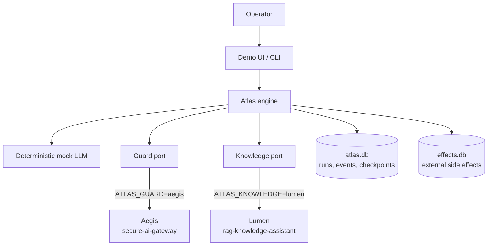
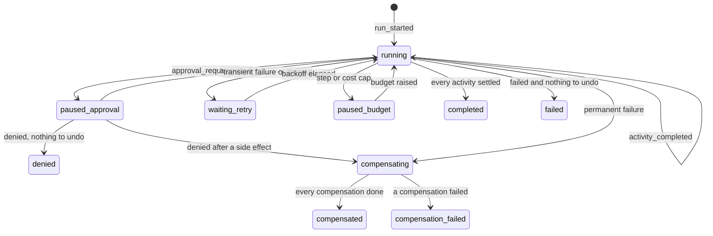
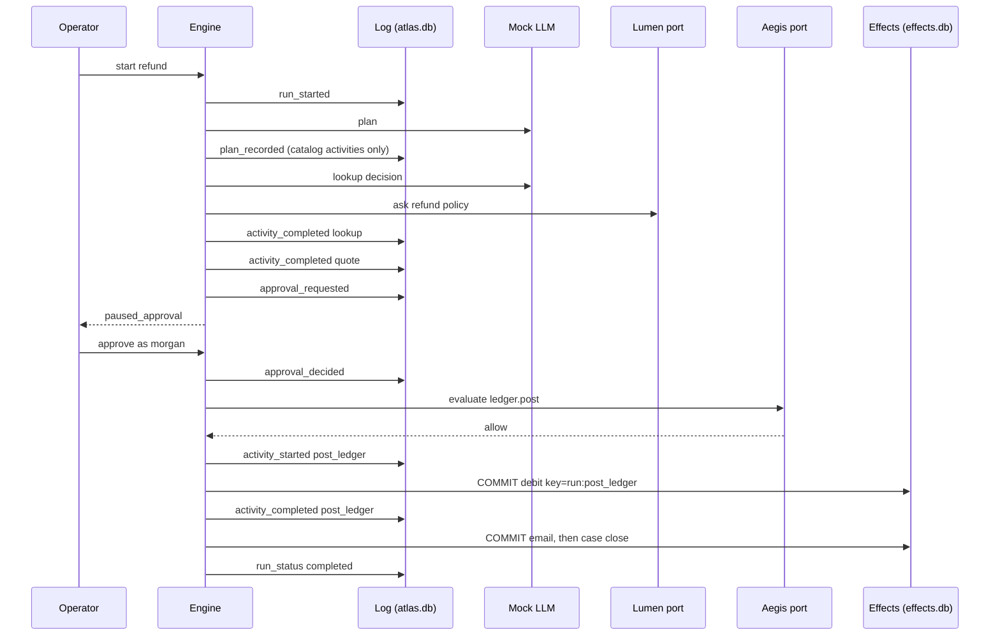
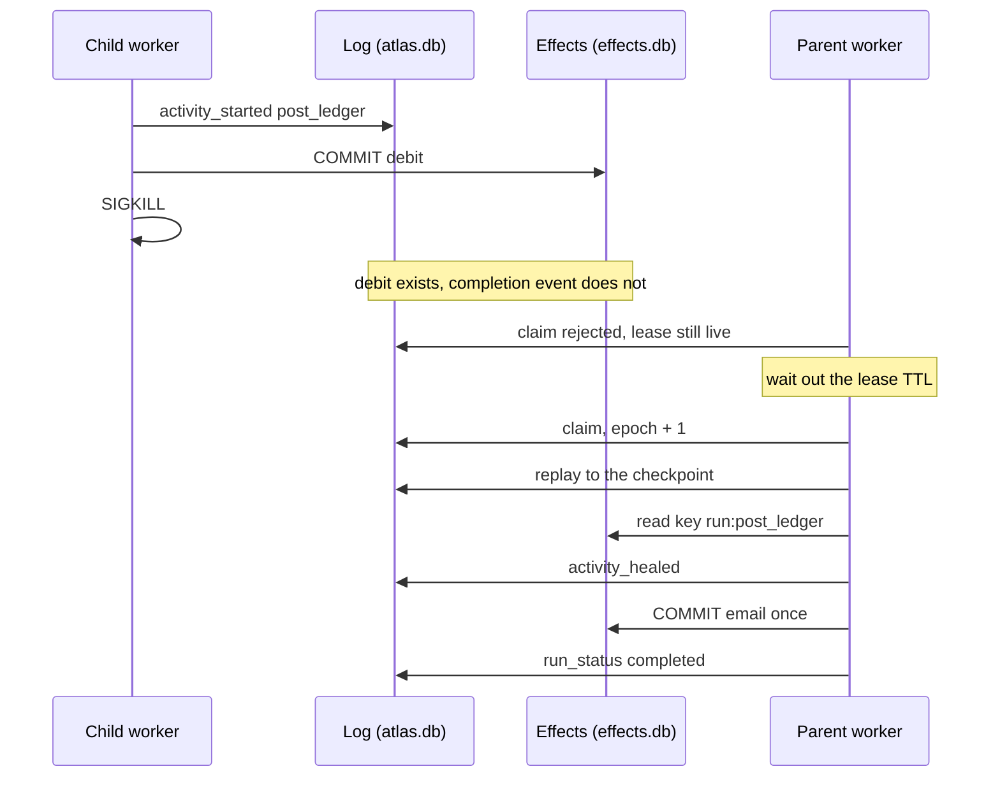

# Atlas architecture

This is the design review. The question is how a multi-agent run survives a crash between a
remote side effect and the local record of it, without charging twice and without re-deciding
finished work. Agents propose tool calls. The engine commits them.

Numbers are from suite `atlas-workflows-v1`
([`eval_results/latest/summary.json`](eval_results/latest/summary.json)). Recovery times are
simulated from each activity's `latency_ms` (a heal is 1 ms). Wall-clock figures are measured
on the eval host and labeled as such.

## 1. System

Aegis and Lumen stay separate processes. Atlas does not import them. The offline stubs speak
Aegis's verdict vocabulary (`allow`, `require_approval`, `block`, `R-TOOL-...`) and Lumen's
`POST /ask` shape (`answer`, `citations`, `refused`). HTTP adapters fail closed.

## 2. Decisions at a glance

| Choice | Chose | Rejected | Why this one | What it costs |
|---|---|---|---|---|
| Durable store | Event log and effect store, separate commits | One mutable status row. One transaction around the remote call | The row cannot say whether the debit committed. One transaction cannot span a payment API | Two files, backed up together. SQLite is one writer |
| Replay model | Append-only log, hashed checkpoints, model decision recorded before the side effect | Re-read mutable rows. Re-prompt the model on resume | Resume is a function of the log. A sampled model will not repeat itself | The fold is deterministic. A bad first decision is sticky |
| Idempotency | Remote key, local heal if the key exists, refuse tools with no key | At-most-once. Blind at-least-once | The first drops the refund. The second double-charges | The remote system must honor the key |
| Compensation | Saga, each reverse keyed like a forward effect | Two-phase commit across mail and ledger | Atlas does not operate those systems | `compensation_failed` is a real terminal state |
| Guardrail adapter | Port. Offline Aegis stub. Fail-closed HTTP | Import Aegis. Trust the model | Separate deployable. The demo model is gullible on purpose | Stub is a subset. Rule ids can drift |
| Retrieval adapter | Port. Offline Lumen stub. `POST /ask`. Refusal fails the step | Policy text in the prompt. Fail open | Citations and refusal are the contract. A down dependency must not invent a refund | Offline routing is keywords until Lumen is configured |

### Durable store

Two SQLite files. `atlas.db` holds the run row (a projection), the event log, and checkpoints.
`effects.db` holds side effects under the idempotency key, and its commit returns before the
engine appends `activity_completed`.

Rejected a mutable activity row as the source of truth. After `SIGKILL` it still says
`running`. Rejected wrapping the remote call and the completion in one transaction. That
demo passes unit tests and cannot be deployed against a ledger. The SQL, including
`UPDATE runs SET lease_epoch = ? WHERE lease_epoch = ?`, is what a Postgres store keeps.
[ADR 0001](docs/adr/0001-event-log-and-replay.md), [ADR 0002](docs/adr/0002-idempotency-keys-not-at-most-once.md).

### Replay model

`replay.fold` applies events in order. Resume uses the newest checkpoint whose stored SHA-256
matches the payload, then folds the tail. A mismatch drops that checkpoint. `llm_decision`
is appended before the tool call. Resume replays it. A hostile model swapped in after a crash
is not consulted for a step that already has a decision.

Rejected re-prompting, because the second completion will not match the first attempt's
idempotency key. Rejected trusting the checkpoint alone. The hash is for torn writes, not
for a malicious writer who can update the hash too. Clock reads and random choices inside
the fold are forbidden. Time is an argument.

### Idempotency

Forward key `{run_id}:{activity_id}`. Compensation key with a `:compensate` suffix. Same
payload returns the original row. A different payload is `IdempotencyConflict`. Resume of a
`running` activity with a key present appends `activity_healed` and skips the body. No key
means one retry under the same key. `sms.send` is refused with `R-TOOL-NOT-IDEMPOTENT`
before any send.

Rejected at-most-once: the customer never gets the refund if the process dies before the
call. Rejected a fresh call on every retry: the baseline posts two debits on
`refund_crash_after_remote`; Atlas posts one and re-runs 0 completed steps. A provider that
forgets keys after a short window will double-charge later. That is outside what this
process can prove.

### Compensation

Permanent failure skips unfinished forward work and runs `compensate` tools in reverse
completion order. Each one is an effect with the heal protocol, so `compensate_crash` ends
as one debit and one credit. Compensations are exempt from the step and cost caps. A failed
compensation ends the run as `compensation_failed`.

Rejected two-phase commit. There is no shared transaction manager, and building one would
couple Atlas to systems it does not run. The amount on the credit is the quote result, not
a model argument. Steps with no honest reverse (a page that already fired) declare no
`compensate` and should be ordered last. [ADR 0003](docs/adr/0003-sagas-not-two-phase-commit.md).

### Guardrail adapter

`ToolGuard.evaluate` returns one verdict. The offline implementation blocks non-idempotent
tools, freemail domains, and URL hosts outside `status.acme.example`, `hooks.acme.example`,
and `api.acme.example`. High-risk tools need an approval already on the run. Block outranks
`require_approval`. The HTTP adapter targets `POST /v1/tool-guard/evaluate` and blocks with
`R-AEGIS-UNAVAILABLE` on any error. The vendor specialist proposes a personal webhook because
the mock follows an injected instruction. The activity is `on_block: skip`. The provision
step still runs once.

Rejected a library import of Aegis, which would make three deployables one outage. Rejected
a system prompt that says not to exfiltrate. The eval's interesting case is a model that
does it anyway. The stub does not tokenize, taint, or audit. Those remain Aegis features
behind the port. [ADR 0004](docs/adr/0004-ports-for-aegis-and-lumen.md).

### Retrieval adapter

`Knowledge.ask` returns answer, citations, and `refused`. Offline, three articles plus
Lumen's refusal sentence. The quote step parses the limits out of the answer. Refusal or a
transport failure fails the quote. Nothing is posted.

Rejected inlining the policy in the planner prompt: no citation, no refusal signal, no way
to point the same step at the real index. Rejected failing open. The HTTP path is Lumen's
actual demo API (`POST /ask`, `X-User-Id`). The offline path is keyword routing, so it will
miss paraphrases and it does not apply Lumen's ACLs. That is acceptable only while
`ATLAS_KNOWLEDGE=offline`.

## 3. SLO and cost budgets

| Budget | Target | Mechanism | Result on this suite |
|---|---|---|---|
| Duplicate effects after crash | 0 | Effect key plus fencing epoch on the completion write | 0 / 4 crash cases. Baseline 3 / 4 |
| Completed steps re-run | 0 | Replay restores them. Only a started step with no effect row runs again | Mean 0 vs 3.25 |
| Catch-up | Bookkeeping, not a replay. Operational floor is one lease TTL | `activity_healed` | Simulated mean 12 ms vs 104 ms. Default lease 30 s. Demo lease 0.4 s |
| Engine overhead, small refund, no model | p95 < 50 ms | In-process drive, no network on the default path | Measured p50 17.3 ms, p95 28.3 ms, SQLite setup included |
| Run cost | Pause before `max_cost_usd` ($1.00 default) or `max_steps` (20) | Check before admitting a new attempt. Compensations exempt | Happy path $0.011. Suite mean $0.00750 vs $0.01225. A $0.0025 cap pauses before the quote |
| High-risk effect without approval | Zero such effects | Approval activity, and the guard if the gate was skipped without a policy waiver | `refund_denied`: empty effect set |
| Guard or retrieval down | Fail closed | Block, or refusal that fails the dependent step | Adapter tests against a closed port |

The $0.011 on a $40 refund is the per-workflow budget I would ship. The $1.00 cap is the
backstop for a planner that will not stop. Accounted cost is the declared price of a
specialist step. It is the projection the enforcer uses. It is not a provider bill. Actual
spend against a model in this repo is $0.

## 4. How this scales to production

| Offline piece | Production replacement |
|---|---|
| `atlas.db` | Postgres, same schema. Lease-epoch update unchanged. Restore this database and the effect records as a pair |
| `drive` loop in one process | Temporal, if the platform has it: log becomes workflow history, each tool call an activity, lease becomes the activity heartbeat. Otherwise a queue, one message per run, same epoch fencing |
| `effects.db` | Idempotency tables inside the ledger, the mailer, and the pager. Atlas writes the completion after their ack |
| Mock LLM | LLM gateway. Here that is Aegis in front of the provider. The completion is still an event, so resume does not call the model again |
| Offline guard | `ATLAS_GUARD=aegis`, fail closed. Tokenization, taint, and the hash-chained audit log stay in Aegis |
| Offline corpus | `ATLAS_KNOWLEDGE=lumen` and `POST /ask`. A refusal still fails the step |
| In-process approval | Same `paused_approval` state. The decision arrives on a queue. No path from timeout to debit |
| `SIGKILL` between the two files | Worker crash between provider ack and history append. The next activity task heals |

Leave behind when you make that move: SQLite as a shared log, a single lease covering a
parallel wave, and keyword retrieval. Add per-activity leases before more than one worker
executes ready activities of the same run. Keep the catalog as the allowlist.

## 5. Goals and non-goals

| Goal | How it is enforced | Where it shows up |
|---|---|---|
| A side effect happens once | Idempotency key in `effects.db`, separate transaction from the completion event | kill-and-resume demo, crash cases in the suite |
| Resume does not re-decide finished work | Append-only event log, checkpoints, replay | `tests/test_engine.py` replay and hostile-model tests |
| A human can stop a refund | Approval activity; high-risk tools also ask the guard | `refund_denied` |
| A runaway agent stops | Step cap and cost cap, checked before a new attempt | `refund_step_budget`, `refund_cost_budget` |
| A failed later step undoes the earlier one | Saga compensations, themselves idempotent | `refund_email_compensate`, `compensate_crash` |
| The model cannot bypass policy | Aegis-shaped guard on the bound arguments | `vendor_guard`, personal-email test |
| Policy text comes from the knowledge base | Lumen-shaped `ask`; a refusal fails the quote | `lumen_refusal` |

Non-goals for this version: a sampled model, multi-region replication, a general programming
language for workflows, timers beyond retry backoff, and approval SLAs. Those are in
[`docs/FAILURE_MODES.md`](docs/FAILURE_MODES.md).

## 6. Durable state machine

A run is not a row that says `running`. The row is a cache of the log. The log is the state.

A crash is not a state. It is a dead worker whose lease expires while an activity is `running`
or a compensation is `running`. Resume claims the lease, replays the log, and heals.

Activity states: `pending`, `ready`, `running`, `waiting_approval`, `waiting_retry`,
`completed`, `failed`, `skipped`, `compensated`.

### Happy path

### Crash after the debit, then resume

On this path the suite records Atlas recovery **56 ms** simulated (1 ms heal + email 35 + case 20)
and **0** completed steps re-run. The baseline, which restarts the plan, records **170 ms** and
**4** completed steps re-run, and posts the debit twice.

Money amounts and recipients are bound by the engine from the quote and the request. The model
may still set an email subject or a URL. Those arguments are what the guard evaluates. That
split is deliberate: free-form arguments are the ones a jailbroken specialist will abuse, and
they are the ones the port is there to see.

## 7. Crash windows

| Window | What has committed | Resume |
|---|---|---|
| Before `activity_started` | Nothing for this step | Start the attempt |
| `after_intent` | The started event, not the remote effect | Re-execute that step only. Suite: in-flight re-run 1, catch-up 45 ms (the ledger's declared latency) |
| `after_remote` | The effect row, not the completion event | Heal. Do not call the tool. Suite: in-flight re-run 0, catch-up 1 ms |
| After `activity_completed` | Both | The scheduler will not touch the step |
| Compensation `after_remote` | The reversing credit, not the compensation event | Heal the credit. Suite: one debit, one credit |

`make kill-resume` is the `after_remote` window with `SIGKILL`, a live lease, and a second process.
In-process tests expire the lease immediately so they do not sleep. The demo waits.

## 8. Replay and checkpoints

`replay.fold` is a pure function from events to state. Resume loads the latest checkpoint whose
SHA-256 still matches the stored payload, then folds only the tail. A tampered checkpoint is
ignored and the log is folded from the previous good checkpoint. The test deletes trust in the
newest checkpoint and checks the rebuilt activities match a full fold.

The mock model is consulted only when the log has no `llm_decision` for that decision id.
A test swaps in a model that throws if asked to re-decide the email step. Resume replays the
recorded decision and still delivers the original subject.

The planner may propose extra activities. They are stored on `plan_recorded` as rejected and
never inserted. The catalog is the allowlist: tools, compensations, timeouts, and budgets.

## 9. Operational rules the budgets depend on

The offline guard blocks non-idempotent tools (`R-TOOL-NOT-IDEMPOTENT`), freemail domains
(`R-TOOL-PERSONAL-DOMAIN`), and URL hosts outside `status.acme.example`, `hooks.acme.example`,
and `api.acme.example` (`R-TOOL-URL-NOT-ALLOWLISTED`). High-risk tools need an approval on the
run (`R-TOOL-HIGH-RISK`). Block wins over approval. Skipping an approval gate because its `when`
expression is false records a policy approval, so the under-$25 refund is not asked twice.

Lumen's offline corpus is three articles (`POL-REF-014`, `POL-VEN-003`, `POL-INC-009`) plus a
refusal. The quote tool parses "up to $200" and "above $25" from the answer text. If the answer
is a refusal, the quote fails permanent and nothing is posted.

Budgets are checked before a new attempt: `steps + 1` against `max_steps`, and `cost + activity
cost` against `max_cost_usd`. The in-flight attempt is not re-checked. Compensations are not
subject to the cap; undoing a charge matters more than staying under it. Cost is the declared
price, charged once on success or heal. Retries increment steps, so a retry loop hits the step
cap. Backoff is `backoff_ms * 2^(attempt-1)`, and the run parks in `waiting_retry` until the
clock passes `retry_at`. Timeouts are an elapsed-time report from the tool compared with
`timeout_ms`. A timeout after the effect committed is a success, not a retry.

## 10. What breaks first at 10×

Ten times the activities, the workers, or the side-effect rate.

* **SQLite write lock.** One file, one writer. The first move is Postgres with the same tables.
  The fencing check (`UPDATE ... WHERE lease_epoch = ?`) already assumes a transactional store.
* **Replay time.** Checkpoints keep the tail short. A poison event in the middle still forces a
  fold from the previous good checkpoint. At a large log, snapshot the checkpoint on a schedule
  and verify the hash before trusting it. That hash check is already there.
* **Effect-store locality.** `effects.db` is a stand-in sitting next to the log. A real ledger
  is another failure domain. The protocol does not change: send the key, let their unique index
  be the source of truth, write our completion after they ack. If they cannot store a key, the
  tool is marked non-idempotent and the engine refuses it, which is what `sms.send` does today.
* **A real model.** The mock is a pure function. A sampled model is safe only because the
  completion is logged before the side effect and resume does not call it again. The first bug
  will be someone "just calling the model" inside a tool that is not behind that record.
* **Fan-out.** The driver runs one ready activity at a time, in `order`. The graph can express
  parallel waves (status page and page-out share a dependency). True parallel workers need a
  per-activity lease, not only a per-run lease, or two workers will both pass the `running` check.
* **Compensation depth.** Compensations are synchronous and in order. A compensation that itself
  needs a human, or that takes minutes, needs a timer and a queue. Today it needs the worker to
  stay in `compensating` and the operator to resume if the process dies. The crash test covers
  the die-and-resume half.

## 11. Trust boundaries

| Boundary | What crosses | Control |
|---|---|---|
| Operator to API | Workflow id, inputs, approval | Demo has no auth. Production would sit behind the same IdP Aegis uses |
| Engine to model | State JSON in, decision JSON out | Decision logged before any side effect; extras rejected |
| Engine to guard | Tool name, bound args, risk, approval bit | Fail closed if Aegis does not answer |
| Engine to knowledge | Question in, answer and citations out | Refusal fails the dependent step |
| Engine to effects | Idempotency key and payload | Unique key; conflicting payload is an error, not a second write |
| Stale worker to log | A completion write | Fencing epoch; the write is rejected and the side effect is not repeated |
