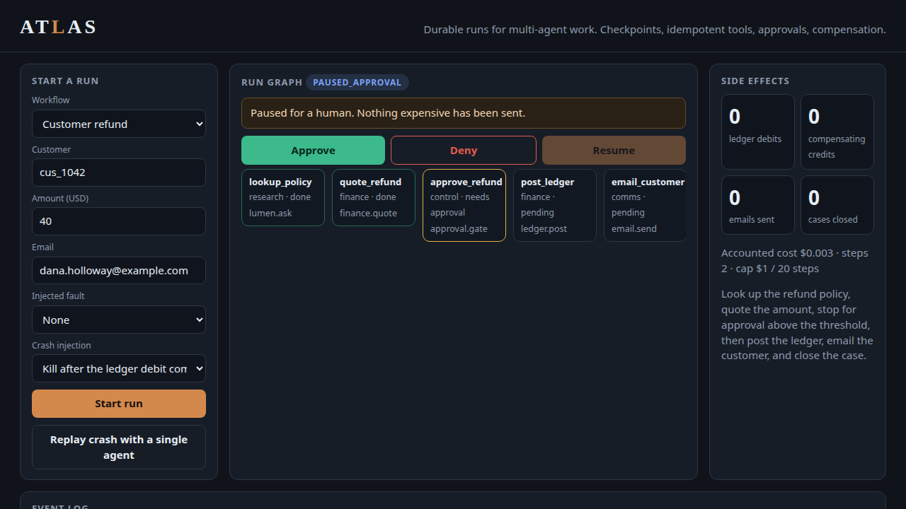
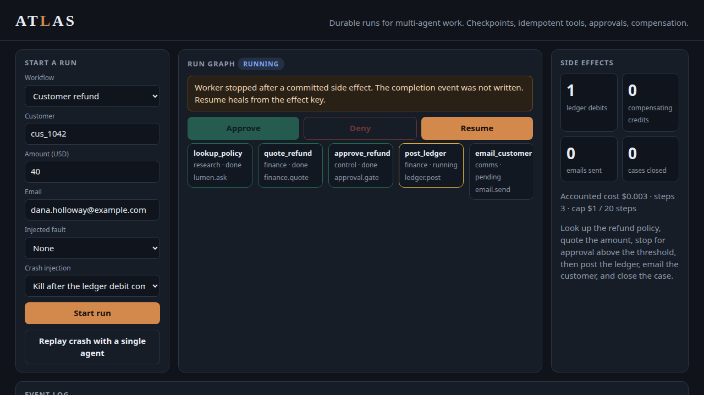
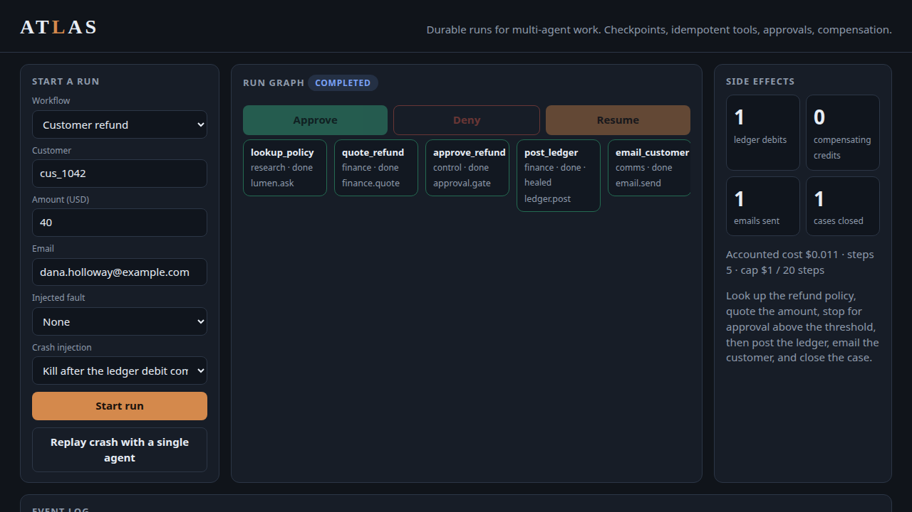
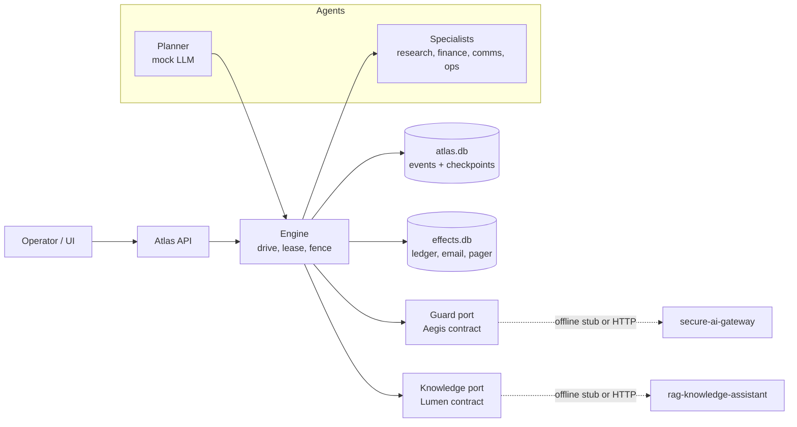
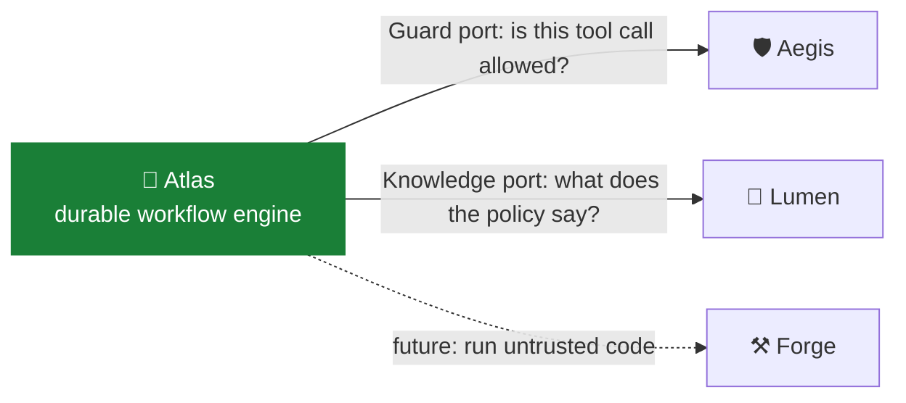

<div align="center">

# 🧭 Atlas

Multi-agent workflows that survive a crash without charging the customer twice.

[](https://github.com/kumarlakshya24/personal-projects/actions/workflows/atlas.yml)

[](pyproject.toml)


[Overview](#overview) ·
[Quickstart](#quickstart) ·
[Usage](#usage) ·
[Architecture](#architecture) ·
[Design decisions](#design-decisions) ·
[Results](#results) ·
[Project layout](#project-layout) ·
[Where it fits](#where-it-fits) ·
[Documentation](#documentation) ·
[Limitations](#limitations)


<sub>A refund waits for approval, the worker is killed with <code>SIGKILL</code> right after the debit, a new worker resumes with the ledger still at one debit, then a naive single-agent replay of the same crash debits twice.</sub>

</div>

---

## Overview

A worker dies after a ledger debit has committed and before the run records success. Retrying the plan charges the customer twice.

Atlas is the durable runtime for that window. A planner and specialists propose tool calls. The engine writes an event log, stores the effect under an idempotency key, and resumes from that key so the debit stays at one. Agents propose calls. The runtime commits them.

Offline. No API key, no Docker, no network. Deterministic mock agents and SQLite. `make up` serves the UI.

The diagram and the decisions table are the review: what was chosen, what was rejected, and what the choice costs. The refund, vendor, and incident workflows are the evidence. Numbers are from [`eval_results/latest/summary.json`](eval_results/latest/summary.json).

## Quickstart

Python 3.12. No Docker. No API key. These targets all run offline:

```bash
cd atlas
python -m venv .venv && . .venv/bin/activate
make install
make test          # includes the SIGKILL resume test
make demo          # short happy-path trace
make eval          # rewrites eval_results/latest and the Results table
make kill-resume   # signal 9 after the debit
make up            # UI on http://127.0.0.1:8096
```

To use the real siblings, copy `.env.example`. `ATLAS_GUARD=aegis` and `ATLAS_KNOWLEDGE=lumen`. If either call fails, the run blocks or refuses. It does not guess.

## Usage

`make kill-resume` is the idempotency decision under `SIGKILL`: child exit `-9`, the lease blocks a second worker, then one debit, one email, one case close, and zero completed steps re-run. `tests/test_kill_resume.py` runs the same path.

<video src="docs/assets/atlas-kill-resume.mp4" poster="docs/assets/03-crashed-after-ledger.png" controls playsinline width="960"></video>

The clip at the top of this page is the same recording as this silent video, [atlas-kill-resume.mp4](docs/assets/atlas-kill-resume.mp4) (about 13 seconds).







The other frames from the same take are [the start](docs/assets/01-start.png), [the baseline double debit](docs/assets/05-baseline-double-debit.png), and [the compensation](docs/assets/06-compensated.png).

## Architecture



`effects.db` commits the debit in its own transaction. `atlas.db` records the completion later.
`make kill-resume` sends `SIGKILL` in that gap. A full drawing, the state machine, and both
sequence diagrams are in [`ARCHITECTURE.md`](ARCHITECTURE.md).

Python 3.12, FastAPI, two SQLite files (event log and effect store), and deterministic mock agents. No Docker and no API key.

### SLO and cost budgets

These are the budgets the engine enforces or the suite regresses. "Measured" is this host, Python 3.12, mock agents, SQLite. "Declared" is the design target the code checks. "Simulated" uses each activity's `latency_ms`; a heal costs 1 ms.

| Budget | Target | How the design meets it | Evidence |
|---|---|---|---|
| Duplicate side effects after a crash | 0 | Heal from the effect key; fencing epoch rejects a stale completion | 0 of 4 crash cases duplicate. Baseline duplicates 3 of 4 |
| Completed steps re-run after a crash | 0 | Replay restores completed activities. Only an in-flight step with no effect row runs again | Atlas mean 0. Baseline mean 3.25 |
| Catch-up after a crash | Heal in bookkeeping time, not a full replay. Floor is one lease TTL | `activity_healed` skips the tool body | Simulated catch-up mean 12 ms vs 104 ms. Lease is 30 s in production config, 0.4 s in the demo |
| Engine overhead, small refund | p95 under 50 ms, excluding model time | In-process drive, one SQLite writer, no network on the default path | Measured p50 17.3 ms, p95 28.3 ms, including file setup |
| Per-run cost | Default cap $1.00 and 20 steps. Pause before the attempt that would exceed | Checked before a new attempt. In-flight attempt is allowed to finish. Compensations are exempt | Happy-path refund accounts $0.011. Suite mean $0.00750 vs baseline $0.01225. `refund_cost_budget` pauses at a $0.0025 cap before the quote |
| Approval before a high-risk side effect | No debit until a human or an explicit policy skip | Gate for amounts over $25. Guard returns `require_approval` if that bit is missing | `refund_denied` ends with an empty effect set |
| Guard and retrieval dependency down | Fail closed | HTTP adapters return block or refusal | Adapter tests against a closed port |

Actual model spend in this repo is $0. The accounted dollars are the price list the budget enforcer sums: a projection of one specialist step, not an invoice. A $40 refund at $0.011 is the budget I would ship for this workflow class, with the $1.00 cap as the backstop for a planner bug. The baseline's higher mean is the cost of replaying finished steps and of not stopping on denial, budget, or refusal.

### How this scales to production

The offline pieces are seams, not the production topology.

| This repo | Production |
|---|---|
| `atlas.db` (events, checkpoints, leases) | Postgres. Same tables. The fencing update stays. Point-in-time recovery of this database and the effect records together |
| Single-process `drive` loop | A workflow engine. Temporal if the platform already runs it: the log is workflow history, each tool call is an activity, the lease is the activity heartbeat. If not Temporal, a queue per run with the same lease and epoch |
| `effects.db` | The ledger's, mailer's, and pager's own idempotency stores. Atlas sends the key and writes the completion after they ack |
| Deterministic mock LLM | An LLM gateway. Aegis is that gateway here: one policy, one audit, provider keys not on the worker. The completion is still recorded before the activity, so resume does not call the model again |
| Offline guard stub | `ATLAS_GUARD=aegis`. Fail closed. Aegis keeps tokenization, taint, and the hash-chained audit log |
| Offline knowledge stub | `ATLAS_KNOWLEDGE=lumen` against `POST /ask`. Refusals still fail the step |
| In-process approval pause | The same `paused_approval` state, with the decision delivered on a queue to an inbox. No timeout-to-debit |
| `SIGKILL` between the two files | A worker crash between the provider ack and the history append. Heal on the next activity task |

What I would not carry over: SQLite as the shared log, one lease for a whole run once activities run in parallel, and the keyword corpus. Per-activity leases come before a real fan-out. The catalog stays the allowlist. The model does not gain tools by proposing them.

## Design decisions

| Choice | Chose | Rejected | Why this one | What it costs |
|---|---|---|---|---|
| Durable store | Two SQLite files: an event log, and an effect store with its own commit | One mutable status row; one transaction around the remote call | A status row cannot say whether the debit committed. A single transaction cannot span a payment API | Two files must be backed up together. SQLite is one writer |
| Replay model | Append-only log, hashed checkpoints, fold the tail. Record the model decision before the side effect | Re-read mutable rows; re-prompt the model on resume | Resume has to be a function of the log. A sampled model will not repeat itself | The fold must be deterministic. A bad first decision stays in the log |
| Idempotency | Key on the remote effect. Heal locally if the key exists. Refuse tools that cannot take a key | At-most-once (never retry). At-least-once with a fresh call every time | At-most-once drops the refund. At-least-once double-charges. The suite's crash-after-debit case stays at one debit | The remote system has to honor the key |
| Compensation | Saga. Reverse completed steps in order, each with its own key | Two-phase commit across email and the ledger | Atlas does not operate those systems, so it cannot prepare/commit them | A compensation can fail. That end state is `compensation_failed`, visible |
| Guardrail adapter | Port with an offline Aegis-shaped stub and a fail-closed HTTP client | Import Aegis. Trust the model to refuse a bad tool call | Aegis deploys alone. Model self-restraint does not survive a jailbreak | The stub is a subset of Aegis. Rule ids can drift |
| Retrieval adapter | Port with an offline Lumen-shaped stub and `POST /ask`. A refusal fails the step | Paste policy strings into the prompt. Guess when retrieval is down | Citations and refusal are Lumen's job. A down dependency must not become a made-up refund | The offline router is keywords, not Lumen's index |

### Durable store

The log (`runs`, `events`, `checkpoints`) and the effects (`side_effects`, primary key = idempotency key) are separate databases on purpose. Resume reads both.

Rejected a single mutable row per activity. After a kill the row still says `running`, which does not tell you whether the debit landed. Rejected holding one SQL transaction open across the remote call. That hides the only window that matters, and it cannot be done against a real ledger. SQLite is the demo store because the kill test is a directory and a signal. The statements, including `UPDATE ... WHERE lease_epoch = ?`, are the ones a Postgres store would keep. See [ADR 0001](docs/adr/0001-event-log-and-replay.md) and [ADR 0002](docs/adr/0002-idempotency-keys-not-at-most-once.md).

### Replay model

`replay.fold` is a pure function from events to state. Resume loads the newest checkpoint whose SHA-256 still matches, then folds the tail. A tampered checkpoint is skipped. The mock model's completion is an event, written before the tool runs. On resume that event is replayed. A test installs a model that throws if the email step is re-decided; the original subject still goes out.

Rejected re-prompting. A live model will pick a new recipient, and the idempotency key will not match the first attempt. Rejected treating the checkpoint as the source of truth. The hash check exists because a torn write should fall back to the log. The cost is that workflow code inside the fold cannot sample or read the clock. Time is passed in and recorded.

### Idempotency

Forward key `{run_id}:{activity_id}`. Compensation key `{run_id}:{activity_id}:compensate`. Same payload returns the stored row. A different payload raises `IdempotencyConflict`. If resume finds the activity `running` and the key present, it appends `activity_healed` and does not call the tool. If the key is absent, it calls the tool once under that same key. `sms.send` is marked non-idempotent and blocked with `R-TOOL-NOT-IDEMPOTENT` before any send.

Rejected at-most-once: a crash before the debit silently drops the refund. Rejected blind retry: `refund_crash_after_remote` on the baseline posts two debits; Atlas posts one, with 0 completed steps re-run. The cost is operational. A provider that only dedupes for ten minutes will eventually double-charge, and Atlas cannot see that.

### Compensation

On a permanent failure, unfinished forward work is skipped and completed steps that declared a `compensate` tool run in reverse. Each compensation uses the same heal protocol, so a kill during the credit does not credit twice (`compensate_crash`: one debit, one credit). Compensations ignore the step and cost caps. Undoing a charge is not optional because the run is over budget. If a compensation fails, the run ends `compensation_failed`.

Rejected two-phase commit. The ledger and the mailer do not share a transaction manager, and Atlas does not operate either. The cost is that compensations have to be written correctly. The amount is copied from the quote result, not from the model. A page that already woke someone has no compensate tool; that step should be last. See [ADR 0003](docs/adr/0003-sagas-not-two-phase-commit.md).

### Guardrail adapter

Every tool call is `evaluate(tool, args, risk, idempotent, approved, rationale)` and returns `allow`, `require_approval`, or `block` with an `R-TOOL-...` rule id, the same vocabulary as Aegis. The offline stub blocks non-idempotent tools, freemail domains, and hosts outside a small allowlist. Block wins over approval. The HTTP client POSTs `{AEGIS_BASE_URL}/v1/tool-guard/evaluate` and returns `R-AEGIS-UNAVAILABLE` / block if the call fails. The vendor workflow's mock follows an injected instruction and proposes `hook.personal.test`. The guard skips that step. Provisioning still runs once, after approval.

Rejected importing `secure-ai-gateway`. It is a separate deployable, and the offline demo has to run without it. Rejected asking the model to police itself. The demo model is gullible on purpose. The cost: the stub does not tokenize, taint a session, or hash-chain an audit log. Those stay in Aegis. See [ADR 0004](docs/adr/0004-ports-for-aegis-and-lumen.md).

### Retrieval adapter

`ask(question)` returns `{answer, citations, refused}`. The offline corpus is three policies (`POL-REF-014`, `POL-VEN-003`, `POL-INC-009`) plus Lumen's refusal sentence, "Not found in the provided documents." The quote tool parses "up to $200" and "above $25" from that text. A refusal fails the quote and nothing is posted (`lumen_refusal`). The HTTP client POSTs `{LUMEN_BASE_URL}/ask` with `X-User-Id`. A transport error becomes a refusal, not a guessed policy.

Rejected stuffing the policy into the system prompt. There is no citation, no refusal, and no way to swap the corpus. Rejected failing open when Lumen is down. A missing policy must not become a refund. The cost: the offline router is keywords. Paraphrases Lumen would hit, and Lumen's ACLs, are absent until `ATLAS_KNOWLEDGE=lumen`.

## Results

The suite is a regression lock for the decisions above. It is not a model benchmark. The baseline is the same workflows with no log, no effect key, no approval wait, no retry, and no compensation.

<!-- EVAL:START -->
Suite `atlas-workflows-v1` on Python 3.12.3. Deterministic regression suite. The mock LLM is a pure function. This is not an estimate of production task success with a sampled model. Recovery milliseconds are simulated from each activity's declared latency_ms. A healed step costs 1 ms of bookkeeping. Actual model spend is $0.

| Metric | Atlas | Single-agent baseline |
|---|---:|---:|
| Task success | 16/16 (100.0%) | 3/16 (18.8%) |
| Mean steps | 3.69 | 6.5 |
| Mean accounted cost (USD) | $0.00750 | $0.01225 |
| Mean completed steps re-run after a crash | 0 | 3.25 |
| Mean in-flight steps re-executed after a crash | 0.25 | 0.25 |
| Mean recovery time after a crash (simulated ms) | 65.75 | 166.25 |
| Mean catch-up time (simulated ms) | 12 | 103.75 |

Recovery time is simulated milliseconds from resume until the run is terminal again. Catch-up time stops when the crashed step is resolved. Engine overhead on 40 small refunds: p50 17.329 ms, p95 28.265 ms (measured wall clock, mock agents).

| Case | Atlas | Baseline | Atlas steps re-run (completed / in-flight) | Baseline steps re-run | Atlas recovery ms | Baseline recovery ms |
|---|---|---|---:|---:|---:|---:|
| refund_happy | pass | pass | — | — | — | — |
| refund_small | pass | pass | — | — | — | — |
| refund_crash_after_remote | pass | fail | 0 / 0 | 4 / 0 | 56 | 170 |
| refund_crash_after_intent | pass | pass | 0 / 1 | 3 / 1 | 100 | 170 |
| refund_denied | pass | fail | — | — | — | — |
| refund_step_budget | pass | fail | — | — | — | — |
| refund_cost_budget | pass | fail | — | — | — | — |
| refund_email_compensate | pass | fail | — | — | — | — |
| refund_email_retry | pass | fail | — | — | — | — |
| refund_ledger_timeout | pass | fail | — | — | — | — |
| compensate_crash | pass | fail | 0 / 0 | 4 / 0 | 1 | 150 |
| vendor_guard | pass | fail | — | — | — | — |
| incident_crash | pass | fail | 0 / 0 | 2 / 0 | 106 | 175 |
| duplicate_submit | pass | fail | — | — | — | — |
| lumen_refusal | pass | fail | — | — | — | — |
| sms_not_idempotent | pass | fail | — | — | — | — |
<!-- EVAL:END -->

The baseline passes where nothing goes wrong, and where the crash happens before any debit. It fails denial, both budgets, compensation, the blocked webhook, a Lumen refusal, a duplicate submit, and a crash after a side effect.

## Project layout

```
atlas/
├── ARCHITECTURE.md
├── Makefile  pyproject.toml  requirements*.txt  .env.example
├── atlas/                 engine, replay, store, guard and knowledge ports, API
├── workflows/             refund, vendor onboarding, incident response, sms notice
├── eval_results/latest/   summary.json and summary.md, spliced into this page
├── tests/                 includes the SIGKILL resume test
├── scripts/
├── docs/adr/              four decision records
└── docs/assets/           kill-and-resume GIF, MP4, and frames
```

## Where it fits

Atlas is where the other projects meet: it is the only one that *calls* its siblings. Each call goes
through a small port with an offline stand-in, so Atlas's tests and demo never need the other service.



| Neighbour | What flows across it | Status today |
|:--|:--|:--|
| [🛡️ Aegis](../secure-ai-gateway/) | Every proposed tool call → `allow`, `require_approval`, or `block`, with an `R-TOOL-…` rule id | ✅ Tested against an offline Aegis-shaped guard (same verdicts and rule vocabulary). ⚠️ `ATLAS_GUARD=aegis` targets `/v1/tool-guard/evaluate`, which Aegis doesn't expose yet, so it fails closed and blocks every call. |
| [🔦 Lumen](../rag-knowledge-assistant/) | "What does the refund policy allow?" → a cited answer, or a refusal that stops the step | ✅ Tested against an offline Lumen-shaped stub. ⚠️ `POST /ask` matches Lumen's API; going live needs a service identity for Atlas in Lumen and Atlas's policies in Lumen's documents. |
| [⚒️ Forge](../forge/) | Agent tools that run code or touch files | ⚠️ Not wired. The demo tools are ledger, email, pager and webhook calls. |
| [🔬 Lens](../lens/) | Workflow and tool spans for sampling, judging and SLOs | ⚠️ Not wired. Atlas's event log is the natural source. |

<sub>See the <a href="../README.md">platform overview</a> for how the projects connect.</sub>

## Documentation

| Doc | What it is |
|---|---|
| [`ARCHITECTURE.md`](ARCHITECTURE.md) | State machine, sequences, SLOs, production mapping |
| [`docs/adr/`](docs/adr) | Log and replay, idempotency, sagas, ports |
| [`docs/FAILURE_MODES.md`](docs/FAILURE_MODES.md) | Crash windows the engine heals, and the ones it cannot see |
| [Design walkthrough](docs/INTERVIEW_WALKTHROUGH.md) | The same design, spoken. `make interview` prints it |
| [`docs/assets/`](docs/assets) | Frames and the kill-and-resume recording |

## Limitations

The suite is a deterministic regression lock. It is not an estimate of task success with a sampled model. Recovery milliseconds are simulated from each activity's `latency_ms`.

A provider that only dedupes an idempotency key for ten minutes will eventually double-charge, and Atlas cannot see that. The offline guard does not tokenize, taint a session, or hash-chain an audit log. The offline knowledge router is keywords, so paraphrases and Lumen's ACLs are absent until `ATLAS_KNOWLEDGE=lumen`. SQLite is one writer, and one lease covers the whole run. Those are the seams in [How this scales to production](#how-this-scales-to-production) and [docs/FAILURE_MODES.md](docs/FAILURE_MODES.md).
