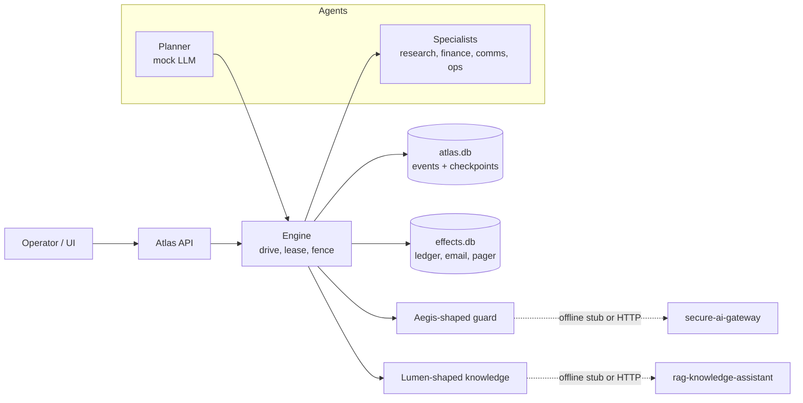
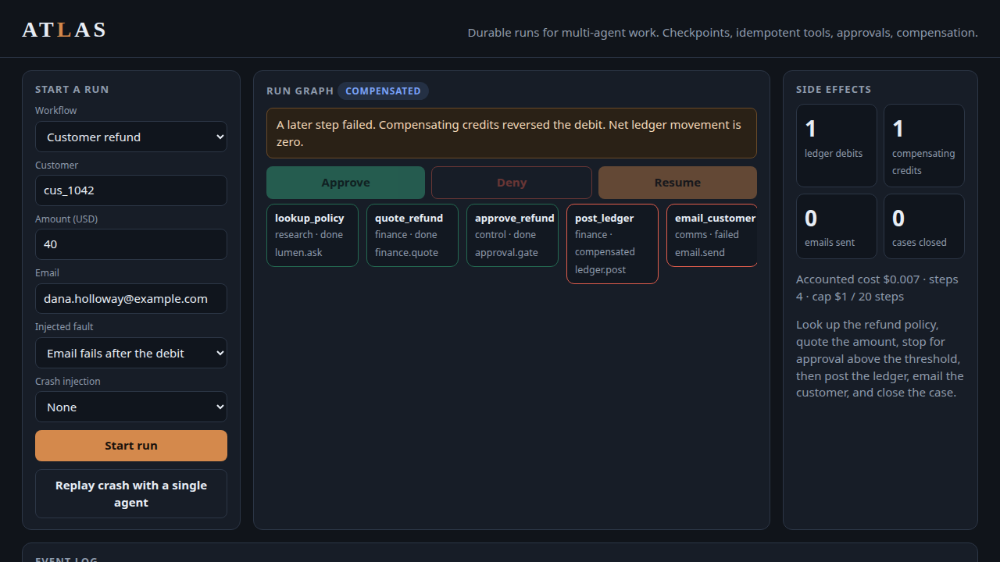
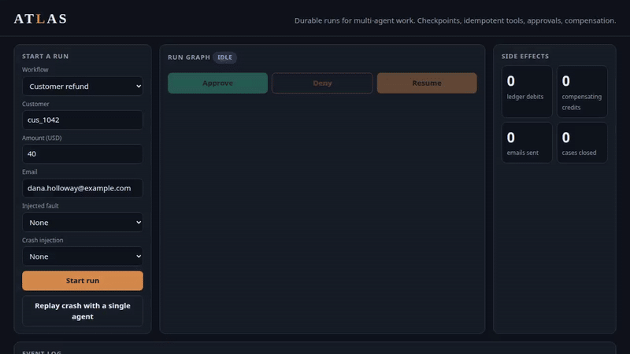

# Atlas: durable execution for multi-agent work

A planner and a few specialists can refund a customer, onboard a vendor, or open an incident.
The failure that matters is not a clumsy sentence. It is a ledger debit that runs twice because
the worker died after the charge and before it wrote "done".

Atlas is the runtime under those agents. It checkpoints every step, replays the event log after
a crash, calls tools through idempotency keys, stops for a human at an approval gate, enforces a
step and cost budget, and runs compensating actions when a later step fails. Tool calls go through
an Aegis-shaped guard. Policy questions go through a Lumen-shaped knowledge tool. Both have offline
adapters, so the demo needs no API key and no network.

The agents in this tree are a deterministic mock model: the same state always produces the same
tool decision, and that decision is written to the log before the side effect. A sampled model can
replace the mock later without changing the durability rules. The eval below is a regression suite
for those rules, not a claim about model quality.

---

## Results

Numbers come from `make eval`, which writes [`eval_results/latest/summary.json`](eval_results/latest/summary.json).
The table in this section is generated from that file.

<!-- EVAL:START -->
Suite `atlas-workflows-v1` on Python 3.12.3. Deterministic regression suite. The mock LLM is a pure function. This is not an estimate of production task success with a sampled model. Recovery milliseconds are simulated from each activity's declared latency_ms. A healed step costs 1 ms of bookkeeping. Actual model spend is $0.

| Metric | Atlas | Single-agent baseline |
|---|---:|---:|
| Task success | 16/16 (100.0%) | 3/16 (18.8%) |
| Mean steps | 3.69 | 6.5 |
| Mean accounted cost (USD) | $0.00750 | $0.01225 |
| Mean completed steps re-run after a crash | 0 | 3.25 |
| Mean in-flight steps re-executed after a crash | 0.25 | 0.25 |
| Mean recovery time after a crash (simulated ms) | 65.75 | 166.25 |
| Mean catch-up time (simulated ms) | 12 | 103.75 |

Recovery time is simulated milliseconds from resume until the run is terminal again. Catch-up time stops when the crashed step is resolved. Engine overhead on 40 small refunds: p50 17.329 ms, p95 28.265 ms (measured wall clock, mock agents).

| Case | Atlas | Baseline | Atlas steps re-run (completed / in-flight) | Baseline steps re-run | Atlas recovery ms | Baseline recovery ms |
|---|---|---|---:|---:|---:|---:|
| refund_happy | pass | pass | — | — | — | — |
| refund_small | pass | pass | — | — | — | — |
| refund_crash_after_remote | pass | fail | 0 / 0 | 4 / 0 | 56 | 170 |
| refund_crash_after_intent | pass | pass | 0 / 1 | 3 / 1 | 100 | 170 |
| refund_denied | pass | fail | — | — | — | — |
| refund_step_budget | pass | fail | — | — | — | — |
| refund_cost_budget | pass | fail | — | — | — | — |
| refund_email_compensate | pass | fail | — | — | — | — |
| refund_email_retry | pass | fail | — | — | — | — |
| refund_ledger_timeout | pass | fail | — | — | — | — |
| compensate_crash | pass | fail | 0 / 0 | 4 / 0 | 1 | 150 |
| vendor_guard | pass | fail | — | — | — | — |
| incident_crash | pass | fail | 0 / 0 | 2 / 0 | 106 | 175 |
| duplicate_submit | pass | fail | — | — | — | — |
| lumen_refusal | pass | fail | — | — | — | — |
| sms_not_idempotent | pass | fail | — | — | — | — |
<!-- EVAL:END -->

How to read that. **Task success** means the run ended in the status the case requires and the
side-effect multiset matches. The baseline is the same workflows with no log, no effect key, no
approval wait, no retry, and no compensation. It passes the three cases where nothing goes wrong
or the crash happens before any debit. It fails the rest: duplicate debits, skipped approvals,
budgets it ignores, refunds it does not reverse, a webhook the guard would have blocked.

**Recovery time** is simulated. Each activity declares a `latency_ms`. After a crash, Atlas pays
1 ms to heal a step whose remote effect already committed, and it does not re-run completed steps.
The baseline walks the plan again. The wall-clock row is the measured engine overhead of a small
refund on this machine, including SQLite setup. Actual model spend in this repo is $0. The
accounted cost is the price list the budget enforcer sums, a projection of model-plus-tool price,
not an invoice.

---

## Quick start

Python 3.12. No Docker. No API key.

```bash
cd atlas
python -m venv .venv && . .venv/bin/activate
make install
make test          # unit, integration, and the SIGKILL resume test
make eval          # rewrites eval_results/latest and this Results section
make kill-resume   # kill -9 after the debit, resume, prove one debit
make demo          # one refund trace, including the approval pause
make up            # UI on http://127.0.0.1:8095
make interview     # print docs/INTERVIEW_WALKTHROUGH.md
```

In the UI, start a $40 refund, approve it as Morgan with "Kill after the ledger debit commits",
and check the debit count. It stays at 1 after Resume. "Replay crash with a single agent" posts
a second debit. That is the whole product in one screen.

### Pointing the adapters at the real siblings

Copy `.env.example` to `.env`. Set `ATLAS_GUARD=aegis` and `AEGIS_BASE_URL` to a gateway that
exposes `POST /v1/tool-guard/evaluate`. Set `ATLAS_KNOWLEDGE=lumen` and `LUMEN_BASE_URL` to a
running Lumen (`POST /ask`, the `rag-knowledge-assistant` API). If either call fails, Atlas
blocks the tool or refuses the question. It does not guess.

---

## Architecture



The two database files are the point. `effects.db` commits the debit in its own transaction.
`atlas.db` records the completion later. A kill between those commits is the bug this project
is about, and it is the one `make kill-resume` forces with `SIGKILL`.

Detail, rejected alternatives, and what breaks at 10×: [`ARCHITECTURE.md`](ARCHITECTURE.md).
Decisions: [`docs/adr/`](docs/adr). Failures: [`docs/FAILURE_MODES.md`](docs/FAILURE_MODES.md).

---

## What a run does

A refund of $40 for Dana Holloway (`cus_1042`):

1. Research calls Lumen and gets `POL-REF-014`: refunds up to $200, approval above $25.
2. Finance quotes $40. The tool clamps the amount. The model does not get to set it.
3. The run pauses. Morgan approves. A denial writes no side effects.
4. Finance posts one debit under the key `run_id:post_ledger`.
5. Comms emails `dana.holloway@example.com`. A personal domain is blocked and the debit is reversed.
6. Ops closes the case.

A $10 refund skips the gate because the policy says so, and the guard then treats the run as cleared.
A vendor run includes a step whose model rationale says "ignore previous instructions" and posts
bank details to `hook.personal.test`. The guard blocks it (`R-TOOL-URL-NOT-ALLOWLISTED`). The
provisioning step still runs, once, after approval.

---

## Kill and resume




The same path, recorded from the UI: [atlas-kill-resume.mp4](docs/assets/atlas-kill-resume.mp4).



`make kill-resume` starts a child process, lets it auto-approve, and `SIGKILL`s it after the
debit transaction has committed and before the completion event. The parent confirms:

* the child died with signal 9
* a second worker cannot claim the run while the lease is still live
* `ledger.post` is already 1 and the activity is still `running`
* after the lease expires, resume marks the step healed and sends the email once

The pytest that runs this is `tests/test_kill_resume.py`. In-process tests cover the other two
windows: kill before the remote call (only that step re-executes) and kill during the compensating
credit (one credit, not two).

---

## Repository layout

```
atlas/
├── ARCHITECTURE.md
├── Makefile
├── atlas/
│   ├── engine.py          drive loop, leases, crash windows
│   ├── replay.py          fold the event log
│   ├── store.py           atlas.db and effects.db
│   ├── llm.py             deterministic mock model
│   ├── guard.py           offline Aegis stub and HTTP client
│   ├── knowledge.py       offline Lumen stub and HTTP client
│   ├── tools.py           ledger, email, pager, and the rest
│   ├── baseline.py        single agent, no durability
│   ├── api/               FastAPI demo and the UI
│   ├── demo/              SIGKILL child and parent
│   └── evaluation/        the suite and the README splice
├── workflows/             refund, vendor, incident, sms
├── eval_results/latest/   generated JSON and markdown
├── tests/
└── docs/                  ADRs, failure modes, interview script, screenshots
```

## Docs

* [`ARCHITECTURE.md`](ARCHITECTURE.md) — state machine, sequences, decisions at a glance, 10×
* [`docs/adr/`](docs/adr) — four decisions
* [`docs/FAILURE_MODES.md`](docs/FAILURE_MODES.md)
* [`docs/INTERVIEW_WALKTHROUGH.md`](docs/INTERVIEW_WALKTHROUGH.md) — `make interview`
* [`docs/assets/`](docs/assets) — UI frames and a short recording of the kill-and-resume path
