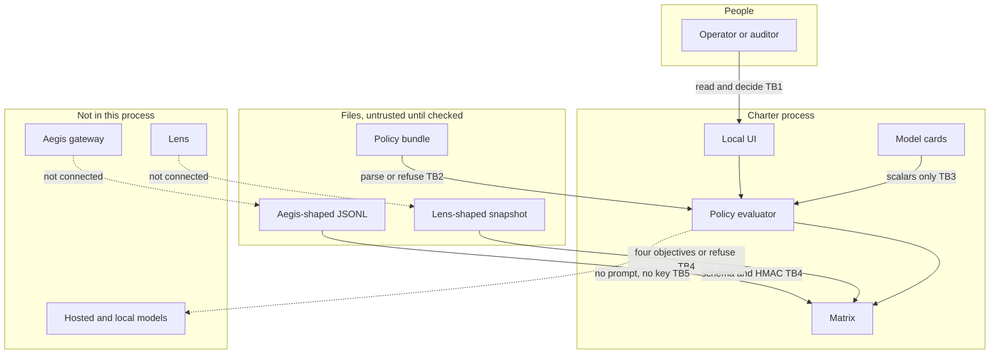
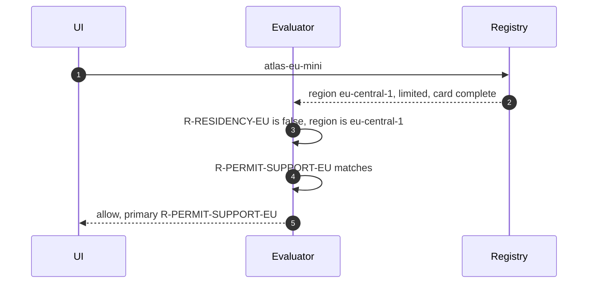
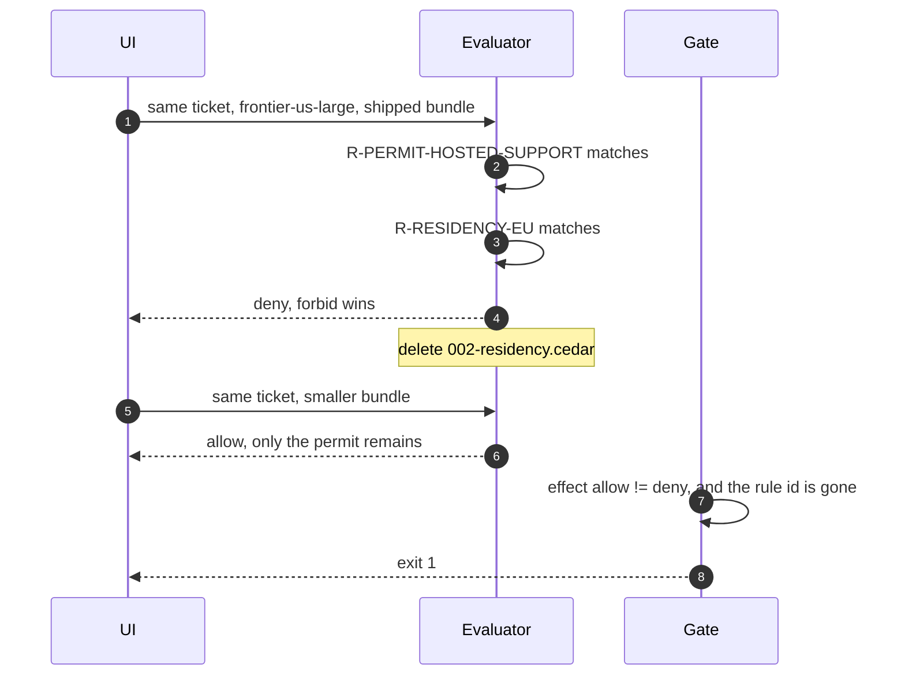

# Charter architecture

Charter decides whether a model may be invoked, records why, and turns that plus two offline stubs into an evidence pack. It does not call a model and it does not sit on the chat path.

Measured numbers live in `reports/`. This document is the design.

---

## 1. Assumptions

| # | Assumption | Why it is the default |
|---|------------|------------------------|
| A1 | The operator is already inside the building. Charter is not an identity provider. | Auth is Aegis's problem. The demo binds to `127.0.0.1` and has no login. |
| A2 | A decision must be explainable from a file a reviewer can diff. | An auditor who cannot read the rule will not trust the stamp. |
| A3 | Aegis and Lens are not running. Charter ships stubs that use their vocabulary. | Each project has to demo alone. Importing a sibling would make that a lie. |
| A4 | The region on a model card is the region the decision is about. | Proving where a packet went is a network control. This is an admission control. |
| A5 | "All green" is not the success condition. The fixture contains one bad route and one unstaffed high-risk model. | A pack that hides those is worse than a pack that names them. |
| A6 | Python 3.12, one process, no extra services. | `make test` and `make up` have to work on a laptop with no key. |

---

## 2. Trust boundaries

| ID | Boundary | What may cross | Control |
|----|----------|----------------|---------|
| TB1 | Person to UI | A case id and which bundle to use | The UI only evaluates cases that are already in `eval/cases.yaml`, or the same shape. It does not send a prompt anywhere. |
| TB2 | Policy file to engine | The Cedar subset | Anything else is a parse error. The process does not evaluate a bundle that did not parse. |
| TB3 | Card to engine | Scalar fields | Lists on the card are for humans. A `when` clause cannot call a function. |
| TB4 | Stubs to the matrix | Records and objectives | The audit chain is recomputed. A broken chain is a gap on record-keeping, not a crash of the decider. A SLO target that is not the Lens contract is refused at load. |
| TB5 | Charter to a model | Nothing | There is no provider client on the decision path. |

---

## 3. Decisions at a glance

| Question | Decision | Where |
|----------|----------|-------|
| What language? | A Cedar subset, in process. Not OPA, not English. | [ADR 0001](docs/adr/0001-cedar-subset-in-process.md) |
| Permit and forbid both match? | Forbid wins. No match is deny. | [ADR 0002](docs/adr/0002-forbid-overrides-default-deny.md) |
| Where do audit and SLO data come from? | Committed stubs shaped like Aegis and Lens. No imports. | [ADR 0003](docs/adr/0003-stubs-not-live-calls.md) |
| What is a green cell? | A computed status. Not a certificate. | [ADR 0004](docs/adr/0004-matrix-is-a-mapping.md) |
| Who is on the request path? | Not Charter. Aegis would pin a bundle or call out. Neither is wired. | This file, section 6 |
| What fails CI? | A shipped case that moves, or a weakened bundle that still matches the locked cases. | `eval/cases.yaml` |

Severity, when several forbids match, is a fixed table in `charter/policy/engine.py`: prohibited, then restricted, then residency, then oversight, then an incomplete card. It picks the primary rule id the UI stamps. It does not change the effect. The effect is already deny.

---

## 4. Sequences

### 4.1 Allowed invocation

The request is EU, confidential, purpose `customer_support`. No forbid's `when` is true. One permit is.

### 4.2 Blocked residency, and the failure if the file is deleted

Two other locked cases lose `R-RESIDENCY-EU` and stay deny (`restricted-us` still hits `R-RESTRICTED-BLOCK`; `eu-confidential-faq-us` hits default deny). The gate compares rule ids, so those fail too. The one that changes from deny to allow is the one a wide permit was waiting under.

### 4.3 A broken audit chain

The decider still answers. Record-keeping (EU-12) becomes a gap, and the pack says not to quote the log. Tamper is a unit test: flip one outcome, the HMAC no longer matches. The shipped fixture verifies.

---

## 5. Components

| Piece | Module | Job |
|-------|--------|-----|
| Lexer and parser | `charter/policy/syntax.py` | Annotations (`@id`, `@controls`) plus permit/forbid. |
| Evaluator | `charter/policy/engine.py` | Head match, `when`, forbid-overrides, default deny, unknown model. |
| Cards | `charter/registry/cards.py` | Required fields, closed sets for tier and status. |
| Audit | `charter/ingest/aegis.py` | Generator, HMAC, violation rule for external routes. |
| SLO | `charter/ingest/lens.py` | Four objectives, targets checked against the Lens contract constants. |
| Matrix | `charter/mapping/matrix.py` | One function per control id. |
| Pack and gates | `charter/evidence/pack.py` | Cases, shipped gate, weakened gate, markdown. |
| UI | `charter/api/` | Snapshot plus one decide call. |

The violation rule, in one place: a `routing_decision` whose route is `allow` or `redact_and_continue`, whose label is `CONFIDENTIAL` or `RESTRICTED`, whose `data_residency` is `EU`, and whose region is not `eu-central-1`. `llm_call` is not a second finding for the same request. The planted event is `req-leak-01`.

---

## 6. What production would add, and what breaks at 10×

At ten times the models and ten times the audit rows:

* The evaluator stays in process. 10× decisions are still sub-millisecond each on this shape of rule. The thing that breaks is the JSON file used as a decision log. That becomes an append-only store. The rule does not change.
* Chain verify is linear in the log. Do it on ingest, cache the head, and do not re-hash the quarter every time someone opens the desk. The UI already shows the summary, not the raw lines.
* The matrix is O(controls × active models). That is fine at 10× models. It is not fine if every status becomes an English prompt to a model. We would be back to a number nobody can diff.
* Charter is one process with no auth. At 10× operators it needs the same identity Aegis already has, and a signed bundle as the artifact Aegis pins. The demo does not grow a second policy language to get there.
* The stubs are the contract. A live export that drops `data_residency` or renames a Lens status makes EU-10 or MEASURE 2.6 `unmapped` or a load error. That is the point of checking the contract in code.

What does not break: forbid-overrides, the default deny, and the rule that a gap in the fixture is a successful eval. Those are the product.

---

## 7. Rejected shapes

These are the short versions. The ADRs have the argument.

* Shelling out to OPA or the Cedar CLI. Offline `make test` would depend on a binary, and the auditor would be reading Rego or Cedar that our evaluator might not match.
* An LLM that "reviews the policy." It does not fail the same way twice, and it costs money to say what a `when` clause already says.
* Importing Aegis and Lens. The demo would not run without those trees, and a private function in Aegis would become part of Charter's API by accident.
* A single compliance percentage. Ten met and three gaps is the sentence. 76% would hide which three.
