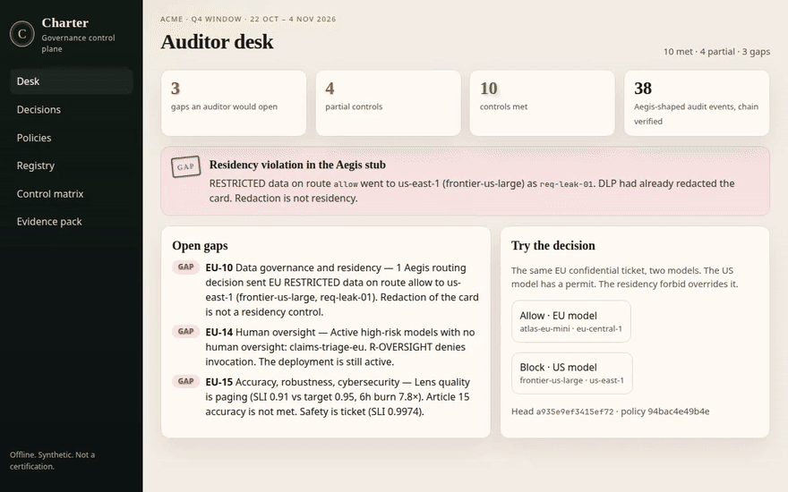
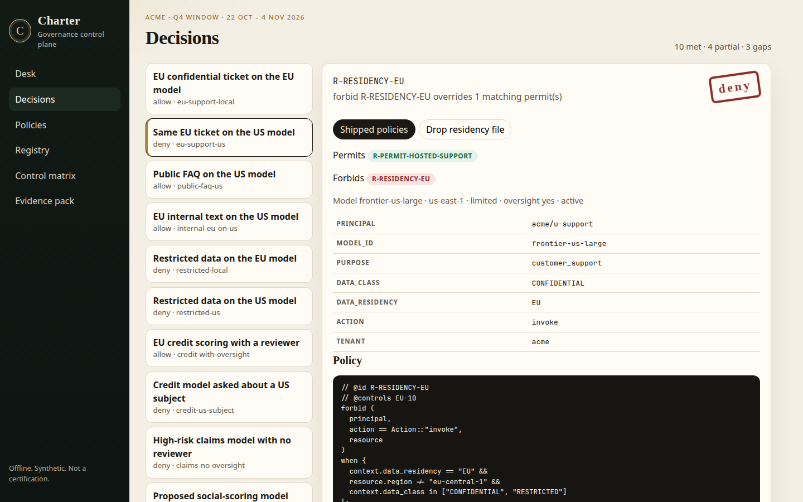
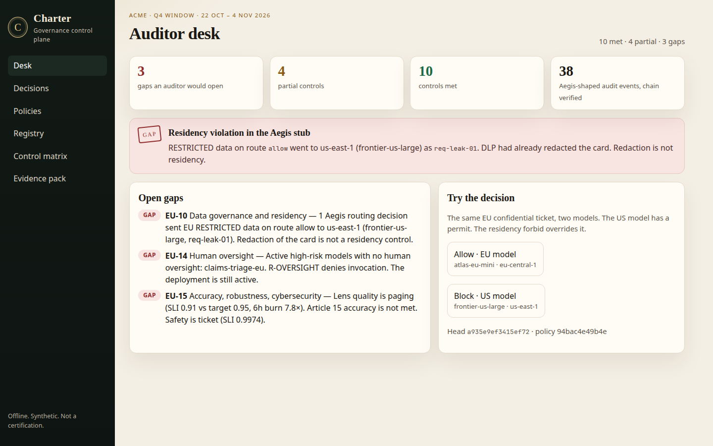
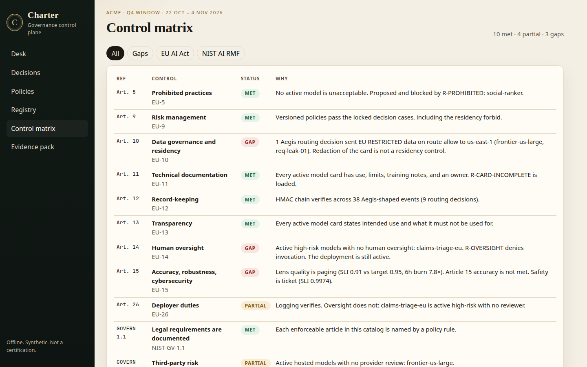
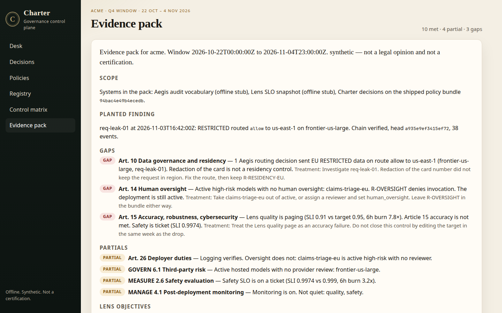
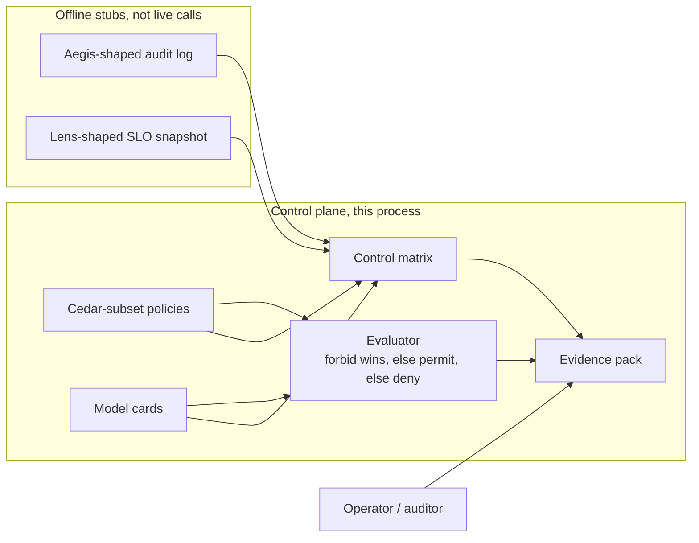
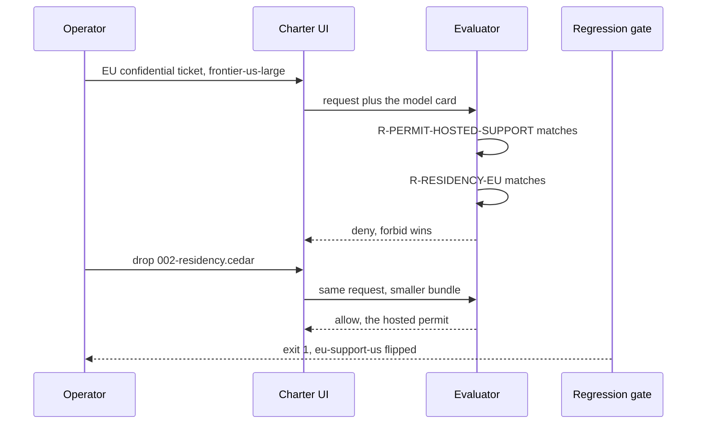
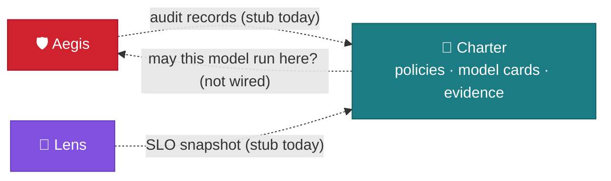

<div align="center">

# 📜 Charter

Which models may run, on whose data, in which region, and can you show the work?

[](https://github.com/kumarlakshya24/personal-projects/actions/workflows/charter.yml)

[](../LICENSE)


[Overview](#overview) ·
[Quickstart](#quickstart) ·
[Usage](#usage) ·
[Architecture](#architecture) ·
[Design decisions](#design-decisions) ·
[Results](#results) ·
[Project layout](#project-layout) ·
[Where it fits](#where-it-fits) ·
[Documentation](#documentation) ·
[Limitations](#limitations)



<sub>The desk names the gap. The EU ticket is denied on the US model. Drop the residency file and that same permit allows it. The matrix stays red on the controls that are not met.</sub>

</div>

---

## Overview

Aegis decides one prompt. Lens tells you quality moved. Neither one can answer an auditor who asks which models are allowed to run, where the data is allowed to go, and which control is actually failing.

Charter is that control plane. Policies are a small Cedar-style language (`permit` / `forbid` / `when`) evaluated in process. A model registry holds the cards. A residency forbid blocks EU confidential data from a model outside `eu-central-1`, even when a broader permit would have allowed the call. An evidence pack maps the result onto EU AI Act articles and NIST AI RMF subcategories, using an Aegis-shaped audit stub and a Lens-shaped SLO snapshot.

Everything below runs offline. No API key, no network, synthetic tenants only. The pack says it is not a legal opinion, because it is not one.

The questions Charter is built to answer:

* Is this model allowed to see this class of data, for this purpose, in this region?
* If a permit is wide, which forbid still wins?
* Which article or NIST subcategory is met, partial, or a gap, and what would close it?
* If someone deletes the residency file, does CI notice?

The decision is deterministic code. A model is not asked whether the request was compliant. The evidence is a mapping over stubs Charter can recompute, not a generated paragraph.

## Quickstart

Python 3.12. No Docker.

```bash
cd charter
python3 -m venv .venv && . .venv/bin/activate
make install
make test            # 20 tests, no network
make eval            # matrix, both gates, writes reports/
make gate            # shipped policies, exit 0
make gate-weakened   # residency file removed, exit 1
make demo
make up              # UI at http://127.0.0.1:8097
```

There is no provider key on this path. `.env.example` only documents `CHARTER_PORT` and the published demo key for the synthetic audit chain. That key is not a credential. The process does not read `.env` by itself.

## Usage

### Demo


[](docs/assets/charter-demo.mp4)

Click the image to open the silent video. It is the same recording as the clip above ([`charter-demo.mp4`](docs/assets/charter-demo.mp4), about 10 seconds).

The sixty-second path: open the desk, block the EU ticket on the US model, drop `002-residency.cedar`, watch the same request flip to allow, then read the three gaps.








What you should see in the UI:

1. **Desk.** 3 gaps, 4 partial, 10 met. One Aegis routing decision, `req-leak-01`, sent EU `RESTRICTED` data on route `allow` to `us-east-1`. DLP had already redacted the card. Redaction is not residency.
2. **Decisions, shipped policies.** `eu-support-us` is **deny**, primary rule `R-RESIDENCY-EU`. The hosted support permit matched. The forbid overrode it. The same ticket on `atlas-eu-mini` is **allow**.
3. **Drop residency file.** The same case becomes **allow** under `R-PERMIT-HOSTED-SUPPORT`. That is the change `make gate-weakened` rejects.
4. **Matrix and pack.** EU-10 (the leak), EU-14 (`claims-triage-eu` is active high-risk with no reviewer), EU-15 (Lens quality is paging). The footer says synthetic, not a certification.

## Architecture

Charter is a control plane. It does not sit on the chat request. The full argument, including what was rejected and what breaks at 10×, is [ARCHITECTURE.md](ARCHITECTURE.md).





| Module | Responsibility |
|---|---|
| [`charter/policy/`](charter/policy/) | Parse and evaluate the Cedar subset. Unknown syntax is an error. Unknown paths fail closed. |
| [`charter/registry/`](charter/registry/) | Model cards. Scalars on the card are what a `when` clause can compare. |
| [`charter/ingest/aegis.py`](charter/ingest/aegis.py) | Read an Aegis-shaped JSONL log and recompute the HMAC chain. Does not import Aegis. |
| [`charter/ingest/lens.py`](charter/ingest/lens.py) | Read a Lens-shaped SLO snapshot. Targets are the Lens contract. Does not import Lens. |
| [`charter/mapping/`](charter/mapping/) | Status for each catalog control. A control with no function is `unmapped`, and eval fails. |
| [`charter/evidence/`](charter/evidence/) | The pack, the locked cases, and both gates. |
| [`charter/api/`](charter/api/) | Local UI on `127.0.0.1:8097`. |

## Design decisions

| Decision | Record |
|---|---|
| A Cedar subset, evaluated in this process, not a shell-out to OPA or full Cedar | [ADR 0001](docs/adr/0001-cedar-subset-in-process.md) |
| A matching forbid wins. A request that matches nothing is denied | [ADR 0002](docs/adr/0002-forbid-overrides-default-deny.md) |
| Aegis and Lens are shaped stubs. Charter does not import either project | [ADR 0003](docs/adr/0003-stubs-not-live-calls.md) |
| The control matrix is a mapping we wrote, not a certificate | [ADR 0004](docs/adr/0004-matrix-is-a-mapping.md) |

## Results

Numbers are from `make eval` and [`reports/latest/summary.md`](reports/latest/summary.md). The matrix is the shipped policies plus the committed stubs. It is supposed to contain gaps. A pack that was all green would be hiding `req-leak-01`.

| | |
|---|---|
| Controls | **10 met, 4 partial, 3 gap** (17 in the catalog) |
| Locked cases | 15. Shipped gate passes. |
| Residency file removed | Gate **fails** on 3 cases. `eu-support-us` flips deny → allow. |
| Decision latency | p50 **9.9 µs**, p95 **11.8 µs**, p99 **14.3 µs** (2,000 rounds of the residency deny) |
| Audit stub | **38** events, chain verifies, **1** residency violation |
| Provider cost | **$0**. Projected external review of this pack: **$0.054** (labeled projection, not an invoice) |

The three gaps:

| Control | Why it is a gap |
|---|---|
| EU-10 Data governance | `req-leak-01` routed EU `RESTRICTED` data `allow` to `us-east-1` on `frontier-us-large`. |
| EU-14 Human oversight | `claims-triage-eu` is active, high-risk, and has no reviewer. `R-OVERSIGHT` denies the call. The deployment is still active. |
| EU-15 Accuracy | The Lens quality objective is paging (SLI 0.91 vs target 0.95). |

Partials, so they are not quietly called met: deployer duties while the claims model is unstaffed (EU-26), third-party review of `frontier-us-large` (GOVERN 6.1), the safety SLO on a ticket (MEASURE 2.6), and post-deployment monitoring while quality or safety is noisy (MANAGE 4.1).

What the latency number is: one in-process evaluation of the interesting case, card already bound, no disk. It is not a network round trip and not an auditor's reading time.

What the $0.054 is: 8,000 input tokens and 2,000 output tokens at the stand-in prices in `eval/pricing.yaml`. `make eval` does not call a model.

## Project layout

```
charter/
├── ARCHITECTURE.md
├── Makefile  pyproject.toml  requirements*.txt  .env.example
├── charter/
│   ├── policy/            Cedar-subset parser and evaluator
│   ├── registry/          model cards
│   ├── ingest/            Aegis-shaped log, Lens-shaped SLO snapshot
│   ├── mapping/           control matrix
│   ├── evidence/          pack and both gates
│   ├── api/               local UI
│   └── cli.py
├── policies/              001-safety, 002-residency, 003-permits
├── registry/models.yaml
├── catalog/controls.yaml
├── fixtures/              committed Aegis audit log and Lens SLO snapshot
├── eval/                  locked cases and the stand-in price list
├── reports/latest/        matrix, summary, evidence pack
├── docs/adr/              four decision records
└── tests/
```

## Where it fits



| Link | What crosses it | Status |
|---|---|---|
| [Aegis](../secure-ai-gateway/) → Charter | Audit records: event types, routes, labels, HMAC chain | ✅ Tested against a committed stub with Aegis's field names and hash construction. ⚠️ Aegis does not export to Charter. Region, model, and data residency are join fields on the stub. |
| [Lens](../lens/) → Charter | SLO targets and status (`within_budget`, `ticket`, `page`) | ✅ Targets match Lens `eval/slo.yaml` (0.995 / 0.99 / 0.95 / 0.999). ⚠️ The snapshot is hand-shaped, not a live Lens export. Quality is paging on purpose. |
| Charter → [Aegis](../secure-ai-gateway/) | "May this model run here?" | ⚠️ Not wired. The intended production shape is a signed bundle Aegis pins, or a call Aegis makes before it chooses a route. Today the UI is the only caller. |

<sub>See the <a href="../README.md">platform overview</a> for how the projects connect.</sub>

## Documentation

| Doc | What it is |
|---|---|
| [ARCHITECTURE.md](ARCHITECTURE.md) | What was rejected, and what breaks at 10× |
| [docs/adr/](docs/adr/) | The four records above |
| [docs/FAILURE_MODES.md](docs/FAILURE_MODES.md) | Language limits, trusted regions, and the gate's blind spots |
| [Design walkthrough](docs/INTERVIEW_WALKTHROUGH.md) | The same design, spoken. `make interview` prints it |
| [reports/latest/summary.md](reports/latest/summary.md) | The matrix this page quotes |

## Limitations

* The policy language has no groups, no entity hierarchy, and no arithmetic. "EU staff" is not a principal. See [docs/FAILURE_MODES.md](docs/FAILURE_MODES.md).
* Residency trusts the region written on the card. It does not watch a packet.
* `INTERNAL` data may use the US model. That is a line in `002-residency.cedar`, and there is a locked case that allows it.
* Deleting the residency file does not allow every confidential call. It allows the one the wide permit covers. The gate checks rule ids, not only allow/deny, so the other two still fail.
* The catalog is a mapping we wrote. It is not a conformity assessment, and it is not a legal opinion.
* Known gaps are the point of the demo. Closing them without changing the fixture would be hiding the finding.
