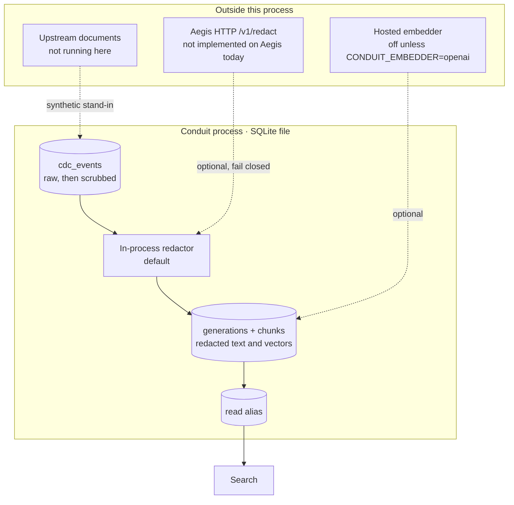
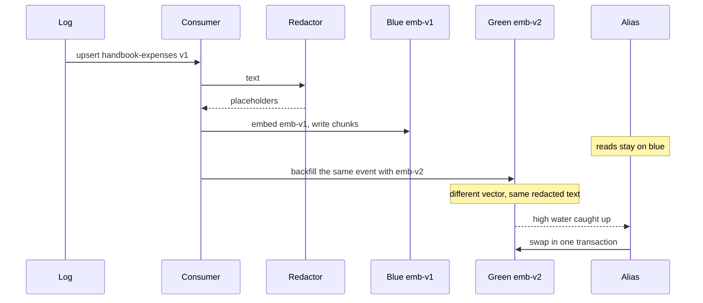
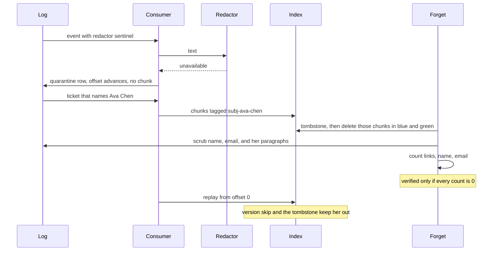

# Architecture

Conduit turns a stream of document changes into a vector index that can change embedding models without mixing spaces, and can forget a person without hoping a filter stays on.

Lumen (`rag-knowledge-assistant/app/ingestion/pipeline.py`) already does the document-level half of this. It hashes chunk text, reuses the embedding when the hash matches, and deletes plus inserts one document's chunks in a single transaction. That is correct for one writer, one model, and one table. Conduit keeps the hash reuse and adds the pieces that indexer does not have: a durable log, a generation alias, a second model, and a subject erasure with a proof.

## Trust boundary

The default path never leaves the process. The log is inside the trust boundary, so a forget that only deletes vectors and leaves the raw event is not a forget. The scrub is part of the proof.

Search does not accept a caller-supplied vector. The query is redacted and embedded with the active generation's model. A client that cached `emb-v2` vectors and then rolled back would otherwise search the wrong space.

## Decisions at a glance

| Question | Decision | Rejected |
|----------|----------|----------|
| Can two models share an index if the dimension matches? | No. A generation has one `model_version`. The alias points at one generation. | Filter by model at query time. One bug returns the wrong space, and `emb-v1` / `emb-v2` are the same width on purpose. |
| What do readers see during a re-embed? | The old generation. The new one is `building` until its high water meets the old one and the consumer is at the log head. | Stop-the-world. In-place overwrite. Read from both and merge. |
| When is a new event written to both? | When the shadow's high water is exactly the previous seq, so the shadow has no gap. Otherwise only the active generation is updated and backfill fills the gap. | Always write to both, which skips the gap and then looks caught up. |
| What is an erasure? | Tombstone, delete matching chunks in every generation, scrub the log, drop unused cache rows, then count. The handler rolls back unless the count is zero. | A search filter. A delete from the active generation only. Encrypt-per-user, which is a different product. |
| What if the redactor throws? | Quarantine the event, advance the offset, do not embed. Retry is explicit. | Block the log forever. Embed the raw text and clean it up later. |
| What if the same version is delivered twice? | Skip. High water only moves forward. | Exactly-once across the embedder. At-most-once, which drops updates. |

## Happy path

An update that changes one paragraph re-embeds that paragraph. The other chunks hit the cache key `(model_version, content_hash)`. On the eval corpus that is 60 reused and 30 embedded across 30 updates.

## Failure path

A new generation built after the scrub replays the log from an empty high water. That is the case the version check does not cover, and it is why the log body has to change. The eval builds that generation and checks the link count is still zero.

## Apply rules

For one event, inside one transaction, for each target generation:

| Situation | What is written |
|-----------|-----------------|
| `delete` | The document's chunks are removed. |
| Every declared subject is tombstoned | The document is removed and not rewritten. |
| Redactor raises | Quarantine row. No chunk. Offset still advances. |
| `doc_version` is older or equal | Nothing. High water does not move backward. |
| Otherwise | Chunks whose subject set hits a tombstone are dropped. The rest are embedded or reused, then the document's rows are replaced. |

Chunks are packed only while consecutive paragraphs share a subject set. Overlap inside one oversized paragraph is zero in this build. A non-zero overlap would pull a person's tokens into the next piece, and that piece would be deleted with them. That widening is the reason the default is zero. It is called out in [FAILURE_MODES](docs/FAILURE_MODES.md).

## Generations

`blue` is created active on `emb-v1`. Migration creates the other color as `building` on the requested model. If that color is `retired`, it is purged first. Rollback points the alias at the previous generation that still exists. Rollback does not resurrect a forgotten subject, because the tombstone sweep already visited every generation, including the retired one.

The fake embedder is feature hashing: tokens, two hashes, a salt per model version, L2 norm. Placeholders such as `[person:subj-ava-chen]` stay one token. Splitting them on the hyphen made every person share the tokens `person` and `subj`, so a query for one person ranked the others. `emb-v1` and `emb-v2` differ only by salt. Same text, different vector. Same salt, identical vector.

Search drops scores under 0.25. On this dimension that band is a shared function word or a one-bucket collision. After a successful forget, a query for the subject's email scores 0.

## Cost and latency

| Figure | Value | Kind |
|--------|-------|------|
| Apply p50 / p95 / p99 | 0.3475 / 0.4222 / 0.5312 ms | Measured, n=221, fake embedder, no network |
| Tokens per synthetic doc | 160.12 (`chars/4`) | Measured on the indexed corpus |
| $ / M docs at that size, $0.02 / M tokens | 3.2024 | Projection |
| $ / M docs, 2,000-token memo, same price | 40 | Projection, token count assumed |
| $ / M docs, 8,000-token policy, same price | 160 | Projection, token count assumed |
| $ / M docs, 8,000 tokens at $0.13 / M tokens | 1040 | Projection |
| Migration embeds | 570 calls, 60 reused inside the new model | Measured |

The formula is `tokens_per_doc * usd_per_million_tokens`. A million documents at 160 tokens is `160 * 0.02 = 3.20` dollars at the small-model list price. Prices live in `eval/pricing.yaml` and are labeled illustrative. Re-check them before a budget.

A model change bills a full pass over distinct chunk hashes. Unchanged-model updates bill the changed chunks. That split is the Lumen property Conduit keeps.

## What breaks at 10×

Ten times the corpus here is still small. The breaks that matter are the ones past a single SQLite writer and a brute-force scan.

| At 10× and beyond | What fails | What you keep |
|-------------------|------------|----------------|
| One process, one writer | A second consumer corrupts the offset. The lock is in-process. | The log is still the source of truth. Put a lease on the consumer and partition by `doc_id`. |
| Brute-force cosine | Fine at a few hundred chunks. Painful once the active generation is millions of rows and the query is on the user path. | The alias and the one-model rule. Swap the scorer for HNSW or pgvector per generation. Do not put both models in one graph. |
| Dual-write disk and embed cost | Two full copies until the old generation is purged. Embed cost doubles for the delta during the migration. | The caught-up check. Do not swap early to save the copy. |
| Erasure | Inline delete of every matching row will not meet a clock if the sweep is huge. Backups and replicas still hold the bytes. | Tombstone first, so new writes cannot reinsert while a background sweep runs. Delete the replicas on purpose. The proof here covers this file only. |
| Redactor outage | Quarantine grows. Those events are not searchable until retry. | Fail closed per event. A stalled log is the alternative, and it is worse for every other document. |

## Numbers that are not claims

Recall@1 is 20 planted keywords on the hash embedder, not a benchmark against a neural model. The latency has no provider RTT in it. The dollar figures are not a bill. Aegis is not called unless you set a URL, and that URL is not a route Aegis serves today.
