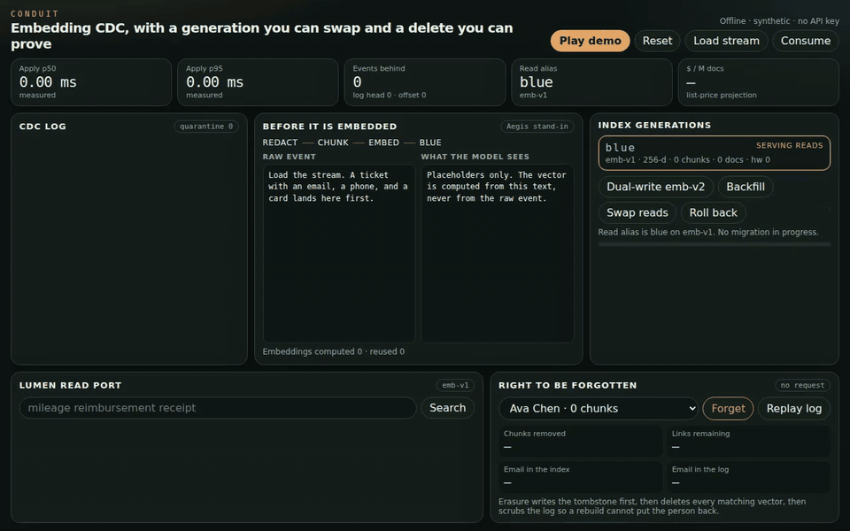
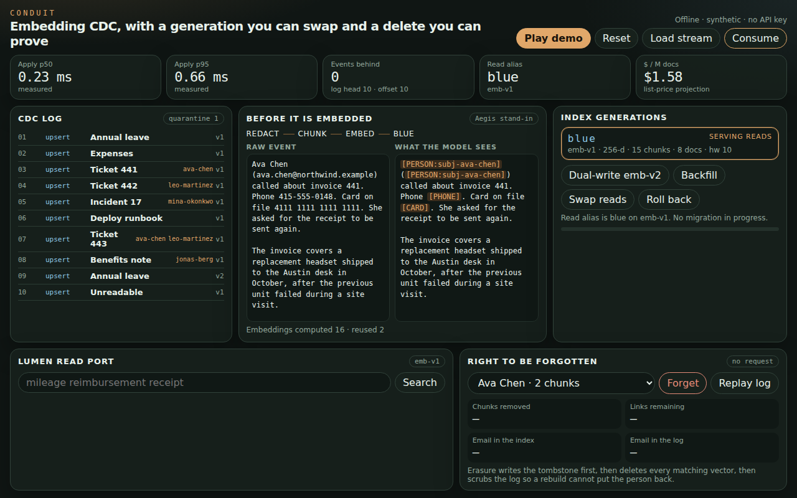
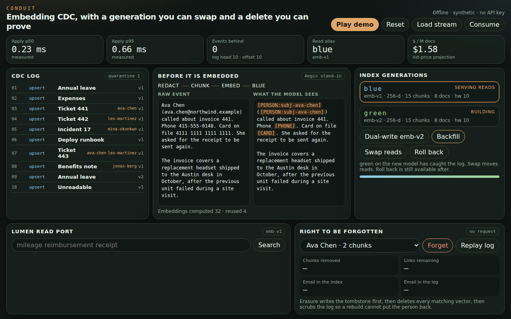
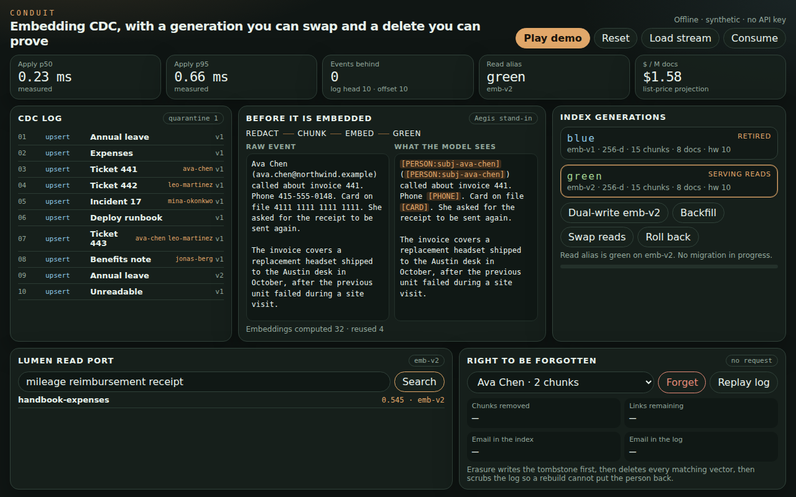
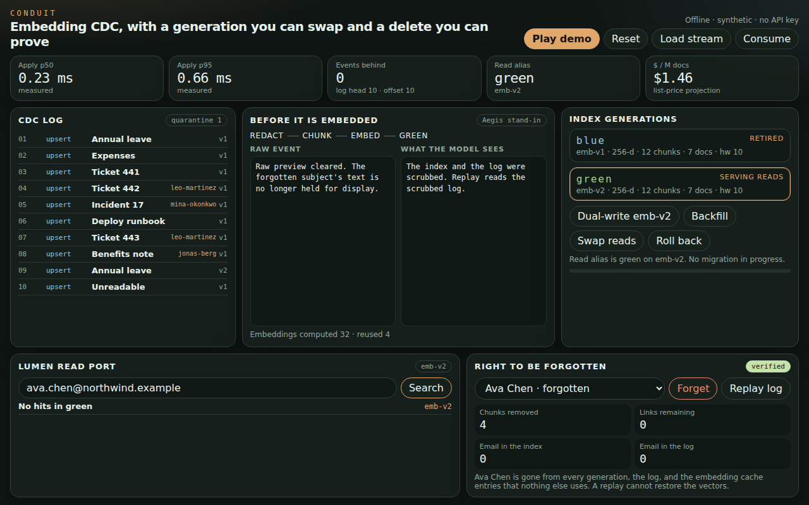
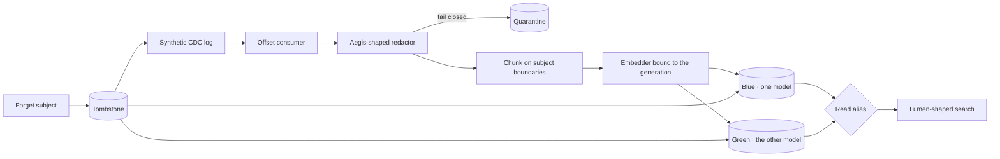
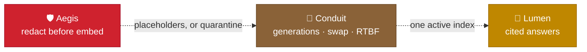

<div align="center">

# 🔌 Conduit

The embedding index stays on one model, swaps when the next model is ready, and can prove a person is gone.

[](https://github.com/kumarlakshya24/personal-projects/actions/workflows/conduit.yml)


[Overview](#overview) ·
[Quickstart](#quickstart) ·
[Usage](#usage) ·
[Architecture](#architecture) ·
[Design decisions](#design-decisions) ·
[Results](#results) ·
[Project layout](#project-layout) ·
[Where it fits](#where-it-fits) ·
[Documentation](#documentation) ·
[Limitations](#limitations)



<sub>CDC events fill the blue index, a second embedding model backfills in green, the read alias swaps, and a forgotten person's vectors stay gone after a replay.</sub>

</div>

---

## Overview

Lumen already re-embeds a changed chunk and leaves the unchanged ones alone. That is the right indexer for one process and one embedding model. It is not a data plane. A model change writes vectors from two spaces into the same index, readers see a half-built generation, and deleting a document does not forget a person who is mentioned in ten other documents.

Conduit is that data plane, offline:

* **A log, then an index.** Synthetic CDC events are appended, then applied from a stored offset. A crash replays. A repeated `doc_version` does not rewrite.
* **One model per generation.** `emb-v1` and `emb-v2` use the same dimension on purpose. A dimension check would not save you. The read alias points at one generation, and every vector in it was embedded with that generation's model.
* **Dual-write, then swap.** The new model backfills while the old one keeps serving. A new event is written to both once the shadow is contiguous. Swap is refused until the high-water marks meet.
* **Forget a person, and prove it.** The tombstone is written first. Chunks that contain the subject are deleted from every generation. The log is scrubbed, so a later rebuild cannot put the vectors back. The API returns the proof only when the remaining count is zero.

The redactor in front of the embedder is an Aegis-shaped stand-in. Emails, phones, cards, and the subject's name become placeholders. The raw string is not what gets embedded.

No API key. No network. The corpus is synthetic.

## Quickstart

Python 3.12.

```bash
cd conduit
make install
make test
make eval
make up
```

`make up` serves the UI on `127.0.0.1:8098`, so it can run beside Charter on 8097. Copy `.env.example` only if you want a different embedder or an Aegis URL. The default is the in-process fake embedder. Nothing in `make test`, `make eval`, or `make demo` reads a key.

| Target | What it does |
|--------|----------------|
| `make up` | Demo UI |
| `make test` | Unit and API tests |
| `make eval` | Recall, reuse, migration, RTBF, latency, cost. Rewrites `reports/eval.json` |
| `make demo` | The story in the terminal. Prints `PASS` or `FAIL` |

## Usage

[](docs/assets/demo.mp4)

Click the image to open the video ([`demo.mp4`](docs/assets/demo.mp4)). It is the same UI session as the clip at the top of this page: the stream lands, PII is replaced before it is embedded, `emb-v2` catches up, reads swap, and forgetting Ava Chen leaves a verified zero that a log replay does not undo.

```bash
cd conduit
make install
make demo          # the story, in the terminal
make up            # http://127.0.0.1:8098
```

1. **Play demo** appends ten synthetic events and applies them one at a time. Ticket 441 shows the raw email, phone, and card, and the placeholders the embedder actually sees.
2. **Dual-write emb-v2** builds the green generation from the log. The blue generation keeps the read alias.
3. **Swap reads.** Search for `mileage reimbursement receipt` hits the expense policy, embedded with `emb-v2`.
4. **Forget Ava Chen.** The proof shows the chunks removed and zeros for her email in the index and in the log. Replay reads the scrubbed log. The search for her email returns nothing.







## Architecture



Readers never see both models. The alias is one row. Swap updates it in the same transaction that marks the old generation retired.

The rejected alternatives, the failure sequence, and what breaks at 10× are in [`ARCHITECTURE.md`](ARCHITECTURE.md).

## Design decisions

Each record names what was chosen, what was rejected, and what the choice costs.

| Decision | Record |
|----------|--------|
| One vector space per generation | [ADR 0001](docs/adr/0001-one-model-per-generation.md) |
| Dual-write, swap only when caught up | [ADR 0002](docs/adr/0002-dual-write-then-swap.md) |
| Tombstone, delete, scrub, then a zero count | [ADR 0003](docs/adr/0003-tombstone-then-prove-zero.md) |
| At-least-once apply, quarantine when redaction throws | [ADR 0004](docs/adr/0004-log-offset-and-fail-closed-redaction.md) |

## Results

Measured, and regenerated by `make eval`.

| What | Result | Source |
|------|--------|--------|
| Recall@1 | **20 / 20** before the swap and **20 / 20** after the read alias moves to `emb-v2` | [`reports/eval.json`](reports/eval.json) |
| Unchanged chunks | On 30 updated docs, **2 of 3** chunks are reused: **60 reused, 30 embedded** (rate **0.6667**) | same file, `make eval` |
| Model migration | **570** embed calls on the new model, **60** of them reused inside that model, **516** chunks left in the shadow after deletes | same file |
| Right to be forgotten | **0** subject links remain. A full rebuild from the scrubbed log restores **0**. The other person on a mixed ticket is still there | same file |
| Poison events | **3 quarantined, 0 indexed** | same file |
| Apply latency | p50 **0.3435 ms**, p95 **0.4614 ms**, p99 **0.5956 ms** (n=221), fake embedder, this machine | `lag_ms` in the JSON |
| Cost projection | Measured size (**160.12** tokens/doc): **$3.2024 / M docs** at a $0.02 / M token list price. A 2,000-token memo is **$40**. An 8,000-token policy is **$160**. Local CPU API cost is **$0** | `eval/pricing.yaml`, labeled as a projection |
| Tests | **17** | `make test` |

The latency numbers are a measurement of this process, not of a hosted embedder. The dollar figures are list-price arithmetic on `chars/4`. They are not an invoice. A real model change costs about one full re-embed: the 570 calls above, not another 60 from the chunks that did not change.

## Project layout

```
conduit/
├── ARCHITECTURE.md
├── Makefile
├── conduit/                 log, redactor, embedder, generations, RTBF, API
├── eval/pricing.yaml        list prices used for the projection
├── reports/eval.json        output of make eval
├── tests/
├── docs/adr/
├── docs/INTERVIEW_WALKTHROUGH.md
├── docs/FAILURE_MODES.md
└── docs/assets/             UI captures, demo.gif, demo.mp4
```

## Where it fits



| Neighbour | Relationship | Status today |
|-----------|----------------|--------------|
| [🔦 Lumen](../rag-knowledge-assistant/) | Lumen's indexer already reuses a chunk by content hash and swaps one document's chunks in a transaction. Conduit is that idea lifted to the index: a log, a generation alias, a second model, and erasure by subject. | ⚠️ Not wired. Lumen still embeds into its own Postgres. Conduit's `GET /api/search` is the read port Lumen would call. |
| [🛡️ Aegis](../secure-ai-gateway/) | Raw identifiers should be tokenized before a vector exists. | ✅ Tested against an in-process stand-in with the same idea as Aegis DLP: find, replace, and fail closed. ⚠️ Aegis has `/chat` and `/vault/detokenize`, not `POST /v1/redact`. If `CONDUIT_AEGIS_URL` is set and the call fails, the event is quarantined and not embedded. |

<sub>See the <a href="../README.md">platform overview</a> for how the projects connect.</sub>

## Documentation

| Doc | What it is |
|---|---|
| [`ARCHITECTURE.md`](ARCHITECTURE.md) | The design, the rejected alternatives, and what breaks at 10× |
| [`docs/adr/`](docs/adr) | The four decision records listed above |
| [`docs/FAILURE_MODES.md`](docs/FAILURE_MODES.md) | Crash, replay, poison events, and a failed redaction |
| [Design walkthrough](docs/INTERVIEW_WALKTHROUGH.md) | The same design, spoken. `make interview` prints it |

## Limitations

Conduit proves its own log and its own indexes. It does not erase the upstream system that produced the CDC event, the demo script in this repository, or a backup you took yesterday. Erasure deletes a chunk, not a span inside a vector, so a neighbor sentence in the same paragraph goes with the person. A nickname that is not in the subject directory and not declared on the event is not linked, and forget will not find that vector. The fake embedder's recall is on this corpus and this hash. It is not a claim about MiniLM or a hosted model. The p95 above has no network in it. See [`docs/FAILURE_MODES.md`](docs/FAILURE_MODES.md).
