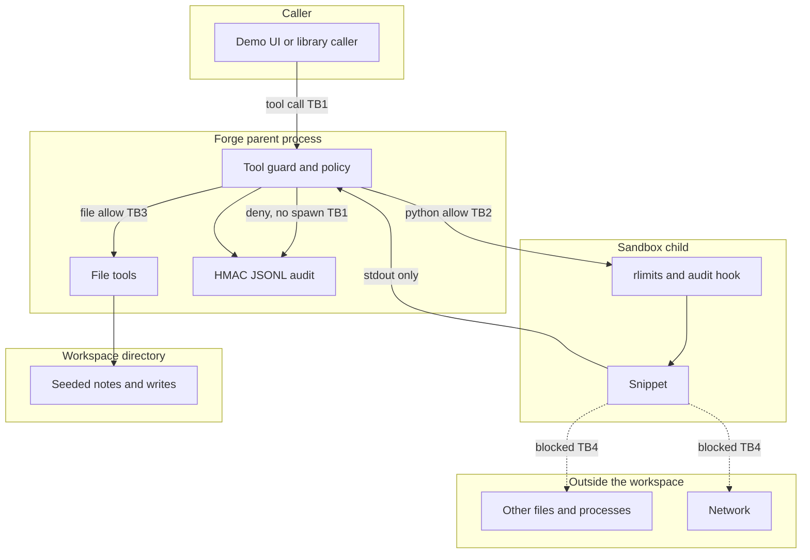
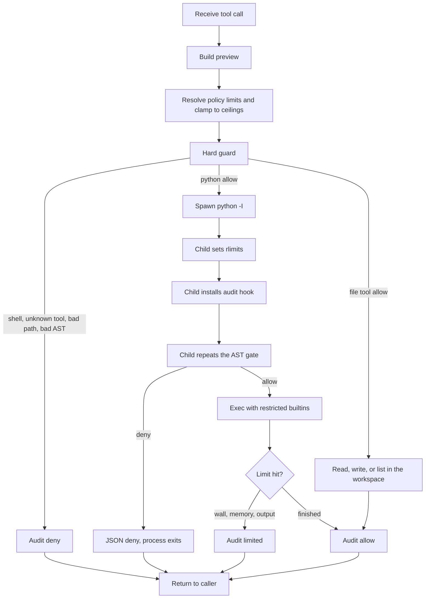
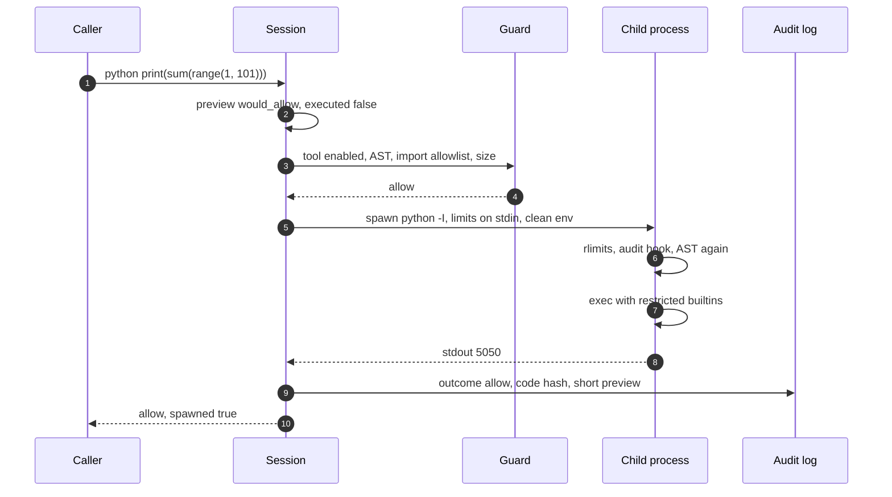
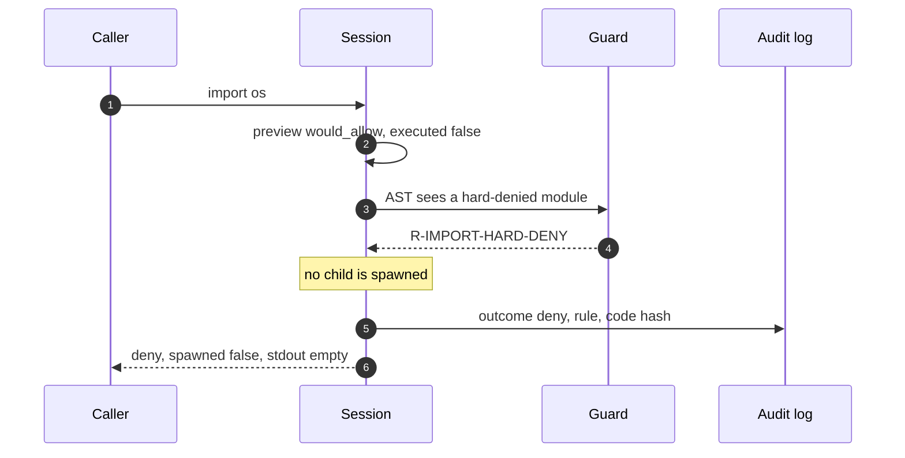

# Forge architecture

Forge decides whether an agent tool call may run, runs the allowed ones in a short-lived interpreter, and records the decision. The demo is offline. The workspace files are synthetic.

Measured numbers live in `reports/`. This document is the design.

---

## 1. Assumptions

| # | Assumption | Why it is the default |
|---|------------|------------------------|
| A1 | The caller is already inside the product. Forge is the tool boundary, not an identity provider. | Auth is a different problem. Aegis covers it. |
| A2 | The default demo runs without Docker, root, or a network namespace. | `make test` and `make demo` have to work on a laptop. |
| A3 | File tools are the only way to touch the workspace. Snippets do not get `open`. | A snippet that can open files is a second, harder policy. |
| A4 | English identifiers, Python 3.11+. | The gate is an AST walk, not a model. |
| A5 | Denied calls are not executed, including in the demo's "unprotected" pane. | The repo must not ship a working abuse of the host. |
| A6 | One tenant, one workspace per session. | Enough to show isolation. Multi-tenant quotas are out of scope. |

---

## 2. Trust boundaries

| ID | Boundary | What may cross | Control |
|----|----------|----------------|---------|
| TB1 | Caller to guard | Tool name and arguments | Allowlisted tools, path rules, AST gate, size caps. A deny does not spawn. |
| TB2 | Guard to child | The snippet and the limit numbers, on stdin | Fresh process, cleaned environment, `python -I`, no audit key in the environment. |
| TB3 | File tools to workspace | Relative paths | Lexical rejection of `..` and absolute paths, symlink refusal, size cap. |
| TB4 | Child to host and network | Nothing intended | Hard-denied imports, restricted builtins, audit hook on process and socket events, `open` only under the stdlib prefix. |
| TB5 | Parent to audit log | Redacted decision records | HMAC chain. The log stores a hash and a short preview, not a second copy of every file. |

---

## 3. Sandbox lifecycle

The preview is computed on every call and is not an execution. `executed` is always false on that object.

---

## 4. Sequences

### 4.1 Allowed tool run

### 4.2 Blocked escape

The same shape covers path traversal (`R-PATH-TRAVERSAL`) and the shell tool (`R-TOOL-NO-EXECUTOR`). A path or import decision that fails the guard never reaches `SandboxRunner`.

A second line exists for cases the parent allowed and the child still refuses. If a caller invokes the runner directly with `os` on the allowlist, the child returns `R-IMPORT-HARD-DENY` and does not print. If a policy grants `pathlib`, `Path.read_text` still dies with `R-SANDBOX-OPEN` because the audit hook rejects opens outside the standard library.

---

## 5. Components

| Piece | Module | Job |
|-------|--------|-----|
| Policy | `forge/policy/` | YAML schema. Network must be `deny`. Numbers clamp to ceilings. |
| Import rules | `forge/guard/imports.py` | Hard deny, then policy deny, then allowlist. |
| AST gate | `forge/guard/ast_guard.py` | Snippet only. Imports, names, dunder attributes. |
| Paths | `forge/guard/paths.py` | Relative, no `..`, no symlinks. |
| Preview | `forge/sandbox/preview.py` | What a raw interpreter would decide. Never runs the call. |
| Runner | `forge/sandbox/runner.py` | Spawns the child and maps timeouts and signals. |
| Child | `forge/sandbox/child.py` | Rlimits, hook, recheck, restricted `exec`. |
| Hook | `forge/sandbox/hook.py` | Blocks process, socket, and non-stdlib `open` events. |
| Audit | `forge/audit/` | Append-only HMAC JSONL, redacted. |
| Gate | `forge/policy/regression.py` | Refuses a policy that allows a locked protected case. |
| API | `forge/api/app.py` | Local UI. The regression action does not save the candidate. |

---

## 6. STRIDE

| Threat | Property | Example in this system | What Forge does |
|--------|----------|------------------------|-----------------|
| Spoofing | Authenticity of the tool | A call named `Python` or `send_email` | Unknown names are `R-TOOL-UNKNOWN`. There is no fuzzy match. |
| Tampering | Integrity of the path and the log | `../`, a symlink, an edited JSONL line | Path rules refuse the path. `verify` reports the first broken sequence. |
| Repudiation | Evidence of the decision | "That call did not happen" | Every call appends a hash-chained record with the rule and a code hash. |
| Information disclosure | Confidentiality of the host | A read outside the workspace, or a snippet that opens a file | The read is refused before I/O. Snippet `open` is not a builtin. The hook blocks other opens. The audit stores a preview, not the file body. |
| Denial of service | Availability | A tight loop, a large allocation, a huge print | Wall clock, `RLIMIT_AS`, `RLIMIT_CPU`, output cap, code-size cap. Ceilings cannot be raised by YAML. |
| Elevation of privilege | The snippet becomes the host | `import os`, a shell string, `ctypes` | Those modules are hard-denied. There is no shell executor. Policy cannot grant the hard set. |

Assets: the workspace, the host filesystem outside it, the audit log, and the ability to spawn processes or open sockets.

---

## 7. Decisions at a glance

| Decision | Choice | Alternative | Why |
|----------|--------|-------------|-----|
| Isolation primitive | Subprocess, rlimits, audit hook | Docker as the default; in-process `exec` only | One command, no daemon. In-process `exec` is not a boundary. |
| Shell | No executor | An allowlisted `sh -c` | A shell is an unbounded tool. YAML cannot create one. |
| Who can relax a rule | Code for hard denials, YAML only to shrink | A single policy file for everything | A bad edit must not enable `os` or path escape. |
| Unsafe pane | Decision preview, never executes a deny | Running the denied call for contrast | The demo must not be an exploit. |
| Audit store | HMAC JSONL | A database | Offline, one file, a verify command. |
| Network | Import gate plus hook. Schema rejects `network: allow` | A netns, which needs privileges | Works unprivileged. The gap is documented. |
| Regression | Locked case ids, fail if a protected case becomes allow | A dashboard | Weakening the policy fails `make eval`. |

ADRs: [`docs/adr/`](docs/adr/).

---

## 8. Related documents

* [`FAILURE_MODES.md`](FAILURE_MODES.md)
* [`docs/threat-model.md`](docs/threat-model.md)
* [`docs/INTERVIEW_WALKTHROUGH.md`](docs/INTERVIEW_WALKTHROUGH.md)
* [`docs/demo-script.md`](docs/demo-script.md)
