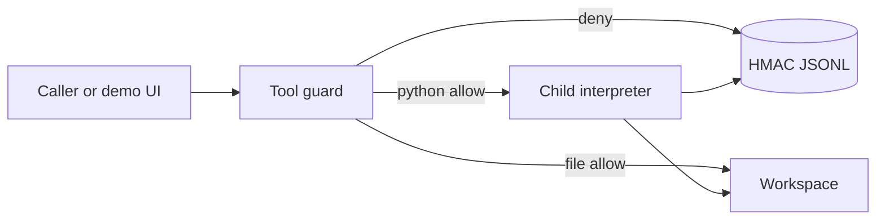

# Forge

Agents that can run tools can also read the wrong file, import the wrong module, or loop until the machine falls over. Forge is an offline demo of the control that should sit in front of that: a policy, a tool guard, a subprocess sandbox, and an append-only audit log.

A call is either refused before a process exists, or it runs in a fresh interpreter with a restricted builtin set, an audit hook, resource limits, and a workspace that is the only directory the file tools will touch. The "unprotected" pane is a decision preview. Forge does not execute a call it has decided to refuse.

No API key, no network, no Docker. Synthetic workspace files only.

---

## Results (measured)

| What | Result | Source |
|------|--------|--------|
| Demo | **12 / 12 pass**, including the wall-clock kill and the regression refusal | [`reports/demo.md`](reports/demo.md), `make demo` |
| Interview beats | **16 / 16 pass** | [`reports/interview.md`](reports/interview.md), `make interview` |
| Eval corpus | **55 / 55 (100%)**: 41 protection, 14 utility | [`reports/eval.md`](reports/eval.md) |
| Regression gate | **41 protected cases locked, 0 regressions** on the default policy. Granting `pathlib` and raising the code cap fails the gate on `prot-import-pathlib` and `prot-code-size`. `import os` stays denied. | [`reports/regression.md`](reports/regression.md) |
| Latency | Deny-before-spawn p50 **0.13 ms**, p95 **0.21 ms**. Allow, one subprocess, p50 **33.68 ms**, p95 **37.55 ms** | [`reports/latency.md`](reports/latency.md) |
| Tests | **53** unit and integration tests | `make test` |
| Security check | Passes (no private keys, no `shell=True`) | `make security-check` |

The corpus is a development set. It locks the decisions we intend to keep. It is not a claim about unknown attacks.

---

## 60-second demo

```bash
cd forge
make install
make demo          # PASS/FAIL in the terminal
make up            # http://127.0.0.1:8095
```

1. **Sum.** Both panes would allow it. The sandbox prints `5050` and writes an audit record.
2. **Traversal.** The preview says a raw file API would use that path. Forge returns `R-PATH-TRAVERSAL` and does not spawn.
3. **Imports.** `import os` and `import socket` are `R-IMPORT-HARD-DENY`. Policy cannot grant them.
4. **Weaker policy.** The regression button refuses a candidate that allows `pathlib` and a larger code cap.


The recording script is [`docs/demo-script.md`](docs/demo-script.md). A short frame sequence of the live UI is [`docs/assets/demo.mp4`](docs/assets/demo.mp4).

---

## Setup

Python 3.11+.

```bash
cd forge
make install
make test
make demo
make eval
make interview
```

`make up` serves the UI on `127.0.0.1:8095`. Optional: copy `.env.example` and set `FORGE_AUDIT_KEY`. If it is unset, Forge uses the documented demo key in `forge/config.py`. That key is a placeholder, not a credential.

---

## Architecture



The full design, trust boundaries, sandbox lifecycle, both sequences, STRIDE, and the decision table are in [`ARCHITECTURE.md`](ARCHITECTURE.md). Failure behavior is in [`FAILURE_MODES.md`](FAILURE_MODES.md). The interview script is [`docs/INTERVIEW_WALKTHROUGH.md`](docs/INTERVIEW_WALKTHROUGH.md).

---

## What a call can do

| Tool | Behavior |
|------|----------|
| `python` | Snippet in a child process. Allowlisted imports only. No `open`, `eval`, or dunder walks in the snippet. |
| `read_file` / `write_file` / `list_dir` | Workspace-relative paths. `..`, absolute paths, and symlinks are refused. |
| `shell` | No executor. Enabling it in YAML does not create one. |

Hard denials live in `forge/guard/constants.py`. The YAML file can only shrink the allowlist. Network cannot be switched to allow: the schema rejects `network: allow`.

---

## Layout

```
forge/
├── ARCHITECTURE.md
├── FAILURE_MODES.md
├── Makefile
├── forge/                 package: guard, policy, sandbox, audit, API
├── eval/cases/corpus.jsonl
├── eval/regression/baseline.json
├── tests/
├── docs/adr/
├── docs/INTERVIEW_WALKTHROUGH.md
├── docs/demo-script.md
├── docs/assets/           UI captures
└── reports/               generated by make demo / eval / interview
```

---

## Limits, said plainly

Forge is not a hypervisor and not a container. The child is a subprocess of the same user. The wall clock, the address-space limit, the audit hook, and the import gate are real controls against the mistakes and the snippets in this corpus. They are not a claim that a hostile native payload cannot escape a same-user process. That residual risk is the reason a production deployment would add a container or a separate sandbox user on top of this policy layer. See [`FAILURE_MODES.md`](FAILURE_MODES.md) and [ADR 0001](docs/adr/0001-subprocess-not-container.md).
