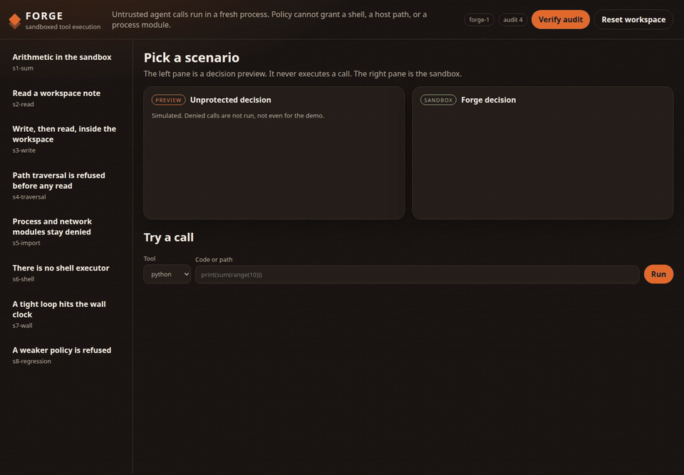
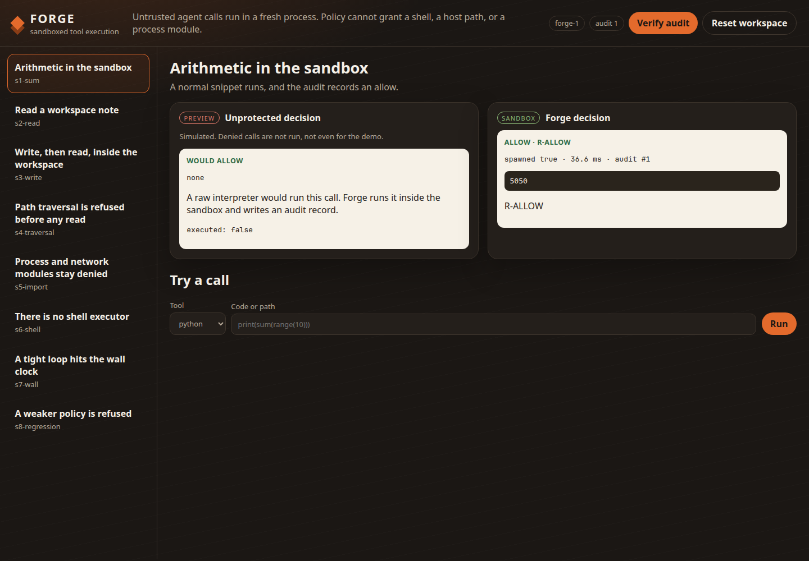
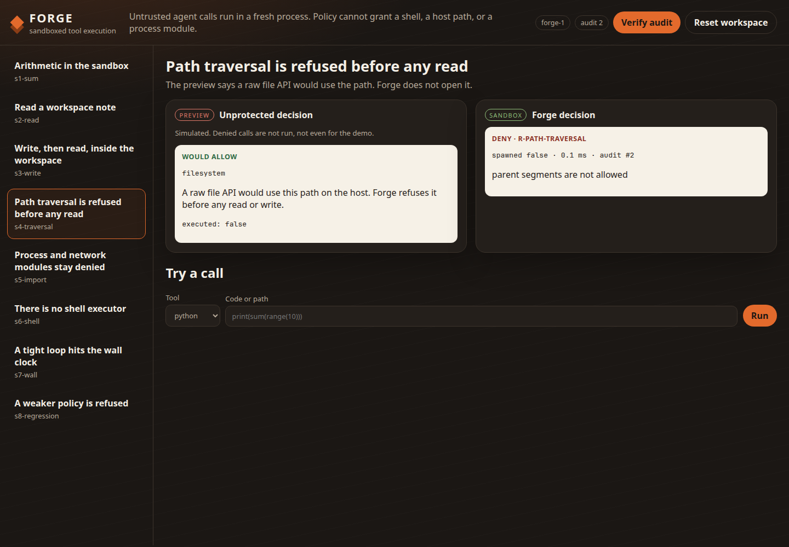
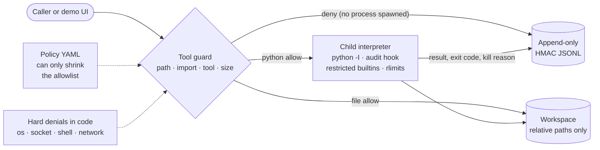
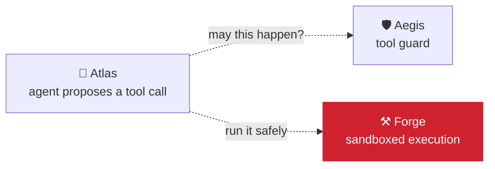

<div align="center">

# ⚒️ Forge

### A sandbox that refuses a dangerous agent tool call before a process even exists

[](https://github.com/kumarlakshya24/personal-projects/actions/workflows/forge.yml)


[**Results**](#results-measured) ·
[**60-second demo**](#60-second-demo) ·
[Setup](#setup) ·
[Architecture](#architecture) ·
[Where it fits](#-where-it-fits-in-the-platform) ·
[Limits](#limits-said-plainly)



<sub>An allowed sum runs in the sandbox. A path traversal and <code>import os</code> are refused before any process starts. A weaker candidate policy is refused by the regression gate.</sub>

</div>

---

## In plain English


An agent that can run tools can also read the wrong file, import the wrong module, or loop until the machine stalls. That call needs a control in front of it.

Forge is that control:

* **Refuse before a process exists** when the path, the import, or the tool is not allowed. `import os` and `import socket` stay denied. Policy cannot grant them, and there is no shell executor.
* **Run the rest** in a short-lived `python -I` interpreter: restricted builtins, an audit hook, resource limits, and a workspace the file tools cannot leave.
* **Record every decision** in an append-only HMAC JSONL log.

The left pane of the demo is a decision preview. It does not execute a call. The right pane is the sandbox. Forge never runs a call it has decided to refuse.

Offline. No API key, no network, no Docker. Synthetic workspace files only.

---

## Results (measured)

| What | Result | Source |
|------|--------|--------|
| Demo | **12 / 12 pass**, including the wall-clock kill and the regression refusal | [`reports/demo.md`](reports/demo.md), `make demo` |
| Interview beats | **16 / 16 pass** | [`reports/interview.md`](reports/interview.md), `make interview` |
| Eval corpus | **55 / 55 (100%)**: 41 protection, 14 utility | [`reports/eval.md`](reports/eval.md) |
| Regression gate | **41 protected cases locked, 0 regressions** on the default policy. Granting `pathlib` and raising the code cap fails the gate on `prot-import-pathlib` and `prot-code-size`. `import os` stays denied. | [`reports/regression.md`](reports/regression.md) |
| Latency | Deny-before-spawn p50 **0.13 ms**, p95 **0.21 ms**. Allow, one subprocess, p50 **33.68 ms**, p95 **37.55 ms** | [`reports/latency.md`](reports/latency.md) |
| Tests | **53** unit and integration tests | `make test` |
| Security check | Passes (no private keys, no `shell=True`) | `make security-check` |

The corpus is a development set. It locks the decisions we intend to keep. It is not a claim about unknown attacks.

---

## 60-second demo

<video src="docs/assets/demo.mp4" poster="docs/assets/ui-sum.png" controls playsinline width="960"></video>

The clip at the top of this page and this video are the same UI recording (`docs/assets/demo.mp4`, about nine seconds).

```bash
cd forge
make install
make demo          # PASS/FAIL in the terminal
make up            # http://127.0.0.1:8095
```

1. **Sum.** Both panes would allow it. The sandbox prints `5050` and writes an audit record.
2. **Traversal.** The preview says a raw file API would use that path. Forge returns `R-PATH-TRAVERSAL` and does not spawn.
3. **Imports.** `import os` and `import socket` are `R-IMPORT-HARD-DENY`. Policy cannot grant them.
4. **Weaker policy.** The regression button refuses a candidate that allows `pathlib` and a larger code cap.





The click-by-click script is [`docs/demo-script.md`](docs/demo-script.md).

---

## Setup

Python 3.11+.

```bash
cd forge
make install
make test
make demo
make eval
make interview
```

`make up` serves the UI on `127.0.0.1:8095`. Optional: copy `.env.example` and set `FORGE_AUDIT_KEY`. If it is unset, Forge uses the documented demo key in `forge/config.py`. That key is a placeholder, not a credential.

---

## Architecture



The full design, trust boundaries, sandbox lifecycle, both sequences, STRIDE, and the decision table are in [`ARCHITECTURE.md`](ARCHITECTURE.md). Failure behavior is in [`FAILURE_MODES.md`](FAILURE_MODES.md). The interview script is [`docs/INTERVIEW_WALKTHROUGH.md`](docs/INTERVIEW_WALKTHROUGH.md).

---

## What a call can do

| Tool | Behavior |
|------|----------|
| `python` | Snippet in a child process. Allowlisted imports only. No `open`, `eval`, or dunder walks in the snippet. |
| `read_file` / `write_file` / `list_dir` | Workspace-relative paths. `..`, absolute paths, and symlinks are refused. |
| `shell` | No executor. Enabling it in YAML does not create one. |

Hard denials live in `forge/guard/constants.py`. The YAML file can only shrink the allowlist. Network cannot be switched to allow: the schema rejects `network: allow`.

---

## 🔗 Where it fits in the platform



Aegis answers *whether* an agent may make a call. Forge answers *how* an allowed call that runs code or
touches files is contained. The two layers are separate on purpose: a policy mistake in one is still
caught by the other.

| Neighbour | Relationship | Status today |
|:--|:--|:--|
| [🧭 Atlas](../atlas/) | Forge is the intended executor for agent tools that run code or touch files. | ⚠️ Not wired. Atlas's demo tools are ledger, email, pager and webhook calls, not code execution. |
| [🛡️ Aegis](../secure-ai-gateway/) | Identity and prompt-injection defence happen at the Aegis boundary; Forge stays out of the auth path. | By design ([ARCHITECTURE.md, assumption A1](ARCHITECTURE.md)). |

<sub>Part of the <a href="../README.md">Enterprise AI Platform</a> portfolio: six projects that each run on their own and connect through small, documented contracts.</sub>

---

## Layout

```
forge/
├── ARCHITECTURE.md
├── FAILURE_MODES.md
├── Makefile
├── forge/                 package: guard, policy, sandbox, audit, API
├── eval/cases/corpus.jsonl
├── eval/regression/baseline.json
├── tests/
├── docs/adr/
├── docs/INTERVIEW_WALKTHROUGH.md
├── docs/demo-script.md
├── docs/assets/           UI captures, demo.mp4, and demo.gif
└── reports/               generated by make demo / eval / interview
```

---

## Limits, said plainly

Forge is not a hypervisor and not a container. The child is a subprocess of the same user. The wall clock, the address-space limit, the audit hook, and the import gate are real controls against the mistakes and the snippets in this corpus. They are not a claim that a hostile native payload cannot escape a same-user process. That residual risk is the reason a production deployment would add a container or a separate sandbox user on top of this policy layer. See [`FAILURE_MODES.md`](FAILURE_MODES.md) and [ADR 0001](docs/adr/0001-subprocess-not-container.md).
