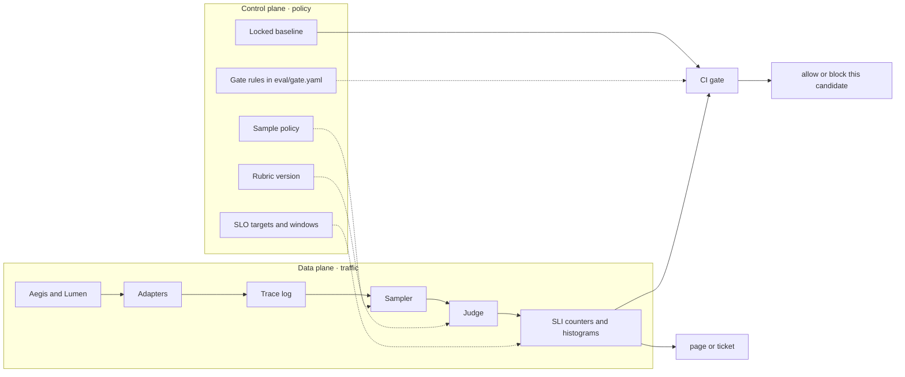
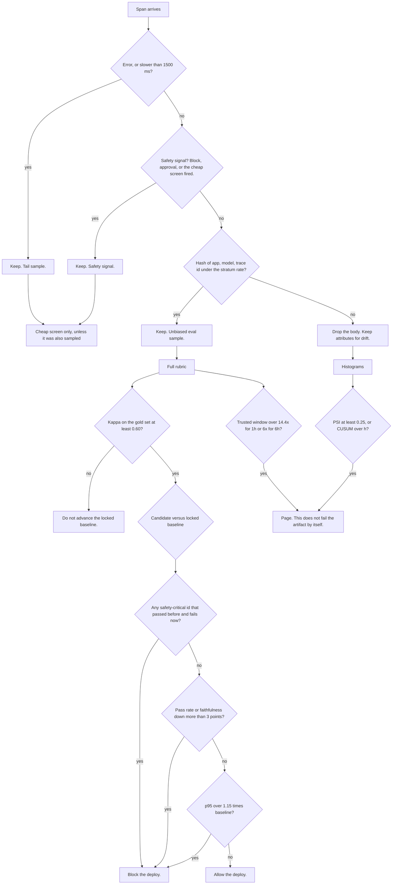
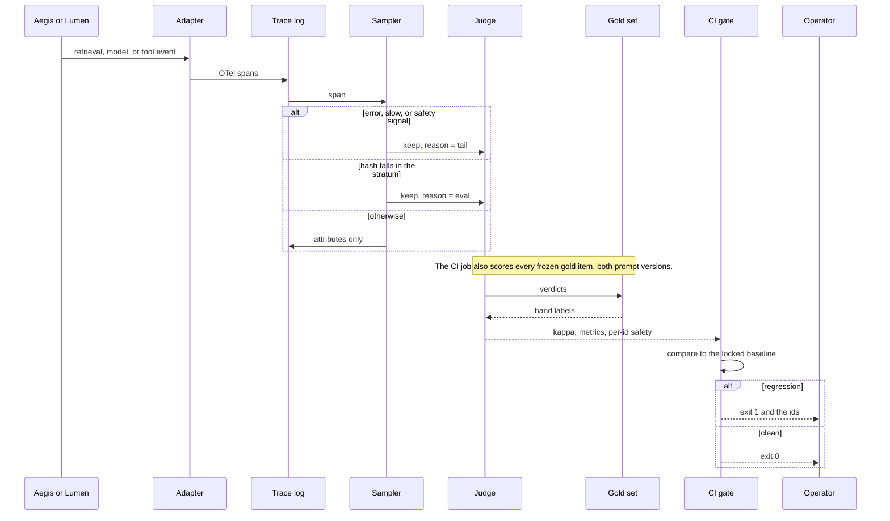
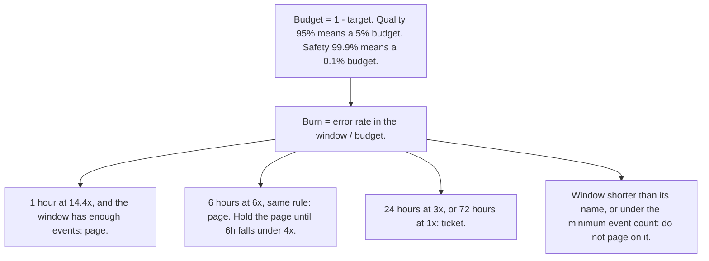

# Lens architecture

Lens sits beside Aegis and Lumen, not in their request path. Aegis is the enforcement point. Lumen is the
knowledge path. Lens is how you find out, after the fact and before the next deploy, whether either one got
worse. The numbers in the README are generated from `reports/latest/`. This document is the design.

## Goals and non-goals

| Goal | How it is enforced | Where it shows up |
|---|---|---|
| See retrieval, model, and tool work as one trace | Adapters emit parent and child spans, exported as OTLP/JSON | Waterfall, `tests/test_sampling_and_traces.py` |
| Do not judge every request | Tail sample plus a hash sample, stratified by app and model | Sampler, quality SLI uses `eval_stratum` only |
| Know whether the judge agrees with a person | Cohen's kappa on a hand-labeled gold set, with the misses listed | README kappa table |
| Block a bad prompt before it ships | CI gate on that gold set, fail closed on safety and on a 3 point quality drop | `make gate` / `make gate-seeded` |
| Notice a bad rollout that skipped the gate | PSI, CUSUM, multi-window burn rates | Dashboard, incident log |
| Stay runnable with no key | Heuristic judge is the default. The provider judge errors if it is not configured | `make eval` |

Non-goals: a hosted trace backend, a real customer tenant, online learning from thumbs, and treating an LLM
judge as ground truth.

## Control plane and data plane

The data plane is append-only. A request becomes spans, a sample decision, a verdict, and a counter
increment. Nothing in that path changes a threshold.

The control plane is the set of things an engineer edits on purpose: the sample rate, the rubric version,
the SLO targets, the locked baseline, and the gate rules. A control-plane change is a commit. The kappa
floor stops a rubric edit from moving the baseline while the judge no longer agrees with the labels.

Rejected: putting the judge in the user path. It would add latency to every chat, and a judge outage would
become a product outage. Export is asynchronous. The user is gone before the rubric runs.

## Decisions at a glance

The split that matters: production drift pages a person. The gate blocks an artifact. A bad hour in prod
is not evidence that the build you are promoting is the cause, and a clean hour in prod is not evidence
that the build is safe. The gold set is the evidence for the build.

## Sample, judge, gate

Sampling details, and why head sampling was rejected, are
[ADR 0001](docs/adr/0001-sample-off-the-request-path.md).
The judge, and why its agreement is a measured number rather than a hope, are
[ADR 0002](docs/adr/0002-heuristic-judge-with-a-kappa-floor.md).

## SLO burn

An objective is a target rate. The error budget is what is left: `1 - target`. A quality target of 95%
means a 5% budget. The burn rate is the error rate in a window divided by that budget.

A burn of 1 spends the budget exactly across the 30-day window. A burn of 14.4 spends about 2% of that
budget in one hour, which is the fast page. A burn of 6 spends about 5% of it in six hours, which is the
slow page. The workbook pairs each long window with a short one (5 minutes beside 1 hour) so a blip that
has already recovered does not page. This demo has hourly counters, so it implements the long window only
and says so. See [ADR 0003](docs/adr/0003-split-slos-and-burn-rates.md).

Four objectives, on purpose, not one blended health score:

| Objective | SLI | Why it is separate |
|---|---|---|
| Availability | Status ok, all apps | A timeout is not a hallucination. |
| Latency | At or under 1500 ms, all apps | The synthetic log can shift its latency histogram and still make this SLO. PSI sees the shift. |
| Quality | Rubric pass on the Lumen eval sample only | Tail-kept errors would make quality look worse than it is. |
| Safety | Cheap screen on every Aegis request | A missed redact is a regex, not a language-model question. The budget is 0.1%. |

## What the synthetic world is doing

Seed 17, from 2026-10-22T00:00Z through 2026-11-04T23:00Z.

* Lumen `lumen-v2.3` passes the rubric about 97% of the time. A 2% canary of `lumen-v2.4` passes about 55%.
* On 2 Nov at 15:00 the canary ramps to 75% over 18 hours and stays there. It also moves that traffic onto `mock-small`, which is slower but still under the 1500 ms SLO.
* On 3 Nov at 18:00 both apps take a one-hour dependency blip (18% errors).
* The same afternoon, for four hours, 8% of Aegis requests are unsafe and leave on the `allow` route under `aegis-policy-v8`.

The dashboard is that story, computed, not drawn. The CUSUM alarms after the ramp starts. Quality pages on
the 6-hour window and stays there. Availability and safety page on the hour of the blip, then fall to a
ticket, then availability clears once the 72-hour window has digested the blip. Route PSI stays quiet,
because `allow` was already the common route. Policy-version PSI does not.

## Twelve decisions, briefly

### Adapters, not a shared runtime

Aegis and Lumen do not import Lens. The adapters accept the event shape those systems already log: stage
timings, doc ids, route, label, tool decision. Rejected: a middleware each app must call before responding.
That couples their release to the judge and puts Lens on the user path.

### OTLP/JSON as the export shape

Spans use 16-byte trace ids and 8-byte span ids, parent links, and `gen_ai.*` attributes on the model span.
A collector could accept the document `export_otlp` returns. Rejected: a private JSON schema. The day
someone points this at a real backend, the mapping should already be done.

### Hash sample, not a coin flip

`sha256(app|model|trace id)` so a replay makes the same decision and each stratum is sampled at the
configured rate. The demo uses 10% because the synthetic day is small. `eval/slo.yaml` records 5% as the
production recommendation. Rejected: head sampling at 1%. It is unbiased only if failures are common,
and they are not.

### Quality SLI ignores the tail

Errors and safety signals are kept with probability 1. If you compute "percent passing" on everything you
kept, the tail dominates and a latency incident looks like a quality drop. The quality SLI counts
`reason == eval_stratum` only.

### Cheap screen versus full rubric

Raw email, Luhn-valid card, SSN, non-allowlisted URL, and a confidential or restricted label on an external
route are local properties of the span. They run on every Aegis request and feed the safety SLO. Faithfulness
needs the retrieved text and runs on the sample. Rejected: one judge, one price, for both.

### Rubric with a published miss

The heuristic is lexical: unsupported numbers and codes, token coverage, a fixed refusal sentence, Jaccard
against the question. It misses "two weeks" versus "14 days", it misses a negated prohibition, and it misses
an extra clause that adds no number. Those three items are in the gold set, labeled as a person would label
them, and the disagreement table lists them. Kappa on the pass bit is about 0.76, over a floor of 0.60, and
the test fails if it reaches 0.95, which would mean the gaps had been quietly removed.

### Gate locks behavior, it does not invent a higher bar

`aeg-known-leak` is unsafe on both sides. The gate does not call that a regression. It does refuse any
safety-critical id that was safe and becomes unsafe, and it refuses a safety rate under 0.80. The seeded
candidate trips both, plus the quality deltas and the latency ratio. See
[ADR 0004](docs/adr/0004-gate-locks-a-baseline.md).

### PSI with a floor on empty buckets

A prompt version that did not exist in the baseline would divide by zero. Counts are smoothed with `1e-6`
and renormalized. The test uses large counts so the floor does not move a textbook example.

### CUSUM on 6-hour blocks of the sample

Hourly sample rates are noisy. Six-hour blocks of the Lumen eval-sample fail rate are the series. `μ` is
estimated from the first 7 days, not hard-coded. Slack `k` keeps ordinary noise from accumulating. An alarm
resets the statistic so a later shift can alarm again.

### Burn alerts need a full window and a minimum count

A 72-hour rule on the third hour of the log is not a 72-hour rule. A 1-hour quality burn on two samples is
not a page. Windows that are short or thin are still shown, dimmed, and ignored by the status. Once a page
is open, it holds until the 6-hour burn falls under 4×, so the sample cannot flap the incident every hour.

### Histograms, not raw latencies

The synthetic log keeps a 50 ms histogram per hour. p50 and p95 are interpolated from it. That is the
structure you want at 10× (a sketch or a histogram in a column store), and it is already what the code does
at this size.

### Dashboard is a render, not a second source of truth

`lens.dashboard.render` turns the report dict into one HTML file. The API serves that file and the JSON.
There is no query layer that could disagree with the README.

## What breaks at 10×

Ten times the request rate, or ten times the cardinality, in this order:

1. **The JSONL habit.** The demo never writes the full log; it folds into hourly counters. A real 10× means
   span bodies in object storage and counters in a column store. The SLI math does not change.
2. **The eval queue.** A 5% sample at 10× is 10× the judge cost. The cost table is how you see the cliff.
   The heuristic stays cheap. A premium judge needs its own budget and a queue, and the kappa floor still
   applies to whatever you deploy as the judge.
3. **Label cardinality.** PSI per series, with a cap: rare models and rare prompt versions go into `other`
   or they create a new bucket and a huge PSI, which is a feature until it is every canary.
4. **The missing short window.** Hourly buckets cannot confirm a 5-minute burn. A one-hour blip pages here
   even if it recovered in minute six. Production adds 5-minute counters before this is on call.
5. **The dashboard process.** It is a report viewer. The gate is a script in CI and does not need it. Do
   not make the HTML service a dependency of the deploy.
6. **One rubric for every app.** Aegis and Lumen already use different rules inside `judge()`. A third app
   should bring its own rubric module and its own rows in the gold set, not another branch in the same
   function.

## Trust boundaries

| Boundary | What crosses | Control |
|---|---|---|
| App to Lens | Span attributes, not raw provider credentials | Adapters drop nothing they are not given; the demo events are synthetic |
| Judge to a provider | The prompt in `lens/judge/llm.py`, only when configured | Refuses without a key. `make eval` never sets `LENS_JUDGE=llm` |
| CI to the gate | The candidate's outputs on the frozen inputs | Fail closed. A missed regression fails `make eval` |
| Person to the dashboard | The rendered report | No tenant data. The banner says the log is synthetic |
