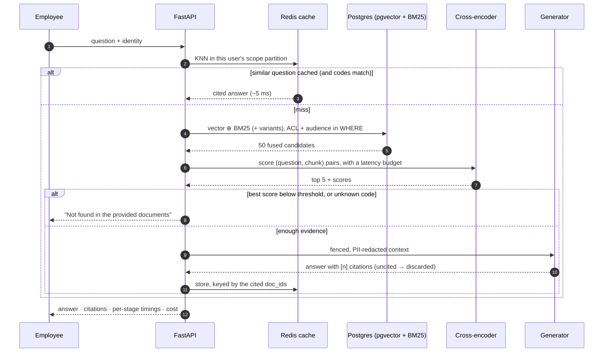

# Architecture and design decisions

This document explains *why* the system is built the way it is: each decision, the alternative I rejected,
the tradeoff, and what breaks first as documents or traffic grow. Measured numbers refer to eval run
`20261104-010419` ([`eval_results/latest/summary.md`](eval_results/latest/summary.md)), produced on a 4-vCPU
container with no GPU.

> **TL;DR:** one PostgreSQL database holds vectors, BM25 postings, access-control columns and lineage, so
> filtering happens *inside* retrieval and document updates are a single transaction. A cross-encoder turns wide
> recall into precision and also decides when to refuse. A Redis cache is partitioned by permission and invalidated
> by provenance. Each phase is a feature flag, so its effect is measured in isolation.

**Contents:** [1. Goals](#1-goals-and-non-goals) · [2. Request path](#2-request-path-and-latency-budget) ·
[3. Stack choices](#3-stack-choices-and-deviations-from-the-default) · [4. Decisions](#4-decisions) ·
[5. Evaluation](#5-evaluation-design) · [6. Scaling](#6-what-breaks-at-scale-and-what-i-would-change) ·
[7. Weaknesses](#7-known-weaknesses)

### Decisions at a glance

| Area | Choice | Main alternative rejected | Why |
|:--|:--|:--|:--|
| Store | PostgreSQL + pgvector (HNSW) | dedicated vector DB | ACL filters, BM25 and atomic re-indexing in one transaction |
| Keyword search | BM25 over a `chunk_terms` inverted index in SQL | `ts_rank` | real IDF and length normalisation, same `WHERE` clause as vectors |
| Chunking | structure first, semantic split second | fixed-size windows | tables and clauses stay whole; citations name sections |
| Fusion | weighted RRF (k=60) | score averaging | cosine and BM25 scores are not comparable |
| Precision | cross-encoder 50 → 5, int8 | LLM re-ranking | ~330 ms on CPU, deterministic, and doubles as the refusal signal |
| Access | filter inside retrieval SQL | post-filter top-k | no leaks through debug output; no recall loss |
| Refusal | calibrated score gate + identifier grounding | “trust the LLM to say no” | refuses before spending tokens; can't substitute codes |
| Cache | Redis HNSW, scope-partitioned, provenance-invalidated | exact-match cache | paraphrases hit, permissions and freshness are never violated |
| Models | ONNX Runtime on CPU | PyTorch + sentence-transformers | smaller image, no GPU, faster cold start |

### One request, end to end



## 1. Goals and non-goals

| Goal | How it is enforced | Where it is measured |
|---|---|---|
| Answers only from documents, with citations | fenced context, citation validation, uncited answers discarded | faithfulness, citation precision |
| Say "not found" instead of guessing | evidence gate (cross-encoder score + identifier grounding) | refusal correctness, false-refusal rate |
| A user only sees what they may see | ACL predicate inside every retrieval query | RBAC leak rate |
| The *applicable* policy wins | audience metadata filter before ranking | cross-team top-1 error |
| Correct after documents change | atomic incremental re-index + cache invalidation | invalidation experiment, integration tests |
| Fast and measurable | per-stage timers, budgets, semantic cache | p50/p95 per stage, cache hit rate |

Non-goals for this version: multi-turn conversation memory, multilingual retrieval, document-level authorisation
from an external system of record (ACLs come from document metadata), and online learning from feedback.

## 2. Request path and latency budget

```
question ─► embed (5 ms) ─► cache lookup (<3 ms) ─┬─ hit ─► answer (≈5 ms p50 end to end)
                                                   └─ miss ─► vector + BM25 (3 ms) ─► multi-query (33 ms)
                     ─► fuse (<1 ms) ─► injection guard ─► cross-encoder 50→5 (331 ms) ─► evidence gate
                     ─► generate (72 ms extractive) ─► validate citations ─► store in cache
```

p50 / p95 for `full`: **445 / 544 ms**. The cross-encoder is about 75% of request time, and that is where the
optimisation effort went (§4.4). Each stage has a budget (`*_BUDGET_MS`). Re-ranking runs in a worker
thread with a timeout: if it exceeds `RERANK_BUDGET_MS`, the request continues with the fused order and
reports `degraded: ["rerank_timeout"]`, so a slow model never turns into an error page. Generation has the
same pattern, falling back to the extractive answer.

## 3. Stack choices and deviations from the default

| Default asked for | What I used | Why |
|---|---|---|
| Python 3.12, FastAPI, Compose | same | The image is `python:3.12-slim`; tests and evals in this repo were run inside it. |
| PostgreSQL + pgvector | same (pgvector 0.8.7, HNSW) | One transactional store for vectors, BM25 postings, ACL columns, lineage and audit events. The atomic swap in §4.6 depends on this. |
| BM25-style keyword search | **real BM25 in SQL** over an inverted-index table | Postgres `ts_rank` is not BM25 (no IDF saturation or length normalisation). An explicit `chunk_terms(term, chunk_id, tf)` table gives true BM25, shares the ACL `WHERE` clause with vector search, and is swapped in the same transaction as the chunks. |
| Redis semantic cache | **Redis 8** (built-in query engine, HNSW) | Vector KNN inside Redis avoids loading every cached vector into Python. Plain Redis would need a brute-force scan per lookup. |
| Pluggable LLM + embeddings | env-selected providers; **ONNX Runtime** for local models | No PyTorch: CPU inference for both MiniLM models, a smaller image and faster cold start. Swapping to an API embedder is one env var (it requires a re-index if the dimension changes). |
| — | **offline extractive generator** | Lets the system run, and the eval run, with no API key, deterministically, at $0. With a key, the same pipeline uses Claude or any OpenAI-compatible model. |

## 4. Decisions

### 4.1 Parsing and chunking

**Decision.** Parse into structural blocks (heading path, paragraph, numbered clause, list item, table), then
chunk *within* heading sections. Tables, numbered clauses and a list together with its lead-in sentence are
atomic. Oversized sections are split at the unit boundary with the **lowest embedding similarity** between
neighbouring units, with a balance penalty. Undersized sibling sections are merged. Each chunk carries a
context header (`Doc title > Section`) that is embedded with it and shown in citations.

**Why.** Fixed-size chunking splits tables from their headers ("$95" with no "Tier 1") and cuts clauses in half,
which is how RAG systems produce confidently wrong policy answers. Pure semantic chunking (embedding every
sentence and splitting on similarity drops) ignores the structure the author already gave us. Structure first,
semantics only when structure is not enough, is cheaper and more predictable.

**Tradeoff.** Chunk sizes vary (46–180 tokens in this corpus). Very long tables are split by row groups with the
header row repeated, which keeps each piece self-describing but loses cross-group aggregation ("which tier is
cheapest"). PDF heading detection is heuristic (font size and bold) and will mis-detect on unusual layouts;
the ingestion events table records what was produced.

### 4.2 Retrieval: vector, BM25, fusion, multi-query

* **Embeddings: all-MiniLM-L6-v2 (384-d).** Small, fast on CPU (about 5 ms per query), good enough for paraphrase
  recall on short policy text, and available offline. It is weak on identifiers ("VPN-ERR-809" and
  "VPN-ERR-503" are nearly identical vectors), which is exactly what BM25 is for. At 10x scale I would move to a
  stronger embedder (e.g. bge-base/e5-base, or an API model) and measure it with the same eval.
* **Fusion: weighted RRF (k=60) by default**, with weighted min-max score fusion available. RRF ignores the
  incomparable score scales (cosine 0–1, BM25 0–30) and is robust without tuning. Weights are config
  (`HYBRID_VECTOR_WEIGHT`, `HYBRID_BM25_WEIGHT`).
* **Multi-query.** With an LLM: N intent-diverse rewrites ("laptop died, help" → troubleshooting / warranty /
  loaner). Offline: RM3-style pseudo-relevance feedback (expand with discriminative terms from the top documents).
  Variant result lists are fused with 0.6 weight relative to the original query, so expansion can add
  candidates but cannot out-vote the user's actual words.
* **What the eval shows.** On the same candidate sets, hybrid raises first-stage MRR from 0.851 to 0.888, and
  multi-query raises first-stage recall@5 to 100%. **End-to-end they change nothing on this corpus**, because 50
  candidates out of 52 chunks means the cross-encoder sees nearly everything anyway. This is a property of a small
  corpus, not of the techniques. Their value grows as `corpus size / CANDIDATE_K` grows, which is the regime of §6.

### 4.3 Filtering before ranking: two different filters

**Visibility (security)** is `public | team | restricted(allowed_roles)`. **Audience (applicability)** is the list of
teams a policy applies to. Both are denormalised onto every chunk row and applied in the `WHERE` clause of
*both* the ANN and BM25 queries. A chunk the user may not read is never a candidate, never scored, never in debug
output, and never in the LLM prompt.

* Post-filtering (retrieve top-k, then drop) was rejected: it leaks through debug output and timing, and it
  silently shrinks recall when most of the top-k is filtered out.
* With HNSW, filtering can starve the index scan. `hnsw.iterative_scan = relaxed_order` (pgvector ≥ 0.8) keeps
  scanning until k rows pass the filter.
* BM25 IDF statistics are computed over the whole corpus, not the visible subset, so scores leak nothing about
  which restricted documents exist.

**Measured.** RBAC leak rate: 100% in baseline → 50% with the audience filter only → **0%** with ACL. Cross-team
top-1 error: 25% → **0%**. A notable finding: re-ranking *without* the audience filter made cross-team accuracy
worse (83% → 67%), because the cross-encoder rewards the Sales policy's literal mention of "Sales Operations
analysts" for a Finance analyst's query. Relevance is not applicability, and only metadata can encode applicability.

### 4.4 Re-ranking

**Decision.** Retrieve 50 fused candidates, score each `(query, header + chunk)` pair with
cross-encoder/ms-marco-MiniLM-L-6-v2, and keep the top 5. Before and after rankings are logged per request
(`rerank {"before": [...], "after": [...], "moved_into_top5": [...]}`) and returned in debug responses.

**int8 quantisation.** Dynamic int8 quantisation of the verified fp32 ONNX weights (built locally by
`fetch_models.py`; it is not downloaded) cut end-to-end `full` p95 from 939 to 544 ms (about 40%). End-to-end
correctness and refusal behaviour were identical, and rank correlation with fp32 was 0.97–0.99 on spot checks.
The fp32 model is one env var away.

**Tradeoff.** Re-ranking is the dominant cost and scales linearly with `CANDIDATE_K`. Options in order of
preference: a GPU or batched inference service; a smaller K chosen from eval data; a distilled or ColBERT-style
late-interaction model; or caching scores for `(query-cluster, chunk)` pairs.

### 4.5 Evidence gate, generation and citations

* **Refuse before generating.** If the best cross-encoder score is below `MIN_RERANK_SCORE`, the system returns
  "Not found in the provided documents" without calling the LLM, which is cheaper and cannot hallucinate. The
  threshold (-7.0) was chosen by `scripts/calibrate.py` on a **held-out** calibration set
  (`eval/calibration.yaml`), not on the eval set. The margin is thin (-6.94 vs -7.13), so this is the first
  thing I would re-calibrate on production query logs.
* **Identifier grounding.** If the question names a code (`VPN-ERR-999`, `RW-2`, `HR-POL-201`) that appears in
  none of the final evidence, the system refuses rather than answering with a neighbouring code's policy. This
  is a cheap, general check that vector similarity cannot provide.
* **LLM path.** The system prompt states the rules. Documents are XML-escaped and fenced in
  `<document index=… title=… section=… version=…>` tags, and the prompt says that their content is data. The
  output is validated: citation indices must exist, invalid ones are stripped, and **an answer with no valid
  citation is discarded and becomes a refusal.** The Anthropic provider opts into server-side refusal fallbacks
  and handles `stop_reason == "refusal"`.
* **Extractive path.** Candidate answers are single sentences and 2-sentence windows (a table row becomes a
  "Header: value; …" sentence), scored by the same cross-encoder with the section heading as context.
  Injection-flagged sentences are never candidates. Faithful by construction; weaker at synthesis (see §7).

### 4.6 Changing documents: incremental indexing

* **Identity and change detection.** `doc_id` comes from metadata (or a slug of the path). The document hash
  covers block text and the metadata that affects access or answers. If the hash is unchanged, the ingest is a
  logged no-op.
* **Atomic swap.** Old chunks, their BM25 postings (via cascade) and the new chunks are deleted and inserted in
  **one transaction**, with `SELECT … FOR UPDATE` on the document row. Readers see either v3 or v4, never both
  and never neither. Duplicate chunks are impossible by construction (`UNIQUE (doc_id, chunk_index)`).
* **Embedding reuse.** A chunk whose content hash existed in the previous version reuses its stored embedding.
  The policy update in the eval re-embedded **2 of 6 chunks**.
* **Lineage.** `chunk_lineage` records `added | unchanged | modified | removed` with `previous_chunk_id`, so
  "which chunk did this citation used to be?" is answerable and auditable. Chunk ids encode the version
  (`doc::v4::c2`), so a citation pins the exact version it came from.
* **Delete and re-index** operate per document (`DELETE /documents/{id}`, `POST /reindex`) without a rebuild.
  Failures are recorded per file and never abort a batch. `/ingestion/status` shows documents, chunks created /
  replaced / reused / removed, and failed files with errors.

### 4.7 Semantic cache

The cache stores the final answer with its citations, keyed by query embedding, in a Redis HNSW index.

1. **Partitioned by entitlement.** The partition hashes team + sorted roles + profile + filters. An answer built
   from restricted documents can only be served to principals with the same access. This is the cache rule that
   matters most, and the easiest one to get wrong.
2. **Invalidated by provenance.** Each entry is registered under the doc_ids it cites. Updating or deleting a
   document evicts dependent answers. *Refusals* depend on the whole corpus (a new document could answer
   them), so they are evicted on any change.
3. **Threshold plus specificity guard.** A hit needs cosine ≥ 0.85 **and** identical numbers, codes and amounts.
   The measured sweep is the justification: without the guard, 33–83% of near-miss pairs ("VPN-ERR-809" vs
   "VPN-ERR-503", "$20,000" vs "$80,000") would have been served the other question's answer. With it, there are 0
   false hits down to 0.80. I chose 0.85, not 0.80, to keep a margin. That trades paraphrase hit rate
   (23.9% vs 43.5%) for safety, because a wrong policy answer costs more than a cache miss.
4. **TTL** (6 h) bounds anything provenance cannot see, for example a *new* document that would have been a
   better answer for a cached question.

Measured: paraphrase hit rate 23.9% with 0 wrong answers served; hits p50 ≈ 5 ms vs ≈ 448 ms on a miss; exact
repeats 100% hits. The cache fails open: if Redis is down, requests go through the full pipeline.

### 4.8 PII

Regex detectors with validation (Luhn for cards, SSN range rules) for email, phone, card, SSN, IBAN, IP and
employee IDs, plus an allowlist for published business contacts (help desks, hotlines). In `PII_MODE=external`,
the query and context are redacted only when text is about to leave the trust boundary (an external LLM);
`always` redacts for every provider. Chunks are also tagged with `pii_types` at ingestion for reporting.
Redaction events (`redaction_events` table and logs) store **type and count only**, never values.

**Tradeoff.** Regexes miss names and free-text identifiers. A production system should add an NER-based
detector (e.g. Presidio with a spaCy model). It was not used here because model downloads were blocked in the
build environment, and the redaction interface is the same either way.

### 4.9 Prompt injection

Defence in depth, because no single layer is reliable:

1. **Ingestion scan.** Rule-based scoring of instruction-like sentences (override attempts, role changes,
   addressing "AI assistants", credential exfiltration), stored as `injection_risk` per chunk. Rules are
   **negation-aware**: an early version flagged "Do not share your password", which would have stripped
   legitimate security advice. The regression test is in `tests/unit/test_security.py`.
2. **Query time.** `INJECTION_MODE=strip` removes flagged sentences before re-ranking or generation (`drop`
   removes the chunk; `flag` only annotates).
3. **Prompt structure.** Escaped, fenced documents and an explicit data-not-instructions rule.
4. **Output.** Citation validation means an answer that simply follows a document's instructions without
   citing it is discarded.

Measured: baseline repeated the planted instruction on both injection questions; `full` on neither. This is a
small test: two questions, one attack style.

## 5. Evaluation design

* **Dataset.** 46 questions over 7 categories, each with relevant doc ids, expected facts (with alternatives),
  forbidden docs and forbidden strings, and a paraphrase for cache tests. There are also 6 near-miss pairs for
  the cache, and a separate 16-question calibration set used only for thresholds.
* **Profiles, not branches.** Each phase is a feature-flag profile of the same pipeline, so "before and after each
  phase" is a controlled comparison on identical data and code. Every run is saved with per-question JSON.
* **Metrics.** Doc recall@5/10, MRR, chunk-level evidence recall (are the expected facts inside the top-k
  chunks?), re-ranker before/after on the same candidates, answer correctness (all expected facts present),
  faithfulness (each answer sentence ≥ 80% covered by the chunk it cites), citation precision, refusal
  correctness, false-refusal rate, RBAC leak rate, cross-team top-1 error, injection-followed rate, per-stage
  p50/p95, and actual and projected cost per query.
* **Honesty constraints.** The generator in the published run is extractive, so faithfulness is 100% by
  construction and answer correctness measures sentence selection, not LLM reasoning. Projected cost uses
  estimated token counts at list prices. The eval set and corpus were written by the same author; they are a
  regression suite, not a benchmark.

## 6. What breaks at scale, and what I would change

### 10x documents (about 400 docs / 500 chunks → think 100k+ chunks for a real company)

| Breaks first | Why | Change |
|---|---|---|
| Re-ranker sees a smaller fraction of the corpus | 50 of 500k candidates, so first-stage recall now matters | Hybrid and multi-query start to pay off (§4.2); tune `CANDIDATE_K` against evidence recall@K; better embedder |
| BM25 aggregation in SQL | per-query `GROUP BY` over postings grows with term frequency | ParadeDB `pg_search` (BM25 in Postgres) or OpenSearch; keep the same ACL predicate |
| Global BM25 stats per query | `count(*)` and `avg()` over chunks on every query | materialised corpus-stats table refreshed on ingest |
| HNSW memory and build time | index grows with rows × dim | `halfvec` (2× smaller), tune `m` / `ef_construction`, partition by tenant or team |
| Re-embedding on model change | full re-index required | dual-write to a new embedding column, backfill, flip config; version embeddings |
| Synchronous ingestion | API thread parses PDFs and embeds | queue (e.g. SQS / Redis Streams) plus workers; idempotent by doc hash; status table already exists |
| PDF heuristics | real-world PDFs are messier | layout-aware parser (unstructured, docling) behind the same `Block` interface |
| Cache invalidation fan-out | popular docs have many dependent entries | already O(dependents); add per-doc version stamps checked on read as a second line |

### 10x traffic

| Breaks first | Why | Change |
|---|---|---|
| CPU cross-encoder (≈330 ms, about 75% of latency) | one model per API process, CPU-bound | separate inference service (Triton / TEI) with dynamic batching on GPU; the API stays I/O-bound |
| One uvicorn worker per container | models loaded per process | multiple workers with shared model service; horizontal API replicas behind a load balancer |
| Postgres connections | pool of 10 per process | PgBouncer; read replicas for retrieval, primary for ingest |
| LLM cost and rate limits | ≈ $0.0044 per query projected on claude-opus-5-5 | the cache (exact repeats are common in support traffic); prompt caching of the system prompt; a smaller model for multi-query expansion; batch evals |
| Hot-key cache entries | many users, same question | the partition keeps scopes separate; add an in-process LRU in front of Redis for the hottest entries |
| Observability | logs only | OpenTelemetry spans per stage (the timings already exist), dashboards for refusal rate, cache hit rate, degraded-mode rate |

## 7. Known weaknesses

1. **Answer quality is bounded by the extractive generator in the published numbers.** The 5 remaining `full`
   failures all have the right document in context: the carry-over limit without its March 31 expiry; the
   secondary-caregiver sentence instead of the primary-caregiver 16 weeks; a floating-holiday sentence and the
   wrong PTO table row; the Sales policy's scope sentences instead of its "remote-first" rule; and an
   unanswerable bereavement question answered with parental-leave text, which a reasoning LLM should refuse.
2. **The refusal threshold sits close to real questions.** A 0.06–0.13 logit margin on the calibration set.
   Vague-but-valid questions ("my headset stopped working") score close to unanswerable ones.
3. **The eval set is small and self-authored.** It cannot show generalisation. The next step is sampling real
   anonymised queries and labelling them.
4. **Identity is a demo header.** The ACL model is real; the authentication is not.
5. **Not exercised here.** The Anthropic and OpenAI-compatible providers (no key in the build environment)
   and the API-based embedder. Their first run should be treated as an integration test.
