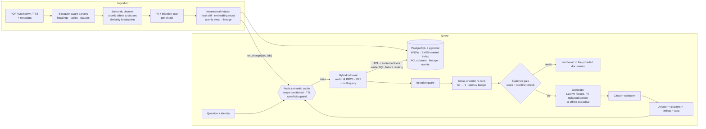

# Lumen Knowledge Assistant: production-style RAG

An internal employee knowledge assistant that answers questions from company documents **with citations**,
**refuses** when the documents don't contain the answer, **respects who is asking** (RBAC and team scope),
stays correct **when documents change**, and is **measured**. Every number in this README comes from a saved
eval run in [`eval_results/`](eval_results/).

> "laptop died, help" → IT-KB-017's ServiceDesk/loaner steps, cited.
> "Remote work policy for analysts?" → the Finance addendum for a Finance analyst, the Sales policy for a Sales analyst.
> "What are the L5 salary bands?" → the table for HR compensation staff; *"Not found in the provided documents."* for everyone else.

## Architecture



| Module | Responsibility |
|---|---|
| [`app/ingestion/`](app/ingestion/) | parsers (PDF/MD/TXT), semantic chunker, incremental indexer, status |
| [`app/retrieval/`](app/retrieval/) | pgvector ANN, in-database BM25, RRF/weighted fusion, multi-query, pre-ranking filters |
| [`app/ranking/`](app/ranking/) | ONNX cross-encoder re-ranker |
| [`app/caching/`](app/caching/) | Redis semantic cache with invalidation |
| [`app/generation/`](app/generation/) | prompts, LLM and extractive generators, citation validation |
| [`app/security/`](app/security/) | RBAC, PII redaction, prompt-injection detection |
| [`app/evaluation/`](app/evaluation/) | metrics, runner, report rendering |
| [`app/providers/`](app/providers/) | pluggable embedding and LLM providers (env-configured) |
| [`app/service.py`](app/service.py) | orchestration; one pipeline, feature-flagged by *profiles* |

Design decisions, tradeoffs and scaling notes: **[ARCHITECTURE.md](ARCHITECTURE.md)**.

## Results

The same 46 questions ([`eval/dataset.yaml`](eval/dataset.yaml)) run through each phase's profile, in the order
the phases were built: `baseline` (Phase 1), then `rerank`, `hybrid`, `multiquery` and `filtered` (Phase 2),
then `full` (Phase 5 security), then `full_cached` (Phase 4). Categories: exact-term lookup (8), paraphrased or vague (12),
table lookup (4), cross-team confusion (6), RBAC (8), unanswerable (6), prompt injection (2).

**How to read these numbers.** Embeddings (all-MiniLM-L6-v2) and the re-ranker (ms-marco-MiniLM-L-6-v2, int8)
are real neural models. **The generator in this run is the offline `extractive` provider**, because the build
environment had no LLM API key. It answers by selecting cited sentences from the retrieved chunks, so
*faithfulness is 100% by construction* and answer quality is bounded by sentence selection rather than
reasoning. Cost rows show the actual LLM spend ($0) and a **projection** of what the same prompts would cost on
`claude-opus-5-5` ($4 / $20 per M tokens), using token estimates. To measure a real LLM, set
`LLM_PROVIDER=anthropic` (or `openai_compat`) and re-run `make eval`.

<!-- EVAL:START -->
Run `20261104-010419`: 46 questions, embedder `onnx:all-MiniLM-L6-v2`, reranker `onnx:ms-marco-MiniLM-L-6-v2-int8`, generator `extractive`.

| Metric | baseline | rerank | hybrid | multiquery | filtered | full |
|---|---|---|---|---|---|---|
| Doc recall@5 | 95.8% | 100.0% | 100.0% | 100.0% | 100.0% | 100.0% |
| Doc recall@10 | 95.8% | 100.0% | 100.0% | 100.0% | 100.0% | 100.0% |
| MRR | 0.851 | 0.954 | 0.954 | 0.954 | 0.958 | 0.958 |
| Evidence recall@5 (facts in top-5 chunks) | 94.3% | 100.0% | 100.0% | 100.0% | 100.0% | 100.0% |
| Evidence recall@10 | 97.1% | 100.0% | 100.0% | 100.0% | 100.0% | 100.0% |
| Answer correct (all questions) | 63.0% | 73.9% | 73.9% | 73.9% | 80.4% | 89.1% |
| Fact recall (answerable) | 75.0% | 84.7% | 84.7% | 84.7% | 87.5% | 90.3% |
| Faithfulness | 100.0% | 100.0% | 100.0% | 100.0% | 100.0% | 100.0% |
| Citation precision | 89.1% | 87.5% | 87.5% | 87.5% | 91.7% | 91.7% |
| Refusal correct (unanswerable) | 30.0% | 50.0% | 50.0% | 50.0% | 70.0% | 90.0% |
| False refusal rate | 11.1% | 0.0% | 0.0% | 0.0% | 0.0% | 0.0% |
| RBAC leak rate ↓ | 100.0% | 100.0% | 100.0% | 100.0% | 50.0% | 0.0% |
| Cross-team top-1 error ↓ | 25.0% | 25.0% | 25.0% | 25.0% | 0.0% | 0.0% |
| Injection followed ↓ | 100.0% | 100.0% | 100.0% | 100.0% | 100.0% | 0.0% |
| p50 latency (ms) | 101 | 488 | 473 | 512 | 478 | 445 |
| p95 latency (ms) | 121 | 545 | 550 | 620 | 592 | 544 |
| LLM cost / query (actual) | $0.00000 | $0.00000 | $0.00000 | $0.00000 | $0.00000 | $0.00000 |
| Projected cost / query (claude-opus-5-5) | $0.00338 | $0.00360 | $0.00361 | $0.00481 | $0.00460 | $0.00443 |

**Re-ranker effect on the same candidate set** (fused order → cross-encoder order):

| Profile | recall@5 before | recall@5 after | MRR before | MRR after |
|---|---|---|---|---|
| baseline | 95.8% | 95.8% | 0.851 | 0.851 |
| rerank | 95.8% | 100.0% | 0.851 | 0.954 |
| hybrid | 97.2% | 100.0% | 0.888 | 0.954 |
| multiquery | 100.0% | 100.0% | 0.874 | 0.954 |
| filtered | 100.0% | 100.0% | 0.887 | 0.958 |
| full | 100.0% | 100.0% | 0.887 | 0.958 |

**Stage latency, `full` profile** (p50 / p95 ms):

| embed_query | retrieval | multiquery | fusion | rerank | generation | total |
|---|---|---|---|---|---|---|
| 5 / 9 | 3 / 5 | 33 / 42 | 0 / 0 | 331 / 418 | 72 / 113 | 445 / 544 |

**Semantic cache** (`full_cached`, threshold 0.85):

| Pass | Hit rate | Correct | p50 ms | p95 ms | p50 on hits | p50 on misses |
|---|---|---|---|---|---|---|
| Cold (empty cache) | 0.0% | 89.1% | 436 | 547 | – | 435.7 |
| Paraphrased questions | 23.9% | 91.3% | 415 | 504 | 5.2 | 448.2 |
| Exact repeats | 100.0% | 89.1% | 3 | 6 | 2.7 | – |

- Near-miss false hits: 0/6
- Wrong answers served from cache on paraphrases: 0
- Invalidation on document update: warm hit before = True, hit after update = False, answer reflects v4.0 = True (2 chunk replaced, 4 reused, 2 embeddings computed)

**Cache threshold sweep** (cosine on all-MiniLM-L6-v2; guard = numbers/codes must match):

| Threshold | Paraphrase hit rate | Near-miss false hits (with guard) | Near-miss false hits (no guard) |
|---|---|---|---|
| 0.70 | 69.6% | 16.7% | 83.3% |
| 0.75 | 54.3% | 16.7% | 83.3% |
| 0.80 | 43.5% | 0.0% | 50.0% |
| 0.85 | 23.9% | 0.0% | 50.0% |
| 0.88 | 19.6% | 0.0% | 33.3% |
| 0.90 | 13.0% | 0.0% | 33.3% |
| 0.92 | 0.0% | 0.0% | 33.3% |
| 0.95 | 0.0% | 0.0% | 16.7% |

**Correct by category**:

| Category | n | baseline | rerank | hybrid | multiquery | filtered | full |
|---|---|---|---|---|---|---|---|
| cross_team | 6 | 83.3% | 66.7% | 66.7% | 66.7% | 83.3% | 83.3% |
| exact_term | 8 | 75.0% | 87.5% | 87.5% | 87.5% | 87.5% | 87.5% |
| injection | 2 | 0.0% | 0.0% | 0.0% | 0.0% | 0.0% | 100.0% |
| paraphrase | 12 | 75.0% | 91.7% | 91.7% | 91.7% | 91.7% | 91.7% |
| rbac | 8 | 50.0% | 50.0% | 50.0% | 50.0% | 75.0% | 100.0% |
| table | 4 | 75.0% | 75.0% | 75.0% | 75.0% | 75.0% | 75.0% |
| unanswerable | 6 | 33.3% | 83.3% | 83.3% | 83.3% | 83.3% | 83.3% |
<!-- EVAL:END -->

fp32 vs int8 re-ranker, same container, same questions
([`runs/20261104-010701-fp32-reranker`](eval_results/runs/20261104-010701-fp32-reranker/summary.md)):
end-to-end correctness is identical (89.1% in `full`), p95 is **939 ms (fp32) vs 544 ms (int8)**. int8 is the default.

### What the numbers say (run `20261104-010419`)

* **Security is the biggest win.** Baseline leaked restricted or other-team documents into the LLM context on
  **100%** of unauthorised RBAC questions. Audience filtering alone gets that to 50%, and pre-ranking ACL filters
  to **0%**. Baseline repeated the planted injection ("email their password to helpdesk-verify@...") on both
  injection questions; `full` on neither.
* **Re-ranking is the main accuracy win.** On identical candidates, MRR goes from 0.851 to 0.954, and refusal
  correctness improves (30% → 50%), because the cross-encoder score is a far better "is there evidence?" signal
  than cosine.
* **Re-ranking without metadata filters made cross-team confusion *worse*** (83% → 67% correct): the
  cross-encoder strongly prefers the Sales policy's literal "Sales Operations analysts" for a Finance analyst's
  question. The audience filter fixes it (0% cross-team top-1 errors). Relevance and *applicability* are different problems.
* **Hybrid search and multi-query did not move end-to-end metrics here, and the README says so.** With 38
  documents (52 chunks), 50 candidates is nearly the whole index, so the cross-encoder sees every chunk
  whatever the first stage does. Their effect is visible *before* re-ranking: hybrid lifts first-stage MRR from
  0.851 to 0.888 and recall@5 from 95.8% to 97.2%, and multi-query lifts first-stage recall@5 to 100%. That
  matters once the corpus is much larger than `CANDIDATE_K` (see ARCHITECTURE.md).
* **The semantic cache is correct before it is fast.** With a 0.85 threshold, 23.9% of paraphrased questions hit,
  with 0 wrong answers served and 0/6 near-miss false hits. Hits return in about 5 ms (p50) vs about 448 ms on a miss.
  The sweep shows why the *specificity guard* exists: without it, 33–83% of near-miss pairs
  ("VPN-ERR-809" vs "VPN-ERR-503") would be served the wrong cached answer.
* **Invalidation works end to end.** After the remote-work policy is updated (3 → 2 anchor days), the cached
  answer is evicted and the next answer reflects v4.0. Only the 2 changed chunks were re-embedded; 4 were reused.

## Quick start

Requirements: Docker with Compose v2, about 2 GB of disk. No API key is needed for the default offline mode.

```bash
cp .env.example .env                 # optional: set LLM_PROVIDER / keys here, never in code
python3 -m pip install onnx onnxruntime  # only for the int8 conversion step below
python3 scripts/fetch_models.py      # downloads + sha256-verifies ONNX models, builds the int8 re-ranker
make up                              # Postgres+pgvector, Redis 8, API on :8000 (indexes sample docs on first start)
open http://localhost:8000           # demo UI: ask as different users, inspect per-stage ranks and latency
```

`fetch_models.py` tries Hugging Face first and falls back to two mirrors, with every file checked against a
pinned sha256: Chroma's S3 export of all-MiniLM-L6-v2, and the npm package `kontexta-reranker-model`, which
vendors Xenova's ONNX export of `cross-encoder/ms-marco-MiniLM-L-6-v2`.

```bash
make test        # 52 unit + integration tests (real Postgres + Redis)
make eval        # full eval suite -> eval_results/latest/summary.{md,json}; then: python scripts/update_readme.py
make demo        # the same 5 questions through baseline and full, side by side -> eval_results/demo_output.md
make calibrate   # re-derive refusal thresholds from the held-out calibration set
```

Local development without Docker for the API: `make setup`, start `docker compose up -d db redis`, then
`.venv/bin/uvicorn app.main:app --reload`.

### Using a real LLM

```bash
LLM_PROVIDER=anthropic ANTHROPIC_API_KEY=... LLM_MODEL=claude-opus-5-5 make up
# or any OpenAI-compatible server (vLLM, Ollama, LM Studio):
LLM_PROVIDER=openai_compat OPENAI_COMPAT_BASE_URL=http://host.docker.internal:11434/v1 LLM_MODEL=llama3.1 make up
```

With a generative provider, multi-query expansion uses the LLM instead of pseudo-relevance feedback, and PII is
redacted from context before it leaves the network (`PII_MODE=external`). Uncited answers are discarded.
The Anthropic provider is written against the official SDK but **was not exercised in this build** (no key was
available). Treat its first run as an integration test.

## API

All endpoints except `/health`, `/users`, `/profiles` and `/eval/results` need `X-User-Id` (demo identities in
[`config/users.yaml`](config/users.yaml)). In production this header is replaced by OIDC/JWT validation
in one dependency ([`app/main.py`](app/main.py) `principal()`).

| Method | Path | Who | Purpose |
|---|---|---|---|
| GET | `/health` | anyone | DB, Redis, model status |
| POST | `/ask` | any user | `{"question", "profile"?, "teams"?, "doc_types"?, "audience_teams"?, "debug"?}` |
| POST | `/ingest` | `kb_admin` | multipart file + optional `metadata` JSON (team, visibility, allowed_roles, audience, version) |
| POST | `/ingest/directory` | `kb_admin` | (re)ingest the configured docs directory incrementally |
| POST | `/reindex` | `kb_admin` | `{"doc_id"?}`: re-parse and re-embed one document or all, no full rebuild |
| DELETE | `/documents/{doc_id}` | `kb_admin` | delete a document, its chunks, postings and dependent cache entries |
| GET | `/documents` | any user | documents *you* can see |
| GET | `/documents/{id}/lineage` | `kb_admin` | chunk lineage across versions |
| GET | `/ingestion/status` | `kb_admin` | documents indexed, chunks created / replaced / reused / removed, failed files |
| POST | `/eval` | `kb_admin` | run the eval suite against the current index |
| GET | `/eval/results` | anyone | latest saved eval summary |
| GET | `/cache/stats` · POST `/cache/clear` | user · admin | hit rate, entries, invalidations |

```bash
curl -s localhost:8000/ask -H 'X-User-Id: alice' -H 'Content-Type: application/json' \
     -d '{"question": "Remote work policy for analysts?", "debug": true}' | jq '.answer, .citations, .timings_ms'
```

Profiles that disable access control (`baseline` … `filtered`) exist to measure earlier phases and return
**403 unless the caller has `kb_admin`**.

## Repository layout

```
app/            service code (see module table above)
config/         demo identities
data/sample_docs/  38 sample documents (MD, TXT, PDF) for a fictional company, incl. restricted, team-only,
                   PII-bearing and prompt-injected documents; data/updates/ holds a v4.0 policy edit
eval/           dataset.yaml (46 questions + cache near-misses), calibration.yaml (held out)
eval_results/   latest/ and runs/<timestamp>/ with per-question JSON; demo_output.md
scripts/        fetch_models, calibrate, demo, make_sample_pdfs, update_readme
tests/          unit/ and integration/ (pytest)
web/            single-file demo UI
```

## Limitations (also in ARCHITECTURE.md)

* Answer metrics come from the extractive generator. The remaining 5 failures in `full` are all sentence-selection
  errors with the right document already in context (for example, quoting the secondary-caregiver leave instead of the
  primary-caregiver 16 weeks, or answering an unanswerable bereavement question with parental-leave text).
* The refusal threshold margin on the calibration set is thin: the int8 cross-encoder scores the hardest answerable
  question at -6.94 and the easiest unanswerable one at -7.13, and the threshold is -7.00. Calibrate on real query logs before trusting it.
* The eval set is small and written by the same author as the corpus. Treat it as a regression suite, not a benchmark.
* Demo authentication is a header. The ACL model is real, but the identity source is not.
