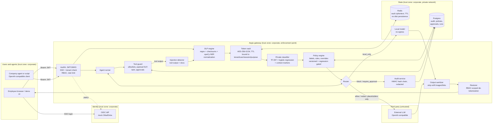
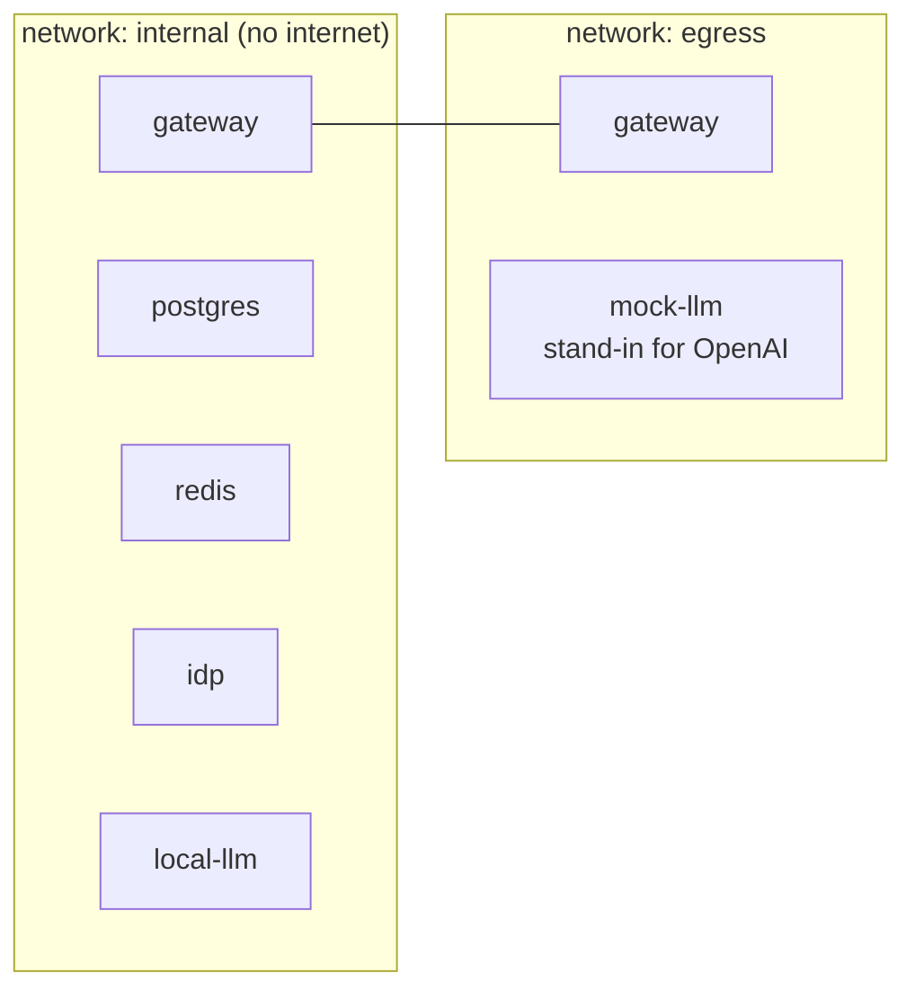
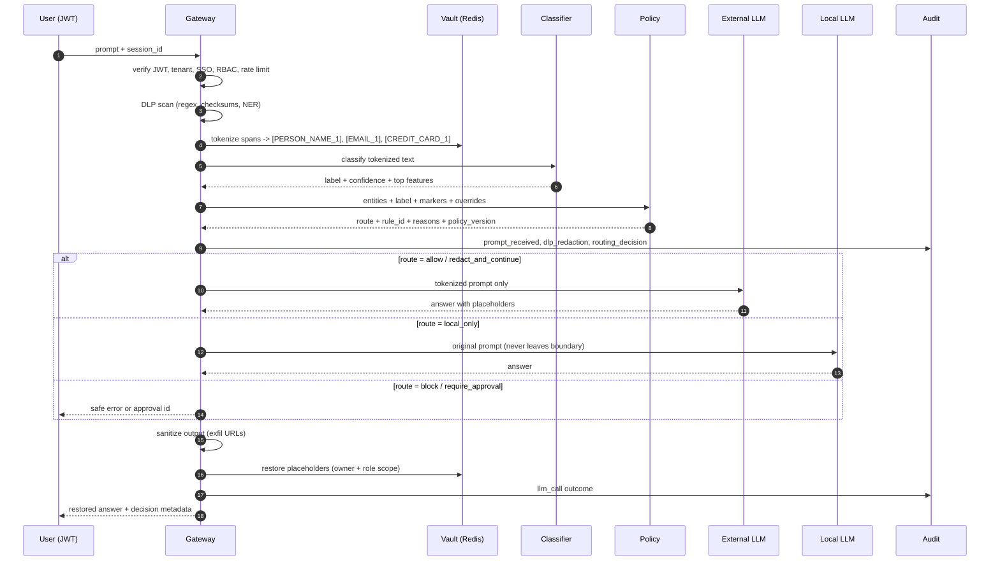

# Aegis: Secure AI Agent Gateway Architecture

Aegis sits between employees, company agents, and third-party LLMs. Its job is to
stop sensitive data from leaving the company, through prompts, through agent tools,
or through prompt injection, without breaking legitimate work.

This document is the design. Measured results (red-team scores, latency) live in
`reports/`, and are generated by the code, not written by hand.

---

## 1. Assumptions (defaults chosen without stakeholder input)

| # | Assumption | Why it is a sensible default |
|---|------------|------------------------------|
| A1 | Users authenticate through the company IdP (OIDC). A mock IdP stands in for Okta or Entra ID. | Every enterprise has an IdP. Building auth into the gateway would duplicate it. |
| A2 | The tenant is `acme`. Corporate mail domain is `acme.example`. All `.example` domains are reserved by RFC 2606. | Synthetic only. Nothing in the repo can collide with a real company. |
| A3 | The external LLM speaks the OpenAI chat-completions protocol. | Most providers and proxies (OpenAI, Azure OpenAI, vLLM, Ollama, LiteLLM) expose it. |
| A4 | A "local model" is any model inside the trust boundary. The demo uses a deterministic mock; Ollama or vLLM plug in by URL. | The routing decision is the security control, not the model quality. |
| A5 | English text only. | spaCy `en_core_web_sm` and the classifier are English. Listed as a limitation. |
| A6 | Agent tools are sandboxed simulations (outbox, egress log). No real email or HTTP leaves the demo. | Safe to demo and test. The guard sits in front of the tool interface, so swapping in real tools does not change the control. |
| A7 | Fast-path latency budget: under 300 ms added at p95, excluding LLM time. | Users notice anything above a few hundred milliseconds; LLM calls already take one to ten seconds. |
| A8 | Traffic that never reaches the gateway (a personal ChatGPT tab) is out of scope for the gateway. Egress controls or a CASB must force traffic through it. | A proxy can only protect the traffic it sees. The demo shows this gap on purpose. |
| A9 | Single region, single tenant in the demo; the data model is multi-tenant throughout. | Keeps the demo runnable on a laptop without hiding tenancy decisions. |

---

## 2. System diagram

### Network segmentation (as deployed by `docker-compose.yml`)

Only the gateway sits on both networks. The local model, the vault cache, and the
database cannot reach the "third party" at all.

---

## 3. Component responsibilities

| Component | Module | Responsibility | Fails |
|-----------|--------|----------------|-------|
| AuthN/AuthZ | `aegis/auth/` | Verify RS256 JWT against IdP JWKS; require `iss`, `aud`, `exp`; require `tid` in allowed tenants and `amr` contains `sso`; map IdP roles to permissions; per-user rate limit. | Closed (401/403/429) |
| DLP engine | `aegis/dlp/` | Normalize text (NFKC, strip zero-width), run pluggable detectors (email, obfuscated email, phone, Luhn-checked card, SSN-like, API keys, private keys, passwords, spaCy PERSON/ORG). Resolve overlaps. Apply per-entity thresholds and the public-term allowlist. Return spans, types, confidences, detector names, and actions. | Closed: detector exception = request blocked |
| Token vault | `aegis/vault/` | Replace values with `[TYPE_N]` placeholders. Store AES-256-GCM ciphertext with AAD = tenant, user, session, purpose, placeholder. Same value gets the same placeholder within a session (HMAC index). TTL expiry. No plaintext anywhere at rest. | Closed: vault down = cannot tokenize = block |
| Classifier | `aegis/classifier/` | Label residual context (after tokenization) as PUBLIC, INTERNAL, CONFIDENTIAL, RESTRICTED. Pure-Python inference over an exported TF-IDF + logistic regression model (no pickle). Explain with top weighted features. | Closed: low confidence escalates the label |
| Policy engine | `aegis/policy/` | Combine entity findings, classifier label, and deterministic context markers into one decision: `allow`, `redact_and_continue`, `local_only`, `require_approval`, or `block`. Apply tenant and user overrides. Versioned. | Closed: invalid policy is rejected at write time |
| Regression gate | `aegis/policy/regression.py` | Replays the regression corpus against a candidate policy. Refuses to activate a policy that loses protection on any case the baseline protected. Runs in CI and in the admin API. | Closed |
| Router | `aegis/gateway/pipeline.py` | Send placeholders-only text to the external provider, or full text to the local provider, or nothing. | Closed |
| Agent runner | `aegis/agent/runner.py` | Bounded tool-use loop (max steps). Every tool call goes through the tool guard; every tool output goes through DLP and the injection detector before the model sees it. | Closed: a block ends the run |
| Tool guard | `aegis/guard/interceptor.py` | Resolve placeholder recipients, enforce email domain allowlist and personal-domain blocklist, enforce URL allowlist, decode URLs (percent, base64, hex) and scan for raw or tokenized data, block risky tools in sessions tainted by injection, queue risky calls for approval. | Closed |
| Approvals | `aegis/guard/approvals.py` | Pending queue with expiry, four-eyes rule (requester cannot approve), same-tenant approver with `tool:approve`. Payload encrypted at rest. | Closed: expired = never executes |
| Injection detector | `aegis/guard/injection.py` | Weighted signals (instruction override, exfil-to-URL, hidden HTML, zero-width text, encoded instructions, AI-addressed imperatives). Noisy-OR score with explanation. | Flags; taint then blocks risky tools |
| Output sanitizer | `aegis/guard/output.py` | Remove markdown/HTML images and links to non-allowlisted domains, and any URL carrying placeholders, before restoration. Stops zero-click image exfiltration in the client. | Closed |
| Restorer | `aegis/vault/vault.py` | Replace placeholders in the answer with real values only for the session owner, scoped by role (`full`, `masked`, `never` per entity type). Never restores inside URLs. | Placeholders stay |
| Audit | `aegis/audit/` | Append-only events, HMAC-SHA256 hash chain, DB triggers reject UPDATE/DELETE, regex scrubber as a last line of defense, content withheld above a label threshold. Query and verify APIs. | Closed: audit write failure fails the request |

---

## 4. Data flow

### 4.1 `POST /chat` (protected path)

### 4.2 `POST /agent/run`

1. The task goes through the same DLP, tokenization, classification, and routing as chat.
   The route picks the model for the whole run.
2. Loop (max 6 steps): the model proposes a tool call.
3. Tool guard checks it. `allow` executes in the sandbox. `require_approval` stores an
   encrypted pending call and stops the run. `block` stops the run with a safe error.
4. Tool output is scanned for injection. A hit taints the session, so later risky tools
   are blocked even if the model is fooled. The output is then tokenized, so customer
   data from CRM lookups reaches the model only as placeholders.
5. Final answer: output sanitizer, then RBAC-scoped restoration.

### 4.3 Policy change

`PUT /admin/policies` (security admin) validates the schema, computes the effective
policy for the tenant and every user override, replays the regression corpus, and
activates the new version only if no previously protected case regresses. Either way
the attempt is audited.

---

## 5. Trust boundaries

| ID | Boundary | What crosses it | Control at the boundary |
|----|----------|-----------------|-------------------------|
| TB1 | User to gateway | Raw prompts, JWTs | TLS (terminated in front of the gateway in production), JWT verification, rate limit, 64 KB body limit |
| TB2 | Gateway to external LLM | Tokenized prompts only | DLP + tokenization + classifier routing; external network is the only path out |
| TB3 | Tool output to model | Untrusted documents, CRM records | Injection detection, taint, tokenization, `<untrusted_tool_output>` spotlighting |
| TB4 | Agent to tools | Tool arguments chosen by a possibly compromised model | Tool guard (allowlists, payload DLP, approvals) |
| TB5 | Gateway to storage | Ciphertext, redacted audit events | AES-GCM with context-bound AAD, Redis without persistence, append-only triggers |
| TB6 | Gateway to client (answer) | Restored values | Owner check, role-scoped restore, URL sanitizer |

---

## 6. Failure modes

| Failure | Behaviour | Rationale |
|---------|-----------|-----------|
| Redis unavailable | Requests that need tokenization fail with 503. PUBLIC prompts with zero findings still pass. | Never send raw PII because the vault is down. |
| Postgres unavailable | Requests fail with 503 (audit write is part of the request). | Legal review requires every decision to be logged. Unlogged traffic is worse than downtime for this use case. |
| spaCy model missing | Falls back to the cue-based name detector and logs a warning; `/healthz` reports `ner_backend: heuristic`. | Degrades recall for names, keeps regex protection. Production should alert on this. |
| Classifier artifact missing or hash mismatch | Startup fails. | A silently missing classifier would turn context protection off. |
| External LLM timeout or 5xx | 502 with safe message, audited. No retry to a different external provider. | Retrying elsewhere could send data to a provider the policy did not approve. |
| Model returns mangled placeholders | Tolerant restore (`EMAIL_1`, `[EMAIL 1]`). Unknown placeholders are left as is. | Never guess a mapping. |
| Vault entry expired before restore | Placeholder stays in the answer, response notes `restore_incomplete`. | Expiry is a feature; show it rather than fail. |
| Approval expires | Status `expired`, call never executes, 410 on approve. | Stale approvals are a classic abuse path. |
| Audit chain verification fails | `/audit/verify` returns the first broken sequence number. | Tamper evidence, not prevention; alerting is a next step. |
| Policy update weakens protection | 409 with the list of regressed cases; old policy stays active. | Rule changes cannot silently break protection. |

---

## 7. Tradeoffs

| Decision | Option A | Option B | Choice and why |
|----------|----------|----------|----------------|
| Where the model runs | **Local model**: data never leaves; lower quality, you run the GPUs | **External model**: best quality, pay per token, third-party exposure | Both. Route by label. CONFIDENTIAL context goes local; tokenized INTERNAL work goes external. |
| Detection method | **Regex + checksums**: microseconds, precise for structured data (cards, keys), blind to context | **NER (spaCy)**: catches names and orgs, a few ms, false positives on tech terms (`Kafka` as PERSON) | Both, with confidence heuristics and an allowlist to cut NER false positives. |
| Context sensitivity | **Keyword rules**: deterministic, auditable, brittle | **Private classifier**: generalizes to unseen phrasing, needs training data, can be wrong | Classifier for recall, plus deterministic markers as a floor ("attorney-client privileged" is always RESTRICTED). A local LLM judge is the next step for higher recall at higher latency. |
| Latency vs accuracy | Regex-only fast path, about 0.1 ms | Regex + NER + classifier, a few ms | Run everything. Measured overhead is far under budget (see `reports/latency.md`), so accuracy wins. The budget would let a small local LLM judge run on the uncertain band only. |
| Tokenization vs full redaction | **Tokenization** (`[EMAIL_1]`): reversible, the LLM can still reason about "the same customer", answer is restored | **Full redaction** (`***`): simplest, nothing to store, answer is less useful | Tokenize names, contacts, cards; irreversibly redact secrets (API keys, passwords); block private keys. |
| Blocking vs approval | **Block**: zero risk, frustrates users, drives them to shadow IT | **Approval**: keeps work moving, costs a human, approval fatigue | Block clear exfiltration (personal domains, unknown URLs, injected sessions); approve legitimate-but-risky actions (internal email with customer data). |
| Gateway vs client-side filtering | See ADR 0001 | | Gateway. |
| Audit content | Store redacted prompt text | Store only metadata | Redacted text up to INTERNAL; above that, a keyed fingerprint and length only, so the audit log does not become the leak. |

---

## 8. Scaling and deployment notes

* The gateway is stateless. All state is in Redis (vault, sessions, rate limits) and
  Postgres (audit, policies, approvals). Scale horizontally behind a load balancer.
* The audit hash chain is a serialization point: one row lock per append. That caps
  append throughput per tenant. Per-tenant chains or batched Merkle roots remove it
  (documented in `docs/cost-and-scaling.md`).
* spaCy and the classifier run in-process. CPU-bound work runs in FastAPI's threadpool.
  NER is the dominant CPU cost; size replicas by measured p95, not by request count.
* See `docs/cost-and-scaling.md` for cost per 1,000 requests.

## 9. Related documents

* `docs/adr/` (architecture decision records)
* `docs/threat-model.md`
* `docs/tradeoffs-and-limitations.md`
* `docs/security-checklist.md`
* `docs/cost-and-scaling.md`
