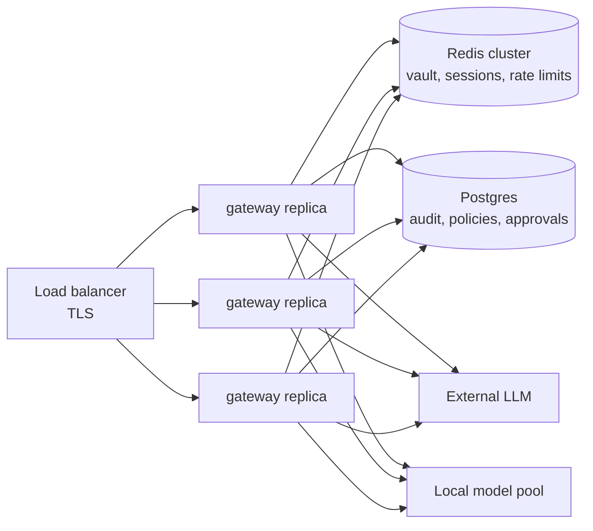

# Cost and scaling

The measured numbers come from this repo (`reports/latency.md`, plus the load and audit probes described
below) on a 4 vCPU container host. Prices are **assumptions** for illustration: replace them with
your contract rates.

## Measured capacity

| Measurement | Result | How |
|-------------|--------|-----|
| Gateway overhead per request, p95 | 9.2 ms in-process, 21.2 ms in the Docker stack (complaint with 3 entities) | `make benchmark`, `make benchmark-live` |
| One gateway replica (1 uvicorn worker), full-path chat | **about 44 requests/s**: p95 28 ms at concurrency 1, then queueing (p95 107 ms at 4, 207 ms at 8) | 12 s closed-loop load test against `docker compose`, mock LLM over HTTP |
| Audit appends, single hash chain on Postgres | **469 appends/s** serial (2.1 ms each) | 500 appends from inside the gateway container |
| Dominant CPU cost | spaCy NER (2.9 ms of the 3.3 ms DLP scan at p50) | stage table in `reports/latency.md` |
| Audit storage | 891 bytes per event on average | `pg_column_size` over 8,482 demo events |

## Cost per 1,000 requests

Assumed request: 400 input tokens (system prompt + tokenized prompt) and 250 output tokens.
Placeholders add a handful of tokens; that is negligible.

| Route | Assumption | Cost per 1,000 requests |
|-------|------------|-------------------------|
| External, small model | $0.15 per 1M input tokens, $0.60 per 1M output tokens | 0.4 × 0.15 + 0.25 × 0.60 = **about $0.21** |
| External, large model | $2.50 per 1M input tokens, $10 per 1M output tokens | 0.4 × 2.5 + 0.25 × 10 = **about $3.50** |
| Local model (8B instruct on one L4-class GPU with vLLM) | $0.80/hour instance; about 5 requests/s at 250 output tokens with batching | at 100% utilization: 200 s → **about $0.04**; at 20% utilization: **about $0.22** |
| Gateway itself | about 44 req/s per vCPU-sized worker; $0.05 per vCPU-hour | 1,000 / 44 ≈ 23 vCPU-seconds → **about $0.0003** |
| Postgres + Redis | small managed instances, roughly $100/month combined | about $0.004 at 10 requests/s sustained |

How to read this:

* The gateway's own cost is noise next to tokens. Its cost is latency (about 10-20 ms), not money.
* External pricing is linear and has no fixed cost. A local model is a fixed cost, so it is cheap
  only when it is busy. Routing *only* CONFIDENTIAL context locally (a minority of traffic) keeps the
  GPU small; routing everything locally is a capacity-planning problem, not a policy one.
* The local-model numbers are an estimate. The demo's local model is a mock, so its cost is not
  measured here. Measure it with your model and hardware before committing.

## Horizontal scaling

* **Stateless replicas.** Every piece of per-request state is in Redis (vault, sessions, rate
  limits) or Postgres (audit, policy versions, approvals, runs). Any replica can serve any request,
  including restoring placeholders created on another replica. Policy changes propagate within the
  store's 5 s refresh.
* **Scale by CPU.** NER is CPU-bound and holds the GIL, so run several uvicorn workers per pod (one
  per core) and scale pods on CPU. Expect roughly 40 requests/s per worker for the full path.
* **First bottleneck: the audit chain.** One chain at 469 appends/s, with 4 events per chat request,
  caps the fleet around 100 chat requests/s. In order:
  1. Batch the four per-request events into one append, for about 4× headroom (about 450 requests/s).
  2. One chain per tenant (or per shard key): independent heads, so no shared row lock.
  3. Merkle batching: append events freely and chain a periodic root, anchored externally.
* **Redis.** The vault is small: each token is about 300 bytes with a 15-minute TTL. At 100
  requests/s with 3 tokens each, that is about 27k live keys and well under 50 MB. Losing Redis loses
  in-flight placeholders, so answers come back tokenized and users retry. Nothing leaks, which is
  why persistence stays off.
* **Postgres.** Audit is append-only at a measured average of 891 bytes per event (4 to 5 events
  per chat request): about 4 GB per million chat requests before indexes. Partition by month; archive old partitions to WORM storage with the chain head hash.
* **Regression gate.** It runs only on policy writes (about 1.5 s for 84 cases × 2 scopes). It is not
  on the request path.
* **Local model pool.** Scale separately (vLLM replicas behind its own load balancer); the gateway only
  needs an OpenAI-compatible URL.
