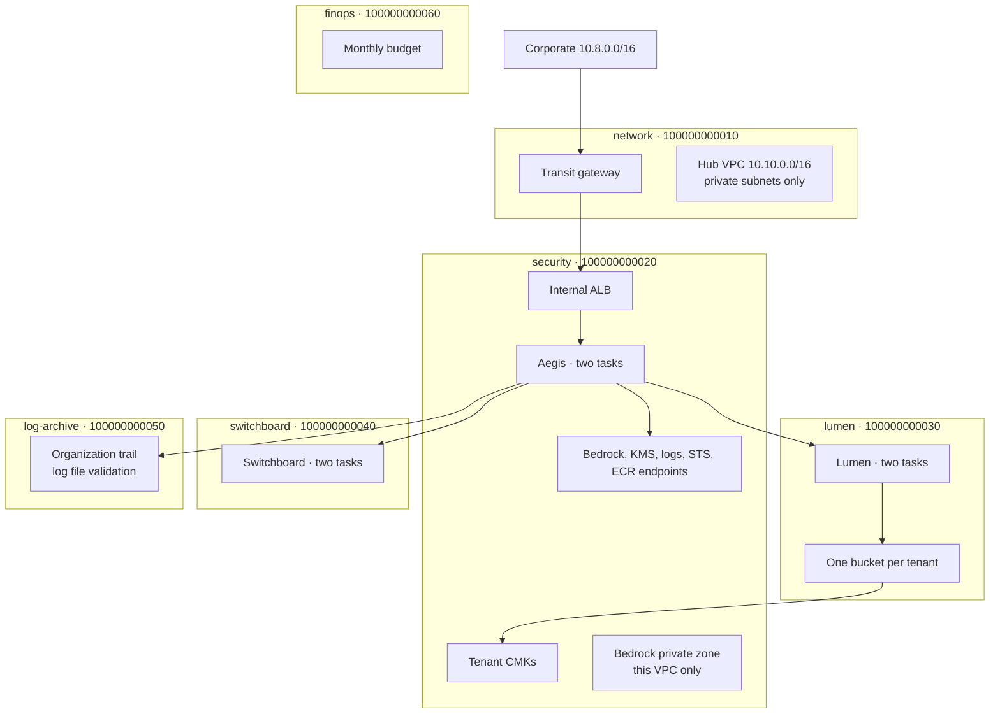
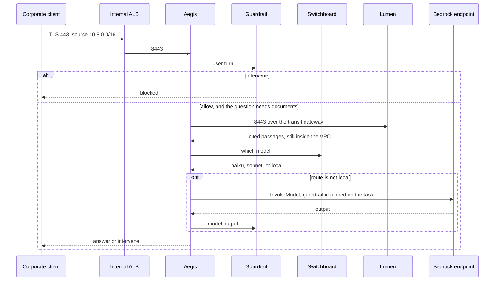
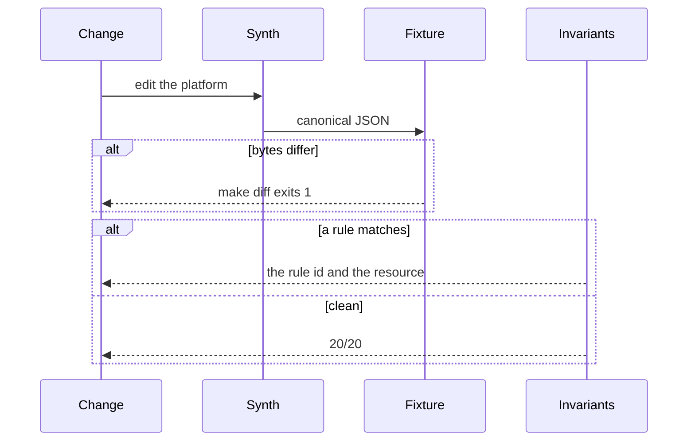

# Skyline architecture

Skyline is the landing zone for Aegis, Lumen, and Switchboard. Aegis is the only role that may call a
model. Lumen holds tenant documents. Switchboard chooses the model and does not call it. The numbers in
the README are generated from `reports/latest/`. This document is the design.

## Goals and non-goals

| Goal | How it is enforced | Where it shows up |
|---|---|---|
| No path from a workload subnet to the internet | No internet gateway, no `0.0.0.0/0` route, no public address on a task | `no-internet-gateway`, `no-default-route`, `tasks-no-public-ip` |
| A tenant's documents are not readable with another tenant's key | One CMK per tenant, encryption context required | `tenant-bucket-key`, `kms-encryption-context` |
| Only Aegis can reach Bedrock | Endpoint in the security VPC, endpoint policy, `Deny` on the other task roles, private DNS not shared | four Bedrock rules |
| A platform change is the one you reviewed | Deterministic synth, fixture diff, named mutations | `make diff`, `make gate-seeded` |
| The private path has a price | Quantities read from the template, rates from `eval/pricing.yaml` | FinOps console |
| Runnable with no account | Fixture synthesizer. `SKYLINE_PROVIDER` other than `fixture` refuses to start | `make test` |

Non-goals: a live deploy, a real organization, `aws-cdk-lib` compatibility, a classifier for hate speech,
and a claim that the frozen prices are this month's bill.

## Accounts and trust

Account ids are synthetic (`100000000010` through `100000000060`). They exist so a key policy can name
a role. They are not an account you can open.



The corporate CIDR is an input in `eval/platform.yaml`. If someone sets it to `0.0.0.0/0`, the security
group rule fails. That is the control. There is no separate "please don't" comment.

Rejected: one shared VPC, with subnets shared over RAM. A shared VPC makes the security group reference
easy and makes the account boundary decorative. The transit gateway is clumsier, and it is the boundary
we can draw on a diagram without lying. The cost of that choice is a hub: if the transit gateway is
down, every cross-account call is down. That is in the reliability note, not hidden.

## Request path



Lumen never receives a route to the Bedrock endpoint. Private DNS for `bedrock-runtime` is associated
with the security VPC only. A packet that guessed the endpoint's address would still fail IAM, because
the endpoint policy principal is the Aegis task role and the Lumen role denies `bedrock:*`.

The two controls fail in different mutations. `lumen-bedrock` removes the deny and adds an allow.
`share-bedrock-dns` associates the Lumen VPC with the private zone. Each one is enough to fail the gate.
Both together would be how a real bypass happens. The gate does not require you to plant both.

## Failure path



A second failure path is the guardrail itself. A card number, an email, a phone, an access-key shape,
a denied phrase, or a prompt-attack phrase returns `INTERVENE` from the stub. An insult returns `ALLOW`.
That second result is a case tagged `content-filter`, and the eval fails if the stub starts blocking it.
The gap is locked open on purpose. See [docs/FAILURE_MODES.md](docs/FAILURE_MODES.md).

## Decisions at a glance

| Question | Decision | Rejected |
|---|---|---|
| How do we synth without an account? | Typed builders emit canonical JSON. CI diffs the fixture. | `aws-cdk-lib`, context lookups, asset hashes |
| Where do tenant keys live? | Security account, one CMK per tenant, `kms:EncryptionContext:tenant` | One platform key. SSE-S3. A key per account that every tenant shares |
| Who calls Bedrock? | Aegis, through an interface endpoint in the security VPC | A NAT gateway and the public endpoint. A shared Bedrock private zone |
| What does the guardrail scan? | User turn and model output | The retrieved context. It would dominate the bill |
| What does the unit cost include? | Variable tokens plus fixed cost smeared over a stated requests/day | One blended number with the volume hidden |
| How is the ALB placed? | Internal, in the security VPC, clients arrive over the transit gateway | A public ALB. An ALB in the network account targeting another VPC, which ALB cannot do |

## What the template actually contains

Each workload VPC:

* two private subnets, `MapPublicIpOnLaunch` false, two different AZs
* a route to `10.0.0.0/8` via `tgw-skyline0001`, and no default route
* a gateway endpoint for S3, which is free
* interface endpoints for logs, STS, ECR API, ECR DKR, and monitoring, so a task can boot and log with no NAT
* the security and Lumen VPCs also have KMS
* only security has `bedrock-runtime`

Security groups do not use `0.0.0.0/0` in either direction. Egress is the security VPC, the other
service's CIDR, or the local endpoint security group. That is stricter than the usual "allow all
egress" template, and it is why a task cannot wander out through a port we forgot.

Task roles that ECS assumes carry `aws:SourceAccount`. A role without that condition can be confused
into trusting a task from another account. Flow-log roles are not ECS roles and are not held to that
rule. Execution roles may use `Resource: "*"` only for `ecr:GetAuthorizationToken`, because that API
does not support a resource ARN. Any other star fails `iam-no-star-resource`.

Keys:

| Key | Account | Use |
|---|---|---|
| `skyline-tenant-northwind`, `helix`, `brightline` | security | That tenant's bucket. Context required. |
| `skyline-ops-security`, `skyline-ops-lumen`, `skyline-ops-switchboard` | the account that logs | Task log groups. Not tenant data. |
| `skyline-trail` | log-archive | The trail bucket. |

Three ops keys instead of one, because a log group in the Lumen account cannot use a key whose policy
only trusts the security account's logs service. Cross-account log encryption is a separate design.
We did not take it.

The guardrail resource configures hate, insults, and misconduct at HIGH, prompt attack at HIGH on input,
two deny topics, and four PII types. The stub scores the PII, the topics, and the prompt-attack phrases.
It records the three content filters as `stubBlindFilters` on the resource metadata. Metadata is not
sent to AWS. It is how the fixture admits what the stub cannot see.

## FinOps model

The unit is the 1,000-request mix in `eval/workload.yaml`.

| Class | Count | Skyline model | Naive model |
|---|---:|---|---|
| FAQ and classification | 620 | Haiku-class | Sonnet-class |
| Cited answer | 250 | Haiku-class | Sonnet-class |
| Confidential | 80 | Local, no token price | Sonnet-class |
| Agent step | 50 | Sonnet-class | Sonnet-class |

Variable cost is tokens, guardrail text units, network bytes, transit-gateway bytes, and KMS data-key
requests at a 1% cache miss. Fixed cost is endpoint hours, NAT hours in the counterfactual, transit
gateway attachment hours, CMK months, Fargate, and the internal load balancer. Fixed cost is smeared
across the requests/day you ask about:

```
per_thousand = variable_per_thousand + fixed_per_day * 1000 / requests_per_day
```

The naive column is not a second template. It is the same three services, one NAT gateway, one CMK,
no transit gateway, no guardrail, and the naive model on every row. Compute and the load balancer
therefore cancel in the comparison. They stay on the table so a fully loaded number is not missing them.

Two crossovers, both computed, neither assumed:

* Fully loaded unit cost. Skyline is more expensive at 1,000 requests/day and less expensive at 10,000.
  The crossing is a few thousand requests/day. Below it, you are paying for the platform. Above it, the
  model mix pays for the platform and the guardrail.
* Endpoints versus one NAT, network line only. The hourly gap is several dollars a day. The byte gap
  on this mix is a fraction of a cent per thousand requests. The crossing is tens of millions of
  requests/day. Private networking is not justified by the NAT bill at any volume this platform states.

Scanning the full prompt, retrieved context included, prices the guardrail above the model-routing
savings. That is why ADR 0004 leaves the corpus out of the guardrail. Lumen already refuses a document
the caller cannot read. The guardrail is for the user turn and the model output.

Not in the model, on purpose: CloudWatch ingestion, inter-AZ data transfer, CloudTrail data events,
support, tax, and provisioned throughput. Adding them would not move the model line. It would move
the fixed cost, which is why they are listed instead of folded in as zero.

## What breaks at 10×

Ten times the tenants is thirty. Thirty buckets and thirty CMKs are fine. A thousand tenants is not
this shape: the account's bucket quota and the KMS key quota become the design, and the key policy
on a shared key would not fit the principals. The replacement is a key per tenant still, with bucket
prefixes and an explicit SSE-KMS key on each `PutObject`, or a tenant account. The gate would have to
change with that. It currently expects one bucket logical id per tenant.

Ten times the traffic does not break the network design. It changes the bill. Endpoint hours stay
flat. Token cost and guardrail text units scale. The console's volume control is that sentence.

Ten times the services, each in its own VPC with its own ECR endpoints, multiplies the hourly
endpoint bill by the VPC count. Centralizing ECR, logs, and STS in the hub VPC would cut that. We
did not, because a shared private zone is the mechanism that would also publish Bedrock DNS into
Lumen. The duplicate endpoints are the price of keeping that mistake a separate resource
(`BedrockPrivateZone`) that the gate can see.

Ten times the regions is out of scope. The trail is marked multi-region. The VPCs are not.

## Rejected alternatives

* **Live CDK.** Context lookups and asset hashes make the diff non-deterministic, and the demo would
  need an account to be honest about what it deployed. ADR 0001.
* **One CMK, with the tenant id only in a tag.** A tag does not stop `Decrypt`. The encryption context
  does, and only if the key policy requires it. ADR 0002.
* **NAT for the model, endpoints for everything else.** The model path is the one that must not have
  a route to the internet. A NAT "just for ECR" becomes a default route the moment a subnet is wrong.
  There is no NAT in the template. ADR 0003.
* **A single $/1k that assumes 100,000 requests/day.** That hides the volume where the platform is the
  expensive part. ADR 0004.
