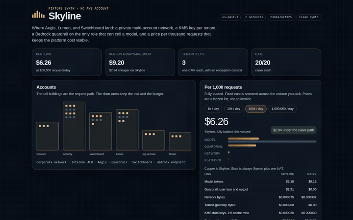
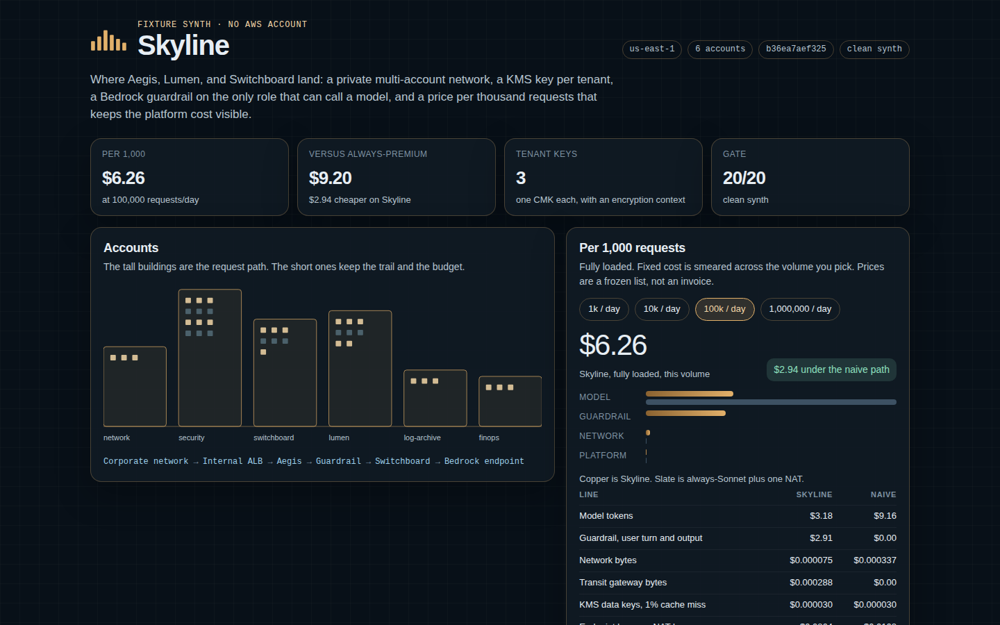
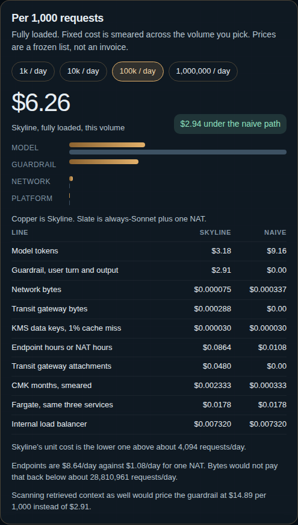
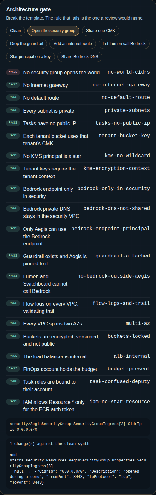
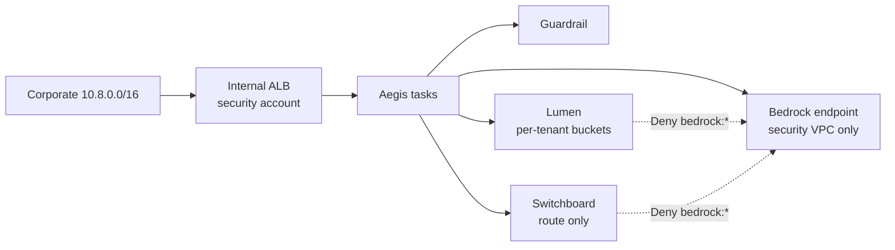
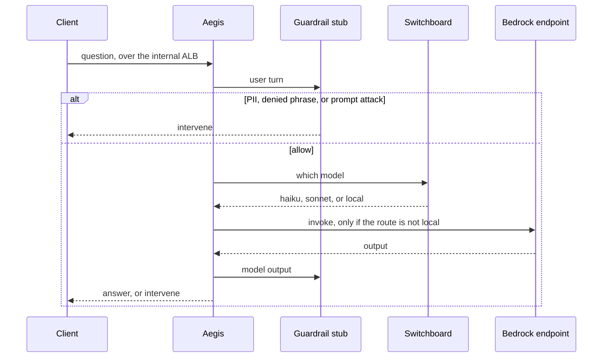

<div align="center">

# Skyline

### A private place for Aegis, Lumen, and Switchboard to land, and a price per thousand requests that does not hide the platform

[](https://github.com/kumarlakshya24/personal-projects/actions/workflows/skyline.yml)


[**Demo**](#demo) ·
[**Why**](#why) ·
[Quickstart](#quickstart) ·
[Architecture](#architecture) ·
[Results](#results) ·
[Where it fits](#where-it-fits)

The three products already run on a laptop. Skyline is the account layout they would share:
no public subnet, a KMS key per tenant, Bedrock only from Aegis, and a bill that shows what that privacy costs.

</div>

---

## In plain English

Aegis decides what may leave. Lumen answers from the documents. Switchboard picks the model.
None of them decides which account the packet is in, which key wraps a tenant's documents, or
whether the model call can reach the internet. Left alone, that decision becomes a public load
balancer and one shared KMS key, because that is what the tutorial creates.

Skyline is the platform definition. It synthesizes a six-account landing zone as CloudFormation-shaped
JSON, diffs it against a committed fixture, and fails a named rule if a change opens the world, shares
a tenant key, drops the guardrail, or lets Lumen call Bedrock. The same run prices 1,000 requests.

No AWS account. No API key. The synthesizer does not import `aws-cdk-lib` and does not call AWS.

```bash
cd skyline
make test       # invariants, guardrail stub, the unit cost
make eval       # synth, both gates, FinOps; rewrites the results below
make gate-seeded  # open 0.0.0.0/0; exits 1
make up         # console at http://127.0.0.1:8097
```

## Demo

Sixty seconds, from a clean synth.

```bash
make up
# http://127.0.0.1:8097
```

1. The skyline is six accounts. Security is the only one with a Bedrock endpoint, and the path under it is corporate network → internal ALB → Aegis → guardrail → Switchboard → that endpoint.
2. At 100,000 requests/day the fully loaded unit cost is about **$6.26** per thousand, against about **$9.20** for the same services on one NAT gateway with every request on a Sonnet-class model.
3. Switch the volume to 1,000/day. Skyline becomes the more expensive unit, about **$22.28** against **$12.79**. The private endpoints are an hourly cost. They do not pay for themselves on bytes.
4. Choose **Open the security group**. The gate goes red on `no-world-cidrs` and the diff shows `0.0.0.0/0`. **Clean** puts it back.
5. The guardrail list blocks a card number and a prompt attack. The insult stays allowed, and it is labeled as a gap. The stub is not a classifier.



<video src="docs/assets/skyline-demo.mp4" poster="docs/assets/skyline-dashboard.png" controls playsinline width="960"></video>

The clip is the same silent recording as [`skyline-demo.mp4`](docs/assets/skyline-demo.mp4): the accounts, the unit cost at three volumes, and the planted break.







## Why

"Put it in a private subnet" is not a design until the template says which subnet, which route, and which principal. Skyline makes those three agree:

* Workload route tables have a route to `10.0.0.0/8` via the transit gateway. They have no route to an internet gateway, because there isn't one.
* The Bedrock interface endpoint lives in the security VPC, and its policy names `AegisTaskRole`. Lumen and Switchboard carry `Deny` on `bedrock:*`.
* Each tenant's documents are a bucket encrypted with that tenant's CMK. The key allows use only when the encryption context is `tenant=<id>`.

The FinOps view exists so those controls have a price. Model routing is the large saving. The guardrail is the next line, because it is priced per text unit, so the template scans the user turn and the model output and not the retrieved context. Private endpoints cost more per day than one NAT gateway. At a trickle of traffic that premium dominates the unit cost. The console shows the crossover instead of a single "private is cheaper" number.

## Quickstart

Python 3.12. No Docker. No AWS credentials.

```bash
python3 -m venv .venv && . .venv/bin/activate
make install
make eval
make demo
make up
```

`SKYLINE_PROVIDER` must be `fixture` or unset. Any other value refuses to run, so a live account cannot be implied by an environment variable. See [`.env.example`](.env.example).

## Architecture

Six accounts. The full argument, including what was rejected and what breaks at 10×, is
[ARCHITECTURE.md](ARCHITECTURE.md). The Well-Architected notes are [docs/WELL_ARCHITECTED.md](docs/WELL_ARCHITECTED.md).





| Module | Responsibility |
|---|---|
| [`skyline/platform.py`](skyline/platform.py) | The six stacks. This is the design. |
| [`skyline/invariants.py`](skyline/invariants.py) | Twenty rules. A mutation fails by name. |
| [`skyline/guardrail.py`](skyline/guardrail.py) | Offline scorer for the guardrail the template declares. |
| [`skyline/finops.py`](skyline/finops.py) | Unit cost. Quantities come from the synth, prices from `eval/pricing.yaml`. |
| [`skyline/dashboard/`](skyline/dashboard/) | The console. It calls the same functions as `make eval`. |
| [`fixtures/assembly.json`](fixtures/assembly.json) | The pinned synth. `make diff` fails if it moves. |

Decisions, in [docs/adr/](docs/adr/):

| | |
|---|---|
| [0001](docs/adr/0001-fixture-synth.md) | Fixture synth, not a live CDK deploy |
| [0002](docs/adr/0002-per-tenant-cmk.md) | A CMK per tenant, with an encryption context |
| [0003](docs/adr/0003-bedrock-endpoint-in-security.md) | Bedrock only in the security VPC, and no internet gateway |
| [0004](docs/adr/0004-price-the-private-path.md) | Price the private path, and do not scan retrieved context |

## Results

Every number between the markers is written by `make eval`. Do not edit it by hand.

<!-- EVAL:START -->
Synth `fixture-cdk` in us-east-1. Hash `b36ea7aef3257f13`. 6 accounts, 122 resources. Invariants 20/20. Guardrail stub 10/10 enforced cases, 1 known unscored gap.

Fully loaded USD per 1,000 requests of the mix in `eval/workload.yaml`. Fixed cost is smeared across the stated requests/day. Prices are the frozen list in `eval/pricing.yaml`, not an invoice.

| Requests/day | Skyline | Always Sonnet-class + one NAT | Skyline cheaper by |
|---:|---:|---:|---:|
| 1,000 | $22.28 | $12.79 | -$9.49 |
| 10,000 | $7.71 | $9.53 | $1.81 |
| 100,000 | $6.26 | $9.20 | $2.94 |
| 1,000,000 | $6.11 | $9.17 | $3.06 |

At 100,000 requests/day the lines are:

| Line | Skyline | Naive |
|---|---:|---:|
| Model tokens | $3.18 | $9.16 |
| Guardrail, user turn and output | $2.91 | $0.00 |
| Network bytes | $0.000075 | $0.000337 |
| Transit gateway bytes | $0.000288 | $0.00 |
| KMS data keys, 1% cache miss | $0.000030 | $0.000030 |
| Endpoint hours or NAT hours | $0.0864 | $0.0108 |
| Transit gateway attachments | $0.0480 | $0.00 |
| CMK months, smeared | $0.002333 | $0.000333 |
| Fargate, same three services | $0.0178 | $0.0178 |
| Internal load balancer | $0.007320 | $0.007320 |

Model routing saves $5.98 per 1,000 requests before the platform. The guardrail, scanning the user turn and the model output, adds $2.91. Scanning the full prompt, retrieved context included, would add $14.89 and is not what the template does.

Skyline's fully loaded unit cost drops below the naive path above **4,094 requests/day**.

Interface endpoints are $8.64/day against $1.08/day for the single NAT in the counterfactual. Per-GB savings would not pay that premium back below about 28,810,961 requests/day.

Measured bounds. A run that takes longer fails `make eval`. The exact sample is printed by the command and is not pinned, because it moves with the machine.

| Measurement | Bound |
|---|---:|
| Synth, including the invariant walk | under 50 ms |
| Guardrail stub, mean | under 100 µs |

Projections, labeled so they are not read as measurements:

| Hop | Figure | Why it is not a measurement |
|---|---:|---|
| Bedrock guardrail round trip | 25 ms | Order of magnitude for a Bedrock Guardrails round trip. This demo does not call Bedrock. |
| KMS GenerateDataKey, cache miss | 4 ms | A typical GenerateDataKey on a cache miss. The mix assumes a 1% miss. |
| KMS, cache hit | 0 ms | The application cache. Not a resource in this synth. |
| Public internet RTT avoided | 20-40 ms | Internet RTT the private endpoint removes. Not measured from this machine. |

Planted breaks. Each one must fail the named rule. A clean synth fails none.

| Mutation | Rule that must fail |
|---|---|
| `open-sg` | `no-world-cidrs` |
| `shared-cmk` | `tenant-bucket-key` |
| `drop-guardrail` | `guardrail-attached` |
| `public-route` | `no-internet-gateway` |
| `lumen-bedrock` | `no-bedrock-outside-aegis` |
| `wildcard-kms` | `kms-no-wildcard` |
| `share-bedrock-dns` | `bedrock-dns-not-shared` |

Quantities read off the template, which is what the fixed cost multiplies:

| Quantity | Count |
|---|---:|
| Customer managed keys | 7 |
| Guardrails | 1 |
| Interface endpoint-AZ pairs | 36 |
| Interface endpoints | 18 |
| Load balancers | 1 |
| Fargate memory, GB running | 3.000000 |
| Fargate vCPU running | 1.500000 |
| Transit gateway attachments | 4 |
<!-- EVAL:END -->

## Where it fits

Skyline does not call Aegis, Lumen, or Switchboard, and they do not call Skyline. It is the account
layout those three would share. The images in the task definitions are `…/skyline/<service>:fixture`.
Nothing is pulled.

| Account | Runs | Does not run |
|---|---|---|
| network | Transit gateway, hub VPC | Tasks, keys, Bedrock |
| security | Aegis, guardrail, tenant CMKs, internal ALB, the only Bedrock endpoint | Document buckets |
| lumen | Lumen, one bucket per tenant | Bedrock. The role denies it. |
| switchboard | The router | Bedrock, and any tenant bucket |
| log-archive | Validating organization trail | A VPC |
| finops | A monthly budget | A forecast. The budget is a ceiling. |

What "deployed for real" would still take is named in [docs/FAILURE_MODES.md](docs/FAILURE_MODES.md):
real model ids, the CloudWatch key policy AWS actually requires on a log group, a management account
that owns the organization trail, and a corporate attachment on the transit gateway. The fixture does
not pretend those calls succeeded.

## Limitations

* The templates are CloudFormation-shaped. They are not passed through `cfn-lint` or the CDK synthesizer. The gate is our rules, not the AWS schema.
* The guardrail stub does not score hate, insults, or misconduct. Those filters are on the resource. One eval case stays `ALLOW` so the gap stays visible.
* Prices are a frozen list in `eval/pricing.yaml`. They follow the shape of the public price list. They are not a quote and not the Price List API.
* Latency for Bedrock, KMS, and the internet RTT the endpoint removes are projections. The measured numbers are synth time and the stub.
* Flow logs are not encrypted. Task log groups are, with an ops key that is not a tenant key.
* This is one region, three tenants, and two availability zones.

## Interview

[`docs/INTERVIEW_WALKTHROUGH.md`](docs/INTERVIEW_WALKTHROUGH.md). `make interview` prints it.
