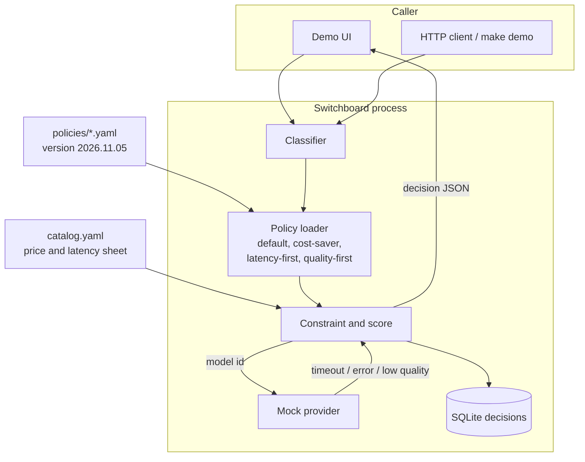
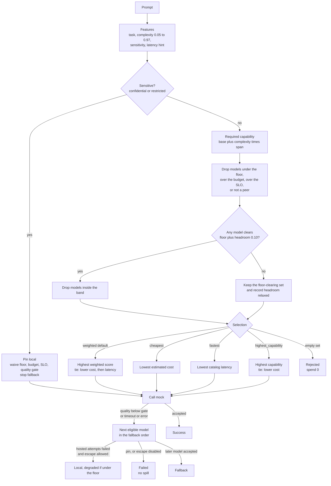
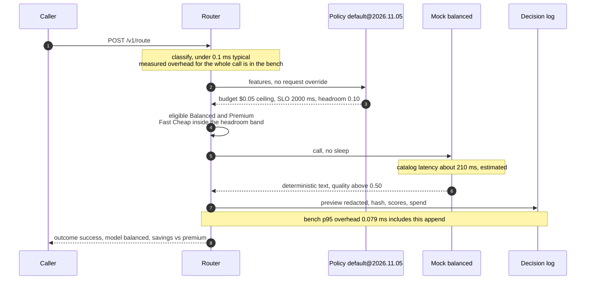
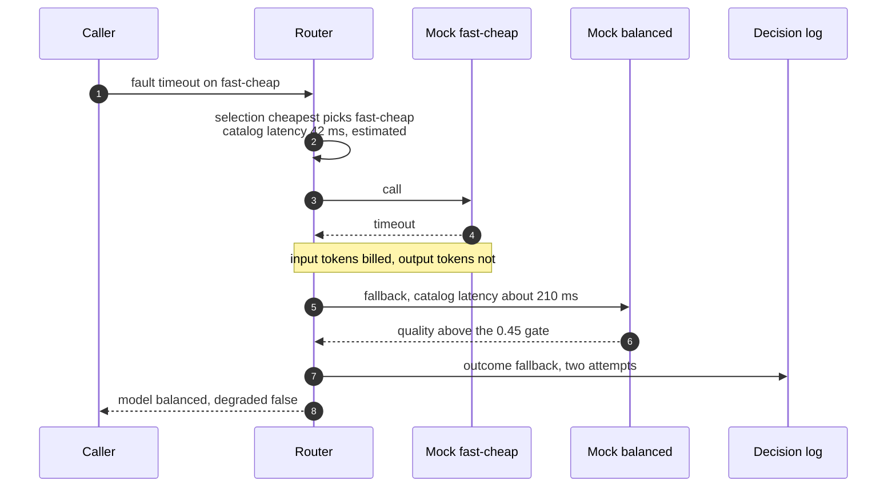
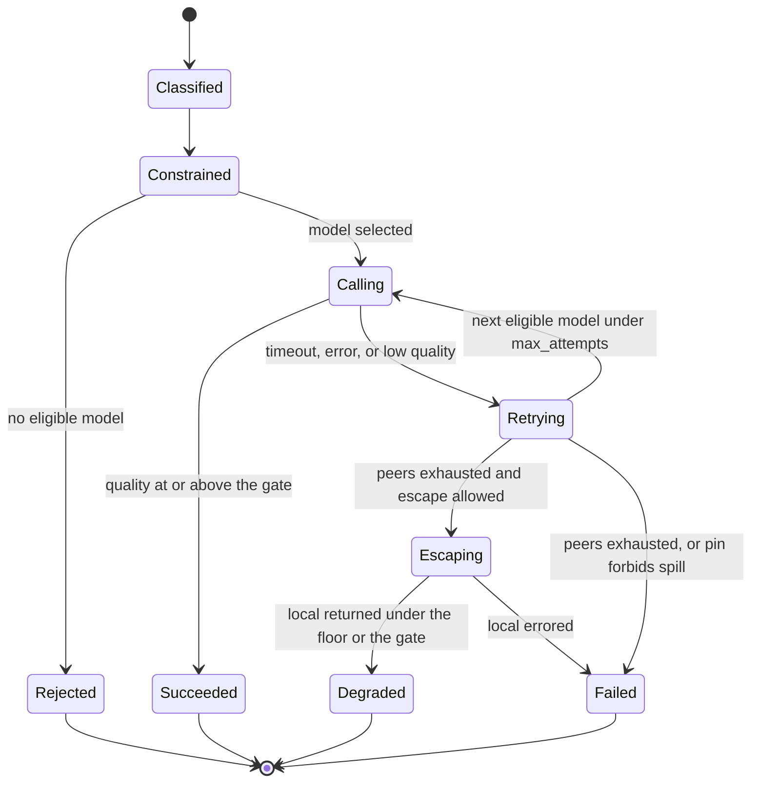

# Switchboard architecture

Switchboard chooses a model for one request. It does not run a real model. The mocks exist so the
decision, the fallback, and the bill can be tested without a network or a key.

Measured numbers live in `reports/`. Catalog latency and price live in
`switchboard/data/catalog.yaml`. This document says which is which.

---

## 1. Assumptions

| # | Assumption | Why it is the default |
|---|------------|------------------------|
| A1 | One process, one tenant, no authentication. | The thing under test is the route, not the identity system. Aegis already covers that boundary. |
| A2 | Four models, all in-process. | Enough spread to show a real choice: 42 ms / $0.00002 versus 680 ms / a few tenths of a cent, plus an on-prem pin. |
| A3 | Token count is `ceil(len/4)`. Output length is a per-task ratio, at least 32 tokens. | Stable and obvious. A real tokenizer would change the bill, not the shape of the decision. |
| A4 | Model latency is a catalog formula: base plus a per-1k-input term. The router does not sleep it. | Tests stay fast. The README does not pretend the mock waited 680 ms. |
| A5 | Local has a showback price and `peer: false`. | A $0 model would win every cost score. Local is a pin and an escape hatch. |
| A6 | Company policy is a ceiling. A request may tighten budget or SLO, not loosen them. | Callers do not get to waive a team budget by sending a bigger number. |
| A7 | English keyword features. No learned classifier. | The explanation has to be a sentence, and the eval has to be reproducible offline. |
| A8 | The decision log stores a redacted preview and a SHA-256, not the prompt. | The log is not a second copy of customer text. |

---

## 2. System context

Nothing in this picture leaves the machine. Fault injection is a field on the request, honored
only when `SWITCHBOARD_FAULT_INJECTION` is true.

---

## 3. Routing decision

Hard constraints remove models. The selection mode ranks whatever remains. Headroom is applied
only when some eligible model still clears it, so a hard prompt whose only capable model sits
inside the band is not rejected.

Numbers on that diagram, from the catalog and the bench:

| Figure | Value | Kind |
|--------|-------|------|
| Fast Cheap base latency | 42 ms | Catalog estimate |
| Balanced base latency | 210 ms | Catalog estimate |
| Premium base latency | 680 ms | Catalog estimate |
| Local base latency | 250 ms | Catalog estimate |
| Default SLO | 2000 ms | Policy ceiling |
| Latency-first SLO | 100 ms | Policy ceiling |
| Real-time wording tightens SLO to | 120 ms | Rule `R-REALTIME-HINT` |
| Default headroom | 0.10 capability | Policy |
| Default quality gate | 0.50 | Policy. Cost-saver 0.45, quality-first 0.55 |
| Default budget | $0.05 per request | Policy ceiling. Quality-first is $0.50 |
| Router overhead p95 | 0.079 ms | Measured, n=400, in-process, SQLite included, model time not slept |

A short public question under the default policy takes the Balanced catalog latency, about 210 ms
estimated, plus that 0.079 ms. The 210 ms is not a measurement.

---

## 4. Happy path

Easy chat, default policy. Fast Cheap's chat capability is 0.58. The floor is about 0.52.
Headroom 0.10 removes it because Balanced (0.82) still qualifies. Weighted scoring then prefers
Balanced over Premium on cost.

## 5. Fallback path

Cost-saver selects Fast Cheap for the same question. The demo injects a timeout. The input-token
estimate is still billed. Balanced is next, eligible, and accepts.

The other cascade, a Premium timeout on hard math under the default policy, does not stop at
"failed". Balanced and Fast Cheap are under the floor, so they are skipped. Local is then called
as an escape and the decision is `fallback` with `degraded: true`. Quality-first sets
`allow_local_on_total_failure: false`, so the same timeout ends as `failed` and local is not called.
A confidential pin never takes either cascade: local is the only attempt.

---

## 6. Components

| Component | Module | Responsibility | On failure |
|-----------|--------|----------------|------------|
| Catalog | `catalog.py`, `data/catalog.yaml` | Price, latency, capability, output ratio, capability floor | Process does not start if the file is invalid YAML the loader cannot read |
| Classifier | `classify.py` | Task, complexity, PII floor, latency hint, redacted preview | Unknown shape becomes `chat`. That is a wrong route, not an exception |
| Policy | `policy.py`, `data/policies/` | Parse and validate YAML. Weights must sum to 1 | `PolicyError` at startup, or HTTP 422 on a candidate dry-run |
| Constraints | `score.py` | Ceiling, rules, pin, headroom | Conflicting pins reject the request |
| Provider | `provider.py` | Deterministic text and quality. Optional fault | Timeout and error become attempts. They do not raise out of `/v1/route` |
| Pipeline | `pipeline.py` | Order the steps and write the why-trace | Returns `rejected` or `failed` with the attempts |
| Log | `store.py` | SQLite, stats, percentiles | A write error fails the request. Dry-runs are not written |
| HTTP | `app.py`, `static/` | UI and API | 404 unknown policy, 422 bad body |

---

## 7. Decisions at a glance

| Topic | Chose | Rejected | Why | Tradeoff |
|-------|-------|----------|-----|----------|
| Where it runs | One process on the request path | A helper inside each client | One versioned policy and one trace | Anything that bypasses the process is unrouted |
| Features | Rules and weights, no model call | An LLM judge on the hot path | Bench p95 is 0.079 ms and every label has a signal name | Phrasing outside the lists is `chat` |
| Ranking | Floor, headroom, budget, SLO, then a named selection mode | One blended score and no floor | A 100 ms SLO can reject instead of quietly picking Premium | Headroom sends some short code and easy math to Premium under `default` |
| Local | Not a peer. Pin for sensitive text, escape after a hosted failure | Letting showback price compete with Fast Cheap | A cheap local model would vacuum up traffic it is weaker at | Escape answers are worse and have to be marked degraded |
| Clock | Measure overhead. Estimate model time | Sleeping the catalog in tests and calling that latency | The eval stays deterministic and the README can say which number was measured | A real provider's tail is not in `reports/latency.md` |
| Log body | Redacted preview plus SHA-256 | The raw prompt | The stats log should not be a copy of the confidential note | You cannot replay the exact prompt from SQLite |

ADRs: [`docs/adr/`](docs/adr).

---

## 8. Data recorded per request

`POST /v1/route` returns the full trace. SQLite stores the same JSON plus columns for the aggregates.
`/v1/stats` ignores dry-runs. Spend is the sum of attempt costs: a failed generation bills output
tokens, a timeout bills input tokens only, a skip bills nothing. Savings compare that sum to one
successful Premium call on the same token estimate, even when Premium itself was ineligible.
`premium_eligible` on the comparison object says which case it is.

---

## 9. Related documents

* `docs/FAILURE_MODES.md`
* `docs/tradeoffs.md`
* `docs/INTERVIEW_WALKTHROUGH.md`
* `docs/demo-script.md`
* `reports/eval.md`
* `reports/latency.md`
