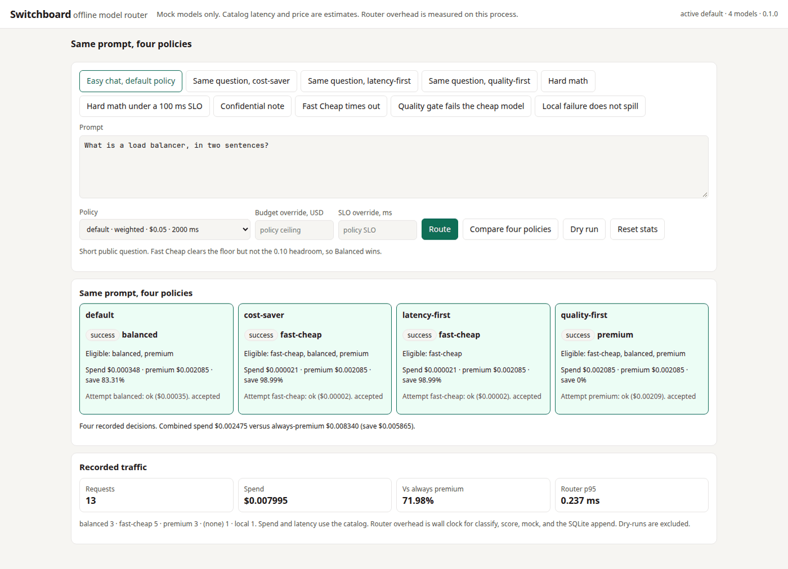
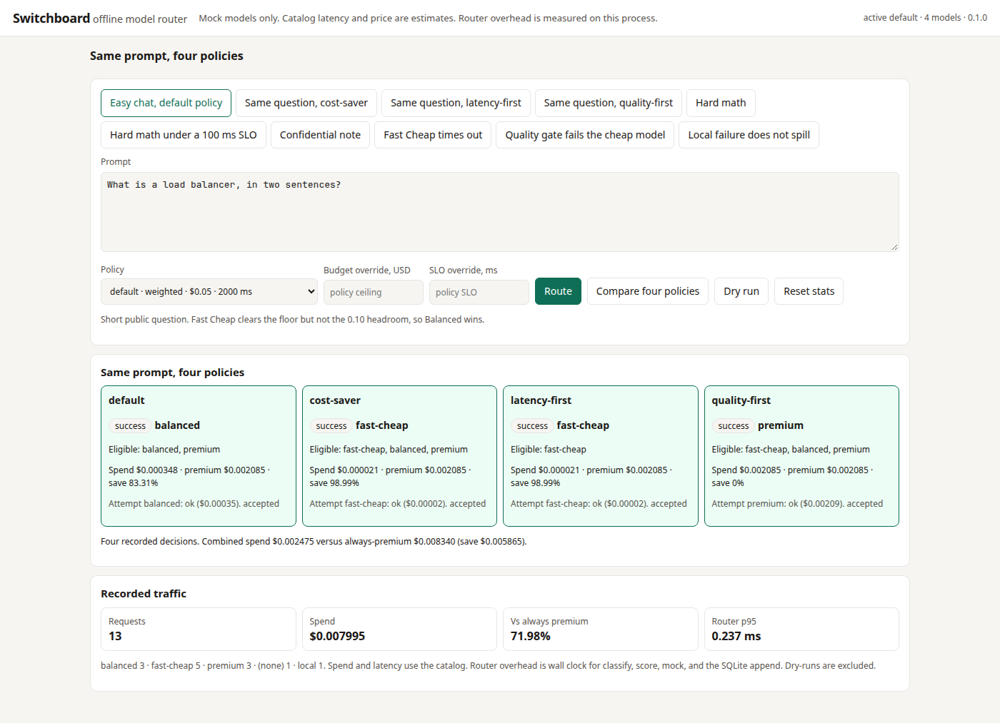
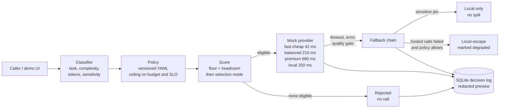

# Switchboard: an offline model router

A team that sends every prompt to one flagship model pays flagship prices for "what is a load balancer?"
A team that sends every prompt to the cheap model gets a cheap answer on a proof and a 100 ms budget
it cannot meet. The routing decision is usually buried in a client SDK, so nobody can say why a
request landed where it did, or what it would have cost on the other policy.

Switchboard sits on the request path and makes that choice explicit. For each prompt it:

* **Classifies** the request with deterministic features: task (chat, code, summarize, extract, math),
  complexity, token estimate, latency sensitivity, and a sensitivity floor (public through restricted).
* **Scores a catalog** of four in-process mocks (`fast-cheap`, `balanced`, `premium`, `local`) on
  capability, catalog latency, and estimated cost.
* **Applies a versioned policy**: hard constraints first (capability floor, headroom, budget ceiling,
  latency SLO, sensitive-content pin), then a selection mode (`weighted`, `cheapest`, `fastest`,
  `highest_capability`).
* **Calls the mock and falls back** on timeout, error, or a quality-gate miss. Confidential prompts
  do not spill to a hosted model. A total hosted failure can escape to local only when the policy allows it,
  and that answer is marked degraded.
* **Records the decision**: model, alternatives, scores, estimated spend versus always-premium, and
  the router's own wall-clock overhead. The log stores a redacted preview and a hash, not the raw prompt.

Everything runs offline with one command. No API key is needed. Prices and model latency come from a
catalog file. They are estimates. The overhead number is measured.

---

## Results (measured, regenerated by the code)

| What | Result | Source |
|------|--------|--------|
| Demo scenarios | **10 / 10 pass** | `make demo` |
| Eval corpus, gold labels | **36 / 36, 100%** | [`reports/eval.md`](reports/eval.md) |
| Savings vs always-premium, answered requests | **64.98%** ($0.02421 vs $0.06914) on 28 answered non-fault cases | [`reports/eval.md`](reports/eval.md) |
| Savings, default policy only | **61.74%** on 16 cases, all answered | [`reports/eval.md`](reports/eval.md) |
| Cost-optimal oracle agreement | **100%** on default, cost-saver, and latency-first. **50%** on quality-first (2 of 4), where the policy deliberately pays for capability | [`reports/eval.md`](reports/eval.md) |
| Task-map heuristic vs the same gold labels | **89.3%** on non-rejected routed cases. The misses are headroom, a tightened budget, and hard math under cost-saver | [`reports/eval.md`](reports/eval.md) |
| Injected faults | **5 / 5** match the expected fallback, degraded escape, or refused spill | [`reports/eval.md`](reports/eval.md) |
| Router overhead, p95 | **0.079 ms** (p50 0.057 ms, n=400, in-process, SQLite append included, model time not slept) | [`reports/latency.md`](reports/latency.md) |
| Catalog latency of the chosen model, p95 | **682 ms** estimated, not wall clock. Premium's base is 680 ms | [`reports/latency.md`](reports/latency.md) |
| Tests | 29 unit + integration tests | `make test` |

Latency-first shows a 99.34% "saving" on its six cases because three of them are rejected and cost $0.
That is a refused request, not a cheaper answer. The answered-only row is the one to quote for money.
Gold accuracy is 100% because the labels are the policy spec, locked so a later edit cannot drift.
The oracle column is the interesting disagreement: quality-first picks Premium where the cheapest
legal model is Fast Cheap or Balanced.

---

## 60-second demo



Same silent clip as video: [`switchboard-demo.mp4`](docs/assets/switchboard-demo.mp4) (six frames, three seconds each).



```bash
make install
make run-local          # http://127.0.0.1:8092
```

1. The page opens on a short question, "What is a load balancer, in two sentences?"
2. Click **Compare four policies**. Default picks Balanced (Fast Cheap clears the floor but not the
   0.10 headroom). Cost-saver and latency-first pick Fast Cheap. Quality-first picks Premium.
   The latency-first card is the same winner as cost-saver and a different eligible set: Balanced
   is out because its catalog latency is about 210 ms and the SLO is 100 ms.
3. Click **Hard math**. Only Premium clears the floor. Savings versus always-premium are 0%, and the trace says so.
4. Click **Hard math under a 100 ms SLO**. The request is rejected. Nothing is called.
5. Click **Confidential note**. The pin sends it to local. A forced local error does not spill to a hosted model.

Prefer the terminal? `make demo` runs the same checks and prints PASS/FAIL.
[`docs/demo-script.md`](docs/demo-script.md) is the click-by-click version.

---

## Setup

Requirements: Python 3.11+. Docker is optional.

```bash
cd switchboard
make install
make test
make demo
make eval          # reports/eval.md
make bench         # reports/latency.md
make run-local     # UI on :8092
```

With Docker:

```bash
make up            # http://localhost:8092
make down
```

There is no real provider. `SWITCHBOARD_FAULT_INJECTION` defaults to true so the demo can
ask a named mock to time out. Turn it off if you later point the call step at a network client.
See [`.env.example`](.env.example).

---

## Architecture



Catalog latencies above are the model's base, before the per-1k-token term.
Router overhead on the bench is **p95 0.079 ms, measured**. It is not in those arrows.

Details: [`ARCHITECTURE.md`](ARCHITECTURE.md), [`docs/adr/`](docs/adr), [`docs/FAILURE_MODES.md`](docs/FAILURE_MODES.md).

---

## Demo scenarios

| # | Scenario | Policy | Result |
|---|----------|--------|--------|
| 1 | "What is a load balancer, in two sentences?" | default | Balanced. Fast Cheap is inside the headroom band |
| 2 | Same prompt | cost-saver | Fast Cheap. Headroom is 0, selection is cheapest |
| 3 | Same prompt | latency-first | Fast Cheap. SLO is 100 ms of catalog latency |
| 4 | Same prompt | quality-first | Premium. Highest capability that clears the floor |
| 5 | Formal proof with an asymptotic bound | default | Premium. Balanced is under the floor |
| 6 | Same proof | latency-first | Rejected. The capable model misses 100 ms |
| 7 | Confidential note with an example.com address | default | Local, pinned. A single email with no confidential marker stays internal and is not pinned |
| 8 | Easy chat, Fast Cheap times out | cost-saver | Fallback to Balanced. The timeout is billed as input tokens |
| 9 | Easy chat, Fast Cheap returns quality 0.10 | cost-saver | Quality gate (0.45 on this policy) fails the attempt, then Balanced |
| 10 | Confidential note, local errors | default | Failed. No hosted attempt |

---

## API

| Method | Path | What |
|--------|------|------|
| POST | `/v1/route` | Classify, score, call, maybe fall back. Body may tighten budget or SLO, name a policy, or inject a fault |
| POST | `/v1/policies/dry-run` | Same decision with no spend recorded. Pass `name` or candidate `yaml` |
| POST | `/v1/compare` | One prompt through several policies. Each decision is recorded |
| GET | `/v1/policies`, `/v1/policies/{name}` | Version, weights, budget, SLO, rules |
| PUT | `/v1/policies/active` | Which policy `/v1/route` uses when the body omits one. Demo controls only |
| GET | `/v1/catalog` | The model sheet the router and the UI both read |
| GET | `/v1/stats` | Spend, savings versus always-premium, outcome counts, overhead percentiles. Dry-runs excluded |
| GET | `/v1/decisions`, `/v1/decisions/{id}` | Recent rows and one full trace. Preview is redacted |
| GET | `/v1/scenarios` | Prompts for the demo buttons |
| POST | `/v1/demo/reset` | Clear the log. Off when `SWITCHBOARD_DEMO_CONTROLS=false` |
| GET | `/healthz`, `/` | Status, and the UI |

OpenAPI: `http://127.0.0.1:8092/docs`.

A request budget above the policy ceiling is ignored. The ceiling stands. The same rule applies to the SLO.

---

## Repository layout

```
switchboard/
├── ARCHITECTURE.md
├── Makefile  Dockerfile  docker-compose.yml  pyproject.toml  requirements*.txt
├── switchboard/
│   ├── catalog.py  classify.py  policy.py  score.py
│   ├── provider.py  pipeline.py  store.py  evaluation.py
│   ├── app.py  runtime.py  demo_data.py
│   ├── data/catalog.yaml  data/policies/*.yaml
│   └── static/                  demo UI
├── eval/corpus.yaml  eval/run_eval.py
├── bench/latency.py
├── scripts/demo.py  scripts/interview_talk.sh  scripts/capture_ui.mjs
├── tests/unit  tests/integration
├── reports/                       generated eval and latency
└── docs/                          ADRs, failure modes, interview track, demo script, screenshots
```

## More

* [`docs/demo-script.md`](docs/demo-script.md): what to click, and what to say
* [`docs/INTERVIEW_WALKTHROUGH.md`](docs/INTERVIEW_WALKTHROUGH.md): the spoken version (`make interview`)
* [`docs/FAILURE_MODES.md`](docs/FAILURE_MODES.md)
* [`docs/tradeoffs.md`](docs/tradeoffs.md)
* [`docs/adr/`](docs/adr)
